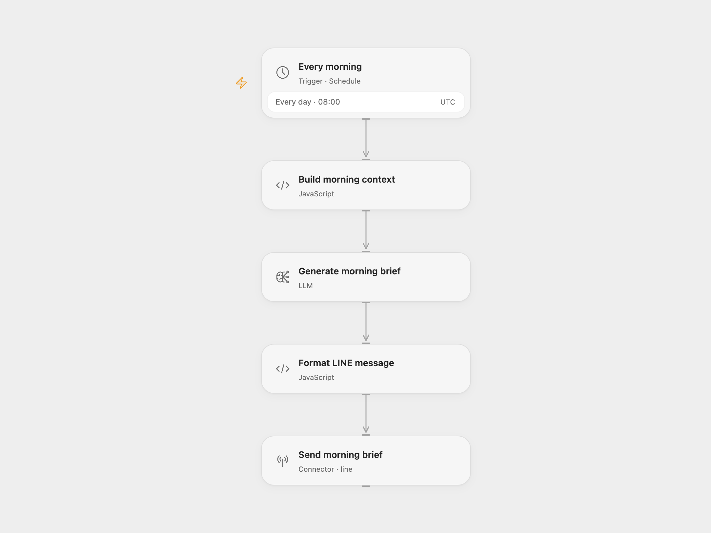

# Morning Brief to LINE

Receive a 3–5 sentence morning brief based on a task list you configure. The workflow runs daily at 08:00 UTC and sends one LINE push message.

<picture>
  <source media="(prefers-color-scheme: dark)" srcset="preview-dark.png">
  
</picture>

[Open Flow JSON](templates/morning-brief-to-line.openflow.json) · [n8n JSON](templates/morning-brief-to-line.n8n.json)

## Setup

For Open Flow, import the JSON and configure:

| Node | Configuration |
| --- | --- |
| Every morning | Set the schedule and timezone. |
| Build morning context | Replace the example tasks and set the display timezone. The task list is static; it is reused on each run. |
| Generate morning brief | Select the configured Claude Haiku 4.5 model or a compatible replacement. |
| Send morning brief | Connect your LINE Messaging API account and replace `YOUR_LINE_USER_ID` with an eligible user, group, or room ID. |

For n8n, configure the task list in **Build Context** and select an Anthropic credential in **Generate Brief**. On **Send via LINE**, select a Header Auth credential with header name `Authorization` and value `Bearer <your LINE channel access token>`; replace the recipient ID in its JSON body. Keep the schedule and display timezone aligned.

Enable the workflow after setup. Test with a LINE recipient your bot is allowed to message. Each run sends one new message, even when the task list has not changed. No calendar or task service is read.

## Changes to the source

- Use real line breaks in the task prompt and JSON-safe request bodies for quotes and multiline text.
- Put Anthropic and LINE credentials in account settings rather than environment expressions.
- Set an explicit UTC schedule and display timezone.
- Stop before sending if the model returns an empty brief or a message longer than LINE allows.

## Source and license

Adapted from [Claude AI Morning Brief](https://github.com/enescingoz/awesome-n8n-templates/blob/827110332c21cbe000ab13f6d292d5adb1f1f8db/OpenAI_and_LLMs/Claude%20AI%20Morning%20Brief.json) in [enescingoz/awesome-n8n-templates](https://github.com/enescingoz/awesome-n8n-templates).

Source collection notice: © 2024–2026 Enes Cingoz, [CC BY 4.0](https://github.com/enescingoz/awesome-n8n-templates/blob/827110332c21cbe000ab13f6d292d5adb1f1f8db/LICENSE). The source export does not identify a separate template author or license. This adaptation includes the changes listed above; see [repository licensing](../../README.md#licensing) for the scope of OOMOL contributions and third-party material.
