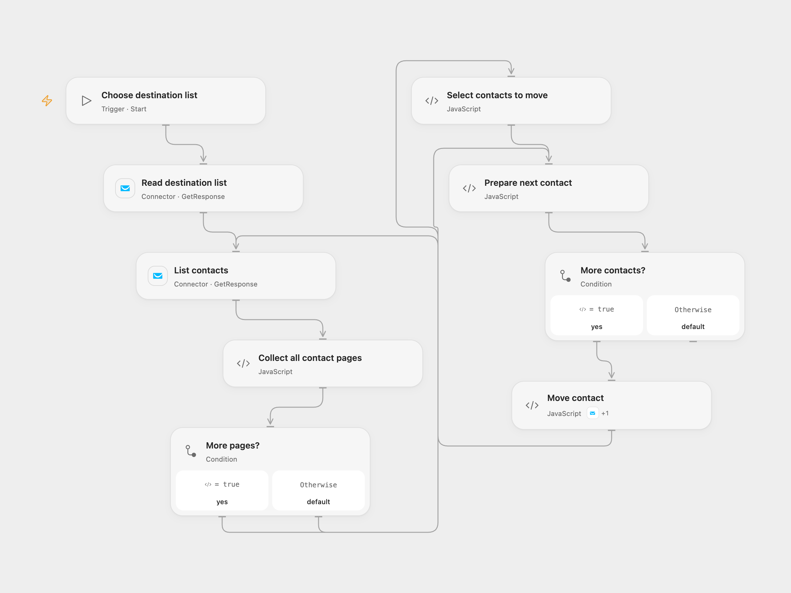

# Move GetResponse Contacts to a List

Move GetResponse contacts from other lists to a selected list.

<picture>
  <source media="(prefers-color-scheme: dark)" srcset="preview-dark.png">
  
</picture>

[Open Flow JSON](templates/move-getresponse-contacts-to-list.openflow.json) · [n8n JSON](templates/move-getresponse-contacts-to-list.n8n.json)

## Setup

Connect GetResponse in **Read destination list**, **List contacts** and the Action in **Move contact**. Enter the destination list ID when starting the Open Flow workflow. In n8n, connect the same GetResponse account to the HTTP nodes and set the destination list ID in **Read destination list**. Use an account allowed to read and update the contacts.

## Behavior

A manual run reads the destination list and all contact pages. It moves each contact whose current list name differs from the destination list name. Moving changes the contact's list and carries its activity history and statistics. Review the destination and affected contacts before running. The workflow does not update contact names, scores, notes or other fields.

If a page is missing, inconsistent, changes during reading, or a contact lacks a list identity, the run stops before moving anyone. n8n stops before updates if the list exceeds its 1,000-page limit. Empty contact lists produce no updates. Updates run one at a time. If an update fails or its outcome is uncertain, earlier contacts may already have moved; inspect GetResponse before retrying. No automatic retry or rollback is configured. Changes made concurrently during pagination can affect which contacts are read.

Inspiration &amp; credits

## Changes to the source

- Choose and verify the destination list instead of using a private ID; compare against that list's actual name.
- Read and validate all pages before any update and send only the destination campaign field.

Adapted from [Get all the contacts from GetResponse and update them](https://github.com/Zie619/n8n-workflows/blob/ae8cf6dc5b873cbb4f74587aa9180ed3a9f70682/workflows/Manual/0075_Manual_Noop_Update_Triggered.json) in [Zie619/n8n-workflows](https://github.com/Zie619/n8n-workflows). The matching [n8n community listing](https://n8n.io/workflows/778-get-all-the-contacts-from-getresponse-and-update-them/) credits Harshil Agrawal. The original template does not state a separate license.

The collection’s [MIT notice](https://github.com/Zie619/n8n-workflows/blob/94007c1445d9258a7da116646b79473e7c7c3282/LICENSE) is pinned at a later revision. This is the collection notice at that revision; it does not establish a separate original template author's license. Our changes are listed above; see [repository licensing](../../README.md#licensing).

> MIT License
>
> Copyright (c) 2025 Zie619
>
> Permission is hereby granted, free of charge, to any person obtaining a copy
> of this software and associated documentation files (the "Software"), to deal
> in the Software without restriction, including without limitation the rights
> to use, copy, modify, merge, publish, distribute, sublicense, and/or sell
> copies of the Software, and to permit persons to whom the Software is
> furnished to do so, subject to the following conditions:
>
> The above copyright notice and this permission notice shall be included in all
> copies or substantial portions of the Software.
>
> THE SOFTWARE IS PROVIDED "AS IS", WITHOUT WARRANTY OF ANY KIND, EXPRESS OR
> IMPLIED, INCLUDING BUT NOT LIMITED TO THE WARRANTIES OF MERCHANTABILITY,
> FITNESS FOR A PARTICULAR PURPOSE AND NONINFRINGEMENT. IN NO EVENT SHALL THE
> AUTHORS OR COPYRIGHT HOLDERS BE LIABLE FOR ANY CLAIM, DAMAGES OR OTHER
> LIABILITY, WHETHER IN AN ACTION OF CONTRACT, TORT OR OTHERWISE, ARISING FROM,
> OUT OF OR IN CONNECTION WITH THE SOFTWARE OR THE USE OR OTHER DEALINGS IN THE
> SOFTWARE.

