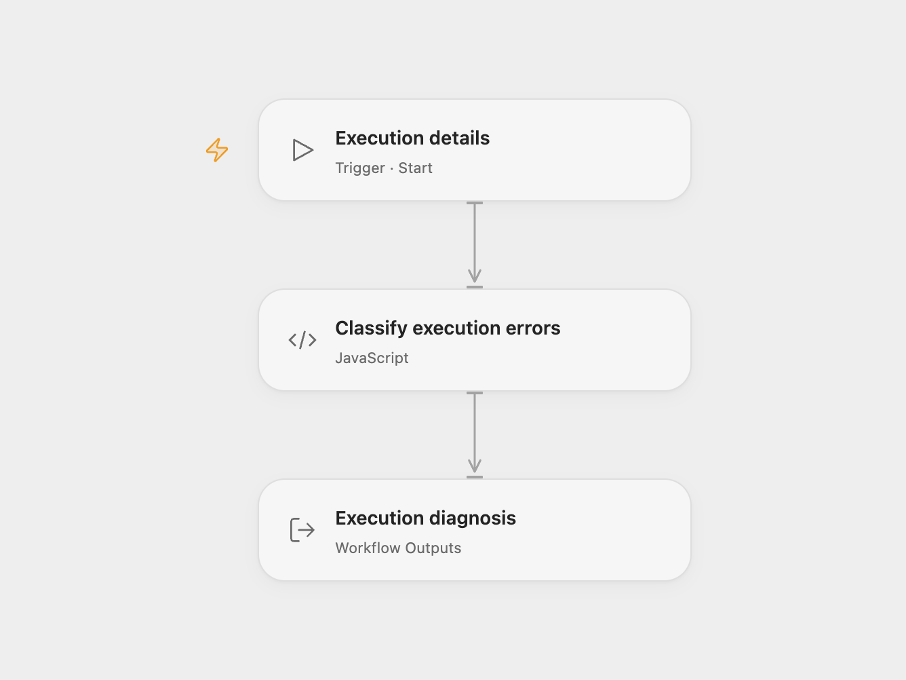

# n8n Execution Diagnostics

Classify errors from an n8n execution without calling a model or an external service. The result lists affected nodes, groups failures by category, and suggests investigation steps. It does not retry or modify the failed workflow.

<picture>
  <source media="(prefers-color-scheme: dark)" srcset="preview-dark.png">
  
</picture>

[Open Flow JSON](templates/n8n-execution-diagnostics.openflow.json) · [n8n JSON](templates/n8n-execution-diagnostics.n8n.json)

## Use

In Open Flow, import the JSON and run it with two object inputs, `workflow` and `execution`. Another Open Flow workflow can supply these inputs through a Workflow step. In n8n, import it as a sub-workflow and pass one JSON item with the same two fields through Execute Sub-workflow. If multiple items are supplied to the n8n Code step, only the first is analyzed, matching the source.

```json
{
  "workflow": {
    "name": "Customer export",
    "nodes": [{ "name": "Read customers", "type": "n8n-nodes-base.httpRequest" }]
  },
  "execution": {
    "data": {
      "resultData": {
        "lastNodeExecuted": "Read customers",
        "error": { "message": "Too many requests", "httpCode": 429 }
      }
    }
  }
}
```

Supply execution details that include `data.resultData` or `resultData`. A summary containing only an execution ID or status has no structured error to analyze. The workflow checks each `runData` error; when none is found there, it uses the top-level execution error.

Outputs include `workflowName`, `lastNodeExecuted`, `failureCount`, `primaryCategory`, `failures`, `diagnosticStatus`, and `privacyNote`. Categories use message and status heuristics: authentication, rate limits, timeouts, network failures, invalid input, expression errors, and other execution errors. They are suggestions for investigation. No matching error produces `NO_STRUCTURED_ERROR_FOUND`.

Common secret-like strings in error messages are redacted, whitespace is normalized, and messages are limited to 300 characters. This does not scrub every field or every possible secret. Review the output before sharing it. Inputs are processed within your configured workflow runtime; no API credentials are required.

## Changes to the source

- Expose the two input objects and diagnosis fields as an Open Flow workflow contract while retaining the n8n sub-workflow entry.
- Reject an array supplied as the execution object.
- Redact the complete token in an Authorization Bearer message before applying general key/value redaction.

## Source and license

Adapted from [n8n Failed Execution Doctor](https://github.com/enescingoz/awesome-n8n-templates/blob/827110332c21cbe000ab13f6d292d5adb1f1f8db/devops/n8n-failed-execution-doctor.json) in [enescingoz/awesome-n8n-templates](https://github.com/enescingoz/awesome-n8n-templates).

Source collection notice: © 2024–2026 Enes Cingoz, [CC BY 4.0](https://github.com/enescingoz/awesome-n8n-templates/blob/827110332c21cbe000ab13f6d292d5adb1f1f8db/LICENSE). The source export does not identify a separate template author or license. This adaptation includes the changes listed above; see [repository licensing](../../README.md#licensing) for the scope of OOMOL contributions and third-party material.
