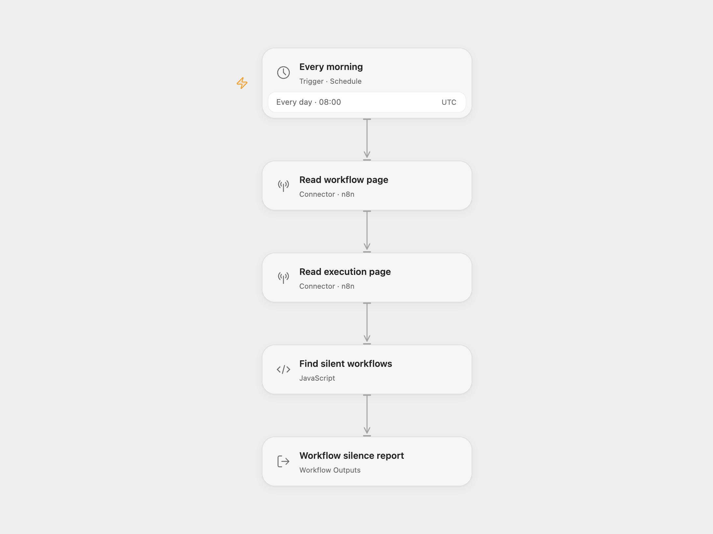

# n8n Silent Workflow Check

Find active n8n workflows whose latest observed execution is older than a configured threshold, or which have no execution in the inspected page. The workflow returns a report every morning. It sends no notifications and changes no workflows.

<picture>
  <source media="(prefers-color-scheme: dark)" srcset="preview-dark.png">
  
</picture>

[Open Flow JSON](templates/n8n-silent-workflow-check.openflow.json) · [n8n JSON](templates/n8n-silent-workflow-check.n8n.json)

## Setup

For Open Flow, select the same n8n API connection in **Read workflow page** and **Read execution page**. Configure that connection with your instance address and API key, with read access to workflows and executions. Set `staleHours` in **Find silent workflows**; it starts at 26 hours. Confirm the schedule and timezone in **Every morning**, initially 08:00 UTC.

For n8n, set `baseUrl` without a trailing slash and `staleHours` in **Configuration**. On **Get workflows** and **Get executions**, select a Header Auth credential with name `X-N8N-API-KEY` and your API key as its value. Confirm the workflow timezone before enabling it; the template starts at UTC.

Enable the configured workflow. The result contains `silent`, `activeChecked`, `findings`, `workflowPageLimited`, and `executionPageLimited`. Each finding includes the workflow name and ID, observed last run, rounded silent hours, and a note. A missing observed run has null timestamp and silent hours. Inactive and archived workflows are excluded. A run exactly at the threshold is considered recent enough.

The check reads one page of at most 250 workflows and one page of at most 250 executions. It preserves the source's bounded inspection window and does not follow cursors. A page-limit flag means more records are available. A workflow absent from the workflow page is not checked; an execution absent from the execution page can produce a silence finding even if that workflow ran earlier. Deleted execution history has the same limitation. Confirm findings against your instance before acting.

This is a report based on observed execution history. It does not establish whether a quiet workflow should have run, and it does not restart anything. If the n8n version runs inside the instance it monitors, an instance outage prevents this schedule from running too.

Inspiration &amp; credits

## Changes to the source

- Use native n8n Connector Actions in Open Flow, with authentication managed by the connection.
- Return a consistent report for both empty and nonempty findings, and expose whether each response contains another cursor.
- Reject a nonpositive or invalid silence threshold instead of silently substituting a default.
- Set an explicit UTC schedule; the Open Flow check uses the scheduled timestamp as its observation time.

Adapted from [n8n Silent Workflow Check](https://github.com/enescingoz/awesome-n8n-templates/blob/827110332c21cbe000ab13f6d292d5adb1f1f8db/devops/n8n%20Silent%20Workflow%20Check.json) in [enescingoz/awesome-n8n-templates](https://github.com/enescingoz/awesome-n8n-templates).

Source collection notice: © 2024–2026 Enes Cingoz, [CC BY 4.0](https://github.com/enescingoz/awesome-n8n-templates/blob/827110332c21cbe000ab13f6d292d5adb1f1f8db/LICENSE). The source export does not identify a separate template author or license. This adaptation includes the changes listed above; see [repository licensing](../../README.md#licensing) for the scope of OOMOL contributions and third-party material.

