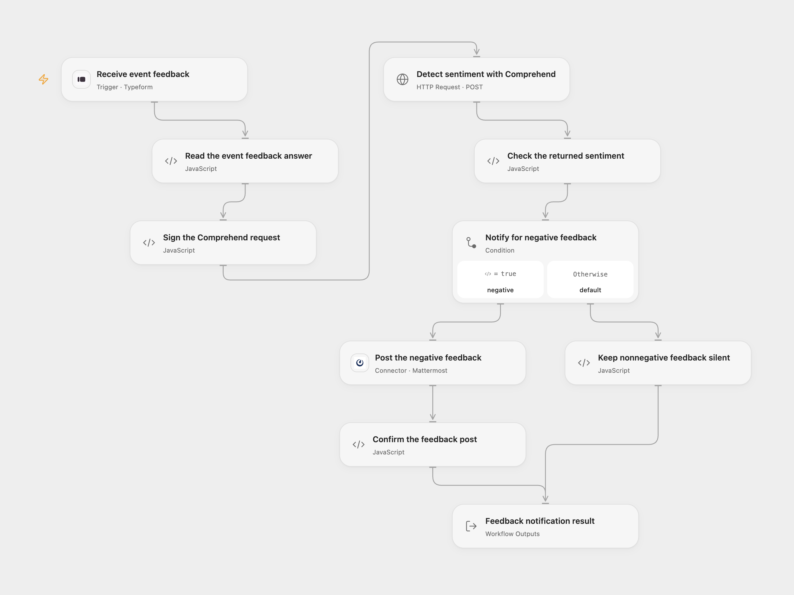

# Negative Event Feedback to Mattermost

Analyze Typeform event feedback with Amazon Comprehend and post to Mattermost only when Comprehend labels the feedback **NEGATIVE**.

<picture>
  <source media="(prefers-color-scheme: dark)" srcset="preview-dark.png">
  
</picture>

[Open Flow JSON](templates/negative-event-feedback-to-mattermost.openflow.json) · [n8n JSON](templates/negative-event-feedback-to-mattermost.n8n.json)

## Setup

Connect a Typeform Personal Access Token in **Receive event feedback**, set the actual form ID, and keep a text question titled **What did you think about the event?**. You can change **Question Title** in **Read the event feedback answer** to match your form. Deploy with a public HTTPS callback and activate the signed subscription. Open Flow accepts complete webhook bodies up to 64 KiB.

In **Sign the Comprehend request**, select secret Variables for **Access Key ID** and **Secret Access Key**. If using temporary AWS credentials, also select a secret Variable for **Session Token** and update the Variables before those credentials expire. Set **Region** to a region where your account can call `comprehend:DetectSentiment`. The initial region is `us-east-1`; the source does not export its credential’s region. **Language Code** starts at `en`, matching the source’s English default. Keep feedback within the service’s 5 KB UTF-8 text limit. Signing uses the execution server’s clock.

Connect a Mattermost Personal Access Token in **Post the negative feedback**, configure the public HTTPS server, and set the actual channel ID. The token’s account must be able to post in that channel.

In n8n, connect **Typeform API**, **AWS (IAM)** and **Mattermost API** credentials in the corresponding nodes. Set the form and channel IDs, AWS credential region and **Language Code** to the same values as Open Flow. Activate one format for this process to avoid duplicate alerts.

## Behavior

Each completed Typeform response must contain one nonblank text answer for the configured question. The workflow sends that original text to Amazon Comprehend once. It posts only for the returned `NEGATIVE` label, including Comprehend’s `SentimentScore.Negative` value and the original feedback. No additional confidence threshold is applied. Positive, neutral and mixed feedback produce no Mattermost post.

The result contains **Posted**, the complete **Assessment**, and the saved **Post** or `null`. Missing/ambiguous answers, malformed assessments, AWS errors or authentication failures stop before a notification. A Mattermost error or missing saved post ID stops the run. No workflow retry is added. Native n8n’s credential helper can resend a Mattermost request once after HTTP 401; the Open Flow Connector sends one request and surfaces the authentication failure. An unknown post result can already have sent a message, so check the channel before replaying. A successful webhook acknowledgment confirms receipt, not completion of the analysis or notification.

Open Flow uses Typeform’s response token as the trigger deduplication identity; the native n8n trigger does not add the same key. Neither format provides an exactly-once notification guarantee.

## Changes to the source

- Resolve the feedback answer using its field definition and title, with duplicate/missing-answer checks.
- Make the source’s English default and native AWS IAM authentication explicit; keep Comprehend’s real label and confidence output.
- Validate the assessment and confirm the saved Mattermost post ID.
- Preserve one analysis followed by at most one post, with no historical import or additional notifications.

Source and license

Adapted from [Typeform event feedback sentiment alert](https://github.com/Zie619/n8n-workflows/blob/ae8cf6dc5b873cbb4f74587aa9180ed3a9f70682/workflows/Mattermost/1215_Mattermost_Typeform_Automate_Triggered.json) in [Zie619/n8n-workflows](https://github.com/Zie619/n8n-workflows). The source export does not identify a separate template author or license.

The collection’s [MIT notice](https://github.com/Zie619/n8n-workflows/blob/94007c1445d9258a7da116646b79473e7c7c3282/LICENSE) is pinned at a later revision. This is the collection notice at that revision; it does not establish a separate original template author's license. Our changes are listed above; see [repository licensing](../../README.md#licensing).

> MIT License
>
> Copyright (c) 2025 Zie619
>
> Permission is hereby granted, free of charge, to any person obtaining a copy
> of this software and associated documentation files (the "Software"), to deal
> in the Software without restriction, including without limitation the rights
> to use, copy, modify, merge, publish, distribute, sublicense, and/or sell
> copies of the Software, and to permit persons to whom the Software is
> furnished to do so, subject to the following conditions:
>
> The above copyright notice and this permission notice shall be included in all
> copies or substantial portions of the Software.
>
> THE SOFTWARE IS PROVIDED "AS IS", WITHOUT WARRANTY OF ANY KIND, EXPRESS OR
> IMPLIED, INCLUDING BUT NOT LIMITED TO THE WARRANTIES OF MERCHANTABILITY,
> FITNESS FOR A PARTICULAR PURPOSE AND NONINFRINGEMENT. IN NO EVENT SHALL THE
> AUTHORS OR COPYRIGHT HOLDERS BE LIABLE FOR ANY CLAIM, DAMAGES OR OTHER
> LIABILITY, WHETHER IN AN ACTION OF CONTRACT, TORT OR OTHERWISE, ARISING FROM,
> OUT OF OR IN CONNECTION WITH THE SOFTWARE OR THE USE OR OTHER DEALINGS IN THE
> SOFTWARE.

