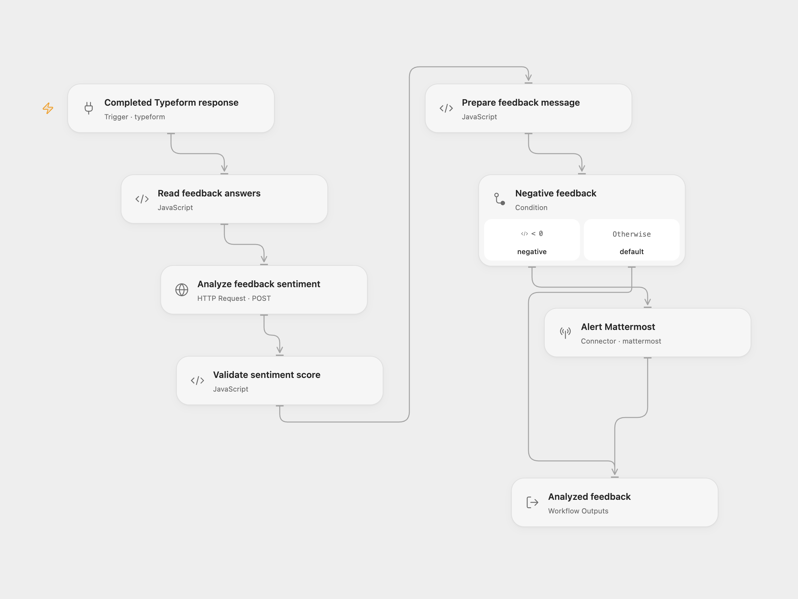

# Negative Feedback Alert

Analyze a Typeform feedback submission and post its text and score to Mattermost only when the score is negative.

<picture>
  <source media="(prefers-color-scheme: dark)" srcset="preview-dark.png">
  
</picture>

[Open Flow JSON](templates/negative-feedback-alert.openflow.json) · [n8n JSON](templates/negative-feedback-alert.n8n.json)

## Setup

Connect **Completed Typeform response** to Typeform and set your form ID. Select a secret Variable containing a Google Cloud API key on the **Analyze feedback sentiment** authentication input. Enable the Cloud Natural Language API and billing in that key’s Google Cloud project, and restrict the key to that API. The key is sent in the `x-goog-api-key` header.

For n8n, choose a Typeform credential and form in **Typeform Trigger**, and a Google Cloud Natural Language OAuth2 credential in **Google Cloud Natural Language**. The n8n trigger keeps the full submission so the question definitions and answers can be matched by field ID.

Use a text question titled **What did you think about the event?**. Select a Mattermost account and channel on **Alert Mattermost**. In n8n, select that account and channel on **Mattermost**.

## Behavior

A score below zero posts one message containing the feedback and score to Mattermost. Zero and positive scores return the analyzed feedback without sending a message.

Each completed form runs one sentiment analysis step against Google Cloud Natural Language v1, using plain text, automatic language detection, and UTF-16 sentence offsets. Blank answers, ambiguous question titles, or an invalid service response stop the run before a destination write. No workflow-level retries or delivery deduplication are configured. A later failed write can leave an earlier write completed; inspect the destination before rerunning the same submission.

Feedback text is sent to Google for sentiment analysis. Negative feedback is sent to the chosen Mattermost channel.

## Changes to the source

- Replace the original private form and destination identifiers with configuration placeholders.
- Match full Typeform answers to question definitions by field ID and reject missing or ambiguous required text answers. Leading or trailing whitespace in question titles is ignored.
- Make the original numeric threshold explicit and validate the service’s score before choosing a branch.
- Use a secret Google API key in Open Flow; the n8n version keeps its native Google OAuth2 credential. Both call the same v1 sentiment endpoint.

## Source and license

Adapted from [Analyze feedback and send a message on Mattermost](https://github.com/enescingoz/awesome-n8n-templates/blob/827110332c21cbe000ab13f6d292d5adb1f1f8db/Other_Integrations_and_Use_Cases/Analyze%20feedback%20and%20send%20a%20message%20on%20Mattermost.json) in [enescingoz/awesome-n8n-templates](https://github.com/enescingoz/awesome-n8n-templates).

Source collection notice: © 2024–2026 Enes Cingoz, [CC BY 4.0](https://github.com/enescingoz/awesome-n8n-templates/blob/827110332c21cbe000ab13f6d292d5adb1f1f8db/LICENSE). The source export does not identify a separate template author or license. See [repository licensing](../../README.md#licensing) for the scope of OOMOL contributions and third-party material.
