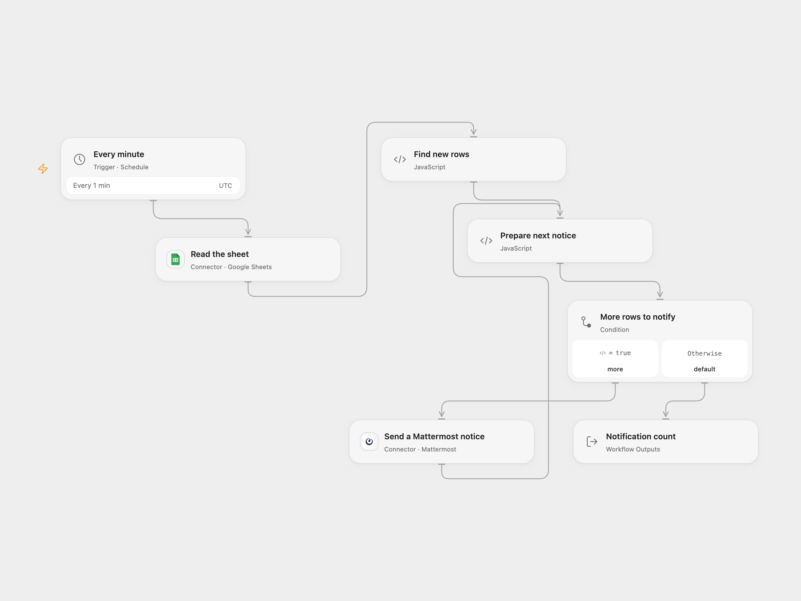

# New Google Sheet Rows to Mattermost

Read a sheet and send a Mattermost message for each newly appended row, newest first.

<picture>
  <source media="(prefers-color-scheme: dark)" srcset="preview-dark.png">
  
</picture>

[Open Flow JSON](templates/new-sheet-rows-to-mattermost.openflow.json) · [n8n JSON](templates/new-sheet-rows-to-mattermost.n8n.json)

## Setup

Connect Google Sheets and Mattermost. In **Read the sheet**, set the spreadsheet ID and a range covering the entire table. Its first row must contain unique `ID`, `Name` and `Email` headers; every data row needs an ID. In **Find new rows**, set the Mattermost channel ID. Keep the workflow deployed with persistent State and prevent overlapping runs. In n8n, set the spreadsheet and channel in the corresponding nodes. Activate only one format.

## Behavior

Every minute, the workflow reads the entire range, scans rows from the bottom and stops at the first previously seen ID. It sends one message per row above that point, in newest-first order. The first successful run notifies all rows. Empty tables, header-only tables and completely empty rows do not change saved IDs. Each message contains ID, Name and Email. Changes below or before a known ID are not a general synchronization; duplicate or reordered IDs can suppress rows.

Open Flow saves the full ID list before sending. n8n saves its changed static IDs at execution end even when a send fails. A failed send can therefore cause remaining notices to be skipped on the next run. Unknown sends may already have delivered. A hard crash or overlapping runs can behave differently between formats. Inspect Mattermost before retrying. State, table data and messages must fit execution limits.

## Changes to the source

- Replace the personal spreadsheet and channel with setup and use an explicit complete range. The source interval parameter defaults to one minute despite its node label; Open Flow runs on UTC minute boundaries while n8n intervals start from activation.
- Open Flow saves IDs before notifying; n8n retains the source static-data behavior at execution end. Open Flow stops before notices if State cannot be saved.

Source and license

Adapted from [Receive a Mattermost message when new data gets added to Google Sheets](https://github.com/Zie619/n8n-workflows/blob/ae8cf6dc5b873cbb4f74587aa9180ed3a9f70682/workflows/Mattermost/1167_Mattermost_GoogleSheets_Create_Scheduled.json) in [Zie619/n8n-workflows](https://github.com/Zie619/n8n-workflows). The source export does not identify a separate template author or license.

The collection’s [MIT notice](https://github.com/Zie619/n8n-workflows/blob/94007c1445d9258a7da116646b79473e7c7c3282/LICENSE) is pinned at a later revision. This is the collection notice at that revision; it does not establish a separate original template author's license. Our changes are listed above; see [repository licensing](../../README.md#licensing).

> MIT License
>
> Copyright (c) 2025 Zie619
>
> Permission is hereby granted, free of charge, to any person obtaining a copy
> of this software and associated documentation files (the "Software"), to deal
> in the Software without restriction, including without limitation the rights
> to use, copy, modify, merge, publish, distribute, sublicense, and/or sell
> copies of the Software, and to permit persons to whom the Software is
> furnished to do so, subject to the following conditions:
>
> The above copyright notice and this permission notice shall be included in all
> copies or substantial portions of the Software.
>
> THE SOFTWARE IS PROVIDED "AS IS", WITHOUT WARRANTY OF ANY KIND, EXPRESS OR
> IMPLIED, INCLUDING BUT NOT LIMITED TO THE WARRANTIES OF MERCHANTABILITY,
> FITNESS FOR A PARTICULAR PURPOSE AND NONINFRINGEMENT. IN NO EVENT SHALL THE
> AUTHORS OR COPYRIGHT HOLDERS BE LIABLE FOR ANY CLAIM, DAMAGES OR OTHER
> LIABILITY, WHETHER IN AN ACTION OF CONTRACT, TORT OR OTHERWISE, ARISING FROM,
> OUT OF OR IN CONNECTION WITH THE SOFTWARE OR THE USE OR OTHER DEALINGS IN THE
> SOFTWARE.

