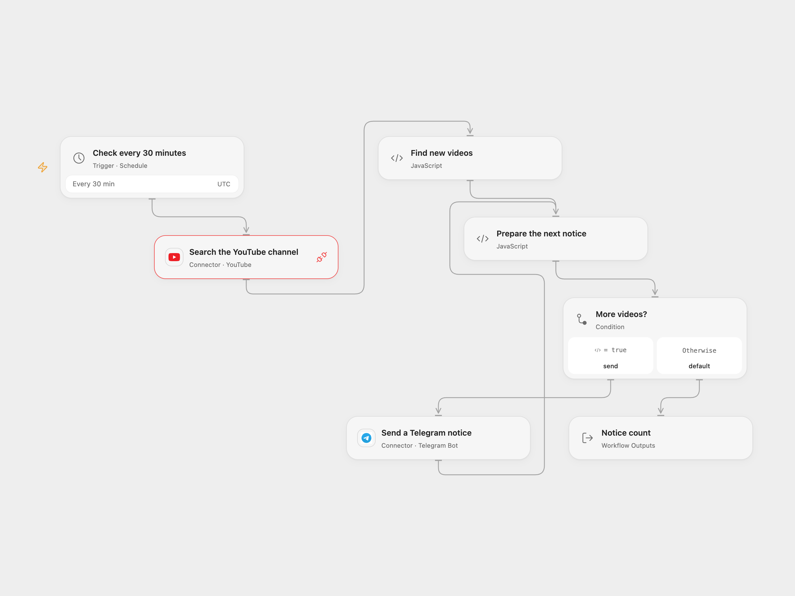

# New YouTube Channel Videos to Telegram

Check a YouTube channel every 30 minutes and send newly found videos to Telegram.

<picture>
  <source media="(prefers-color-scheme: dark)" srcset="preview-dark.png">
  
</picture>

[Open Flow JSON](templates/new-youtube-channel-videos-to-telegram.openflow.json) · [n8n JSON](templates/new-youtube-channel-videos-to-telegram.n8n.json)

## Setup

Connect YouTube and set a channel ID in **Search the YouTube channel**. Connect a Telegram bot in **Send a Telegram notice** and set its chat ID in **Find new videos**. The bot must be able to post in that chat. Keep the workflow deployed with persistent State and prevent overlapping runs. In n8n, configure the YouTube channel and Telegram chat and connect both credentials. Activate one format. n8n manual tests do not persist workflow static data and can repeat the latest notices.

## Behavior

Each run searches the channel for up to four videos ordered by date. The first nonempty run sends all returned videos, newest first. Later runs scan the returned order until the first previously seen video, then send only the videos before it. An empty result sends nothing and leaves the prior IDs unchanged. The workflow stores only the latest nonempty result IDs, so more than four videos between checks, changes in result order, indexing delays or downtime can cause missed or repeated notices. YouTube search consumes API quota.

Open Flow saves the IDs before sending. n8n saves changed static data at execution end even if a send fails. Consequently an unsuccessful or unknown Telegram send can be skipped on the next run; inspect the chat before retrying. Overlapping runs and hard crashes can behave differently. Open Flow checks at UTC half-hour boundaries; the source and n8n interval start from activation, so their phase may differ.

Inspiration &amp; credits

## Changes to the source

- Replace the original channel and chat IDs, and generalize the personal message.
- Upgrade the n8n Function node to Code V2, escape video titles for Telegram HTML and reject malformed results or oversized messages before saving IDs and sending.
- Open Flow uses the YouTube Connection Proxy for the channel-wide search because the current Search Action requires a search term. Both formats retain the channel, video type, date order and four-result limit.

Adapted from [Send YouTube videos to Telegram](https://github.com/Zie619/n8n-workflows/blob/ae8cf6dc5b873cbb4f74587aa9180ed3a9f70682/workflows/Youtube/0197_Youtube_Telegram_Send_Scheduled.json) in [Zie619/n8n-workflows](https://github.com/Zie619/n8n-workflows). The matching [n8n listing](https://n8n.io/workflows/1599-send-new-youtube-channel-videos-to-telegram/) credits Alessio. The original template does not state a separate license.

The collection’s [MIT notice](https://github.com/Zie619/n8n-workflows/blob/94007c1445d9258a7da116646b79473e7c7c3282/LICENSE) is pinned at a later revision. This is the collection notice at that revision; it does not establish a separate original template author's license. Our changes are listed above; see [repository licensing](../../README.md#licensing).

> MIT License
>
> Copyright (c) 2025 Zie619
>
> Permission is hereby granted, free of charge, to any person obtaining a copy
> of this software and associated documentation files (the "Software"), to deal
> in the Software without restriction, including without limitation the rights
> to use, copy, modify, merge, publish, distribute, sublicense, and/or sell
> copies of the Software, and to permit persons to whom the Software is
> furnished to do so, subject to the following conditions:
>
> The above copyright notice and this permission notice shall be included in all
> copies or substantial portions of the Software.
>
> THE SOFTWARE IS PROVIDED "AS IS", WITHOUT WARRANTY OF ANY KIND, EXPRESS OR
> IMPLIED, INCLUDING BUT NOT LIMITED TO THE WARRANTIES OF MERCHANTABILITY,
> FITNESS FOR A PARTICULAR PURPOSE AND NONINFRINGEMENT. IN NO EVENT SHALL THE
> AUTHORS OR COPYRIGHT HOLDERS BE LIABLE FOR ANY CLAIM, DAMAGES OR OTHER
> LIABILITY, WHETHER IN AN ACTION OF CONTRACT, TORT OR OTHERWISE, ARISING FROM,
> OUT OF OR IN CONNECTION WITH THE SOFTWARE OR THE USE OR OTHER DEALINGS IN THE
> SOFTWARE.

