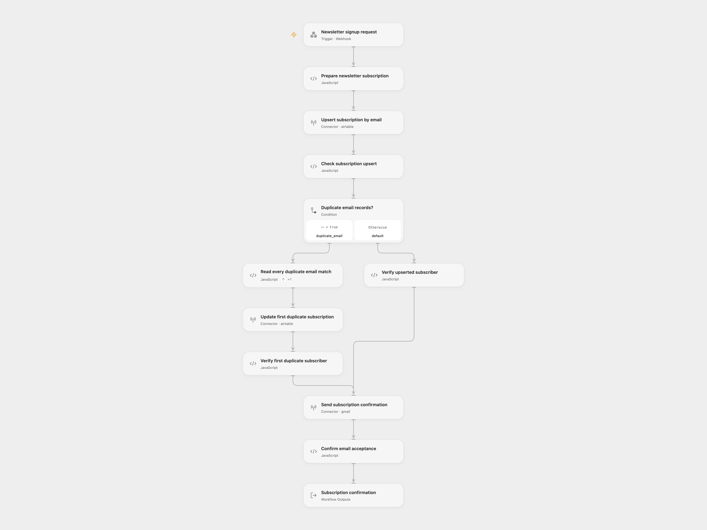

# Newsletter Subscriber Enrollment

Save a newsletter signup in Airtable by email, then send one plain-text confirmation through Gmail. Existing subscribers are updated and set to `active` again.

<picture>
  <source media="(prefers-color-scheme: dark)" srcset="preview-dark.png">
  
</picture>

## Setup

Create an Airtable subscribers table with writable `Email`, `Topic`, `Status`, `Interval` and `Start Day` fields. Use a text field for `Email`, which Airtable supports as an upsert merge key. If using select fields, create `active` for `Status`, `daily`, `weekly` and `surprise` for `Interval`, and `Sun` through `Sat` for `Start Day`. Type casting is disabled; the workflow does not create select options. See [Airtable’s upsert field requirements](https://airtable.com/developers/web/api/update-multiple-records).

In Open Flow, import `templates/newsletter-subscriber-enrollment.openflow.json`:

1. Replace the base and table ID placeholders in **Prepare newsletter subscription**.
2. Select the same Airtable account in **Upsert subscription by email**, **Read every duplicate email match** and **Update first duplicate subscription**. Grant Provider API permission for the upsert and the `airtable.list_records` / `airtable.update_records` Action permissions for the duplicate fallback. The connection needs access to this base with `data.records:read` and `data.records:write`.
3. Select the Gmail account in **Send subscription confirmation**, with permission to send email.
4. Enable the workflow and POST a JSON signup to its webhook:

```json
{
  "email": "subscriber@example.com",
  "topic": "Astronomy",
  "frequency": "weekly"
}
```

`topic` must contain text, `email` must be one address without an apostrophe, and `frequency` must be `daily`, `weekly` or `surprise me`. The stored interval for `surprise me` is `surprise`. `Start Day` is the English weekday at signup processing time in UTC. This template records a preference; it does not schedule or send the newsletter itself.

In n8n, import `templates/newsletter-subscriber-enrollment.n8n.json`. Configure the base and table IDs in **Prepare Newsletter Subscription**, select Airtable credentials in **Create Subscriber**, and Gmail credentials in the send node. Activate the workflow and share its production form URL. The form retains the source topic, email and frequency fields and waits for the workflow result. Open Flow accepts JSON rather than hosting this form. See [n8n Form Trigger](https://docs.n8n.io/integrations/builtin/core-nodes/n8n-nodes-base.formtrigger/).

## Behavior

The first request is an atomic Airtable `performUpsert` by `Email`, writing the five subscription fields. If Airtable reports that more than one record matches the email, the workflow reads every matching page and updates the first returned record, preserving the source’s default duplicate behavior. It does not update every duplicate or merge records. Keep emails unique where possible. The native source fallback interpolates email into a single-quoted formula without escaping. Both formats reject addresses containing an apostrophe before any API call.

The workflow verifies the returned subscription fields before sending one confirmation with the original subject and topic/frequency text. After Gmail returns a message ID, the Open Flow response is:

```json
{"subscribed":true,"confirmationAccepted":true}
```

This confirms Gmail’s acceptance for processing. It does not confirm inbox delivery, email ownership, consent verification or a double opt-in. Expose signup access according to your audience and email policy. See [Gmail message sending](https://developers.google.com/workspace/gmail/api/reference/rest/v1/users.messages/send).

A request failure, unexpected saved record, failed lookup or email error stops the run. There is no workflow retry or rollback. Airtable may already contain the subscription when sending fails, and a repeated signup can send another confirmation. The Open Flow webhook waits up to 60 seconds; processing can outlast the caller’s response window. Check Airtable and Gmail before repeating an uncertain request.

<details>
<summary>Inspiration &amp; credits</summary>

## Changes to the source

- Extract the signup and confirmation component. The source’s scheduled AI fact/image generation and newsletter delivery are separate work.
- Remove example account IDs, credentials and webhook identifiers.
- Normalize the form’s `surprise me` choice to the `surprise` interval expected by the source’s delivery filters.
- Restrict signup addresses to one address without an apostrophe, so an unescaped source duplicate-lookup formula cannot be constructed from a quoted address.
- Use an explicit UTC processing weekday in both formats, replacing the source’s workflow-timezone form timestamp calculation.
- Send plain text in both formats so topic text and line breaks remain literal; the source omitted email type and used the native HTML default.
- Verify Airtable’s saved fields and Gmail acceptance, and acknowledge after completion. The source form acknowledged immediately and said that a factoid was on its way.
- Use the Airtable Provider API for the missing atomic upsert operation in Open Flow, with the existing Actions for paginated duplicate lookup and update.

Adapted from [Email Subscription Service with n8n Forms, Airtable and AI](https://github.com/enescingoz/awesome-n8n-templates/blob/827110332c21cbe000ab13f6d292d5adb1f1f8db/Forms_and_Surveys/Email%20Subscription%20Service%20with%20n8n%20Forms%2C%20Airtable%20and%20AI.json) in [Enes Cingoz’s awesome-n8n-templates](https://github.com/enescingoz/awesome-n8n-templates), pinned to `827110332c21cbe000ab13f6d292d5adb1f1f8db`. The source collection is licensed under [CC BY 4.0](https://github.com/enescingoz/awesome-n8n-templates/blob/827110332c21cbe000ab13f6d292d5adb1f1f8db/LICENSE). This adaptation retains attribution and identifies the changes above.

</details>
