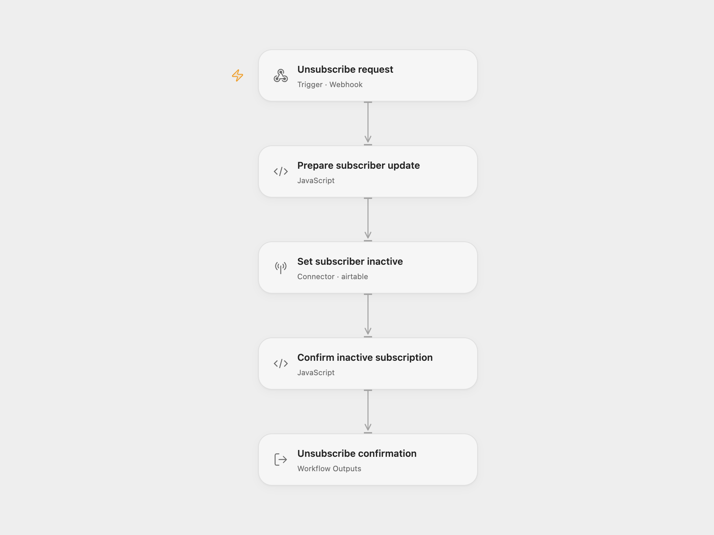

# Newsletter Unsubscribe

Set one newsletter subscriber's Airtable `Status` to `inactive`, using that subscriber's record ID. Confirm the update after Airtable returns the same record and inactive status.

<picture>
  <source media="(prefers-color-scheme: dark)" srcset="preview-dark.png">
  
</picture>

The n8n download provides the source's unsubscribe form, including its optional reasons. The Open Flow download accepts a JSON POST from your existing interface or server. This is the unsubscribe component of the source newsletter service; enrollment, scheduled emails and AI content generation are separate parts of that service.

## Configure

Use your own subscribers base and table. The `Status` field must be writable and accept `inactive`. If it is a single-select field, create that option in Airtable first; typecasting is disabled.

In Open Flow, import `templates/newsletter-unsubscribe.openflow.json`. Set `baseId` and `tableIdOrName` on **Prepare subscriber update** to your Airtable base ID (`app…`) and table ID (`tbl…`). Select an Airtable connection on **Set subscriber inactive**, with `data.records:write` and permission to edit the base. Publish and enable the Webhook, then use its generated URL. The downloadable file contains no connection or endpoint identity.

In n8n, import `templates/newsletter-unsubscribe.n8n.json`. Edit the two `settings` values at the end of **Prepare Subscriber Update**. Select an Airtable Personal Access Token credential on **Update Subscriber**, with write access to that base. The editor may also need schema-read permission to load Airtable resource choices. Activate the workflow and use the form's production URL.

## Use

For Open Flow, POST `Content-Type: application/json` with the subscriber's own ID:

```json
{ "ID": "recXXXXXXXXXXXXXX" }
```

After a confirmed update, HTTP 200 returns `{"unsubscribed":true}` with `Cache-Control: no-store`. The ID must identify a record in your configured subscribers table. No subscriber email, topic or other stored field is returned.

For n8n, open the production form URL with `?ID=<subscriber-record-id>` to prefill its ID field, then submit the form. Prefill is supported in production mode. The form waits for the update and confirmation before displaying **You have been unsubscribed.** This changes the source's default acknowledgement-on-submission behavior so the message follows a confirmed write.

The holder of a record ID can unsubscribe that record; send each subscriber their own link. Both formats accept the optional **Reason For Unsubscribe** field but do not save it, matching the source.

## Behavior

Each request makes one Airtable PATCH containing one record and only `Status: "inactive"`. It does not search by email, remove the record, modify subscription preferences or cancel messages already queued elsewhere. Other stored fields remain intact. Repeating a request sets the same field again.

Blank or malformed record/configuration IDs stop before the API request. An API error, empty update result, different returned ID or a status other than `inactive` prevents confirmation. A successful write followed by a timeout or malformed response may still have changed the record. The workflow has no automatic retry. Open Flow waits up to 60 seconds for its HTTP response and applies its deployment's request limits.

<details>
<summary>Source and license</summary>

Adapted from the independent unsubscribe form → Airtable update branch in [Email Subscription Service with n8n Forms, Airtable and AI](https://github.com/enescingoz/awesome-n8n-templates/blob/827110332c21cbe000ab13f6d292d5adb1f1f8db/Forms_and_Surveys/Email%20Subscription%20Service%20with%20n8n%20Forms%2C%20Airtable%20and%20AI.json) at revision `827110332c21cbe000ab13f6d292d5adb1f1f8db`, collected by [Enes Cingoz / awesome-n8n-templates](https://github.com/enescingoz/awesome-n8n-templates) under [CC BY 4.0](https://github.com/enescingoz/awesome-n8n-templates/blob/827110332c21cbe000ab13f6d292d5adb1f1f8db/LICENSE).

This adaptation removes account/resource identities, isolates the unsubscribe component, validates IDs, and confirms the returned record before reporting success. The two formats retain their native entry interfaces: an n8n form and an Open Flow JSON Webhook. They were checked using the public Open Flow SDK and fixed native n8n implementations with offline service responses; no live subscription record was changed.

API reference: [Airtable update multiple records](https://airtable.com/developers/web/api/update-multiple-records). Form reference: [n8n Form Trigger](https://docs.n8n.io/integrations/builtin/core-nodes/n8n-nodes-base.formtrigger/).

</details>
