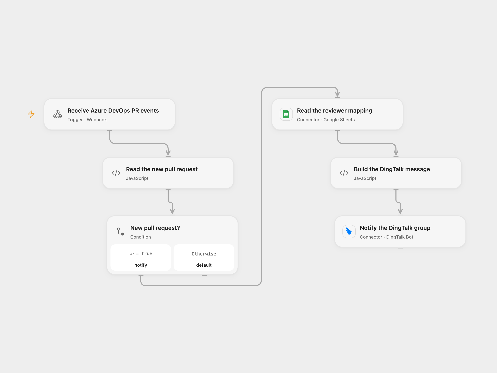

# Notify DingTalk Reviewers of New Azure DevOps Pull Requests

Post new Azure DevOps pull requests to a DingTalk group and mention the reviewers listed in the account map.

<!-- template-actions:start -->
 
<!-- template-actions:end -->

<picture>
  <source media="(prefers-color-scheme: dark)" srcset="preview-dark.png">
  
</picture>

## Setup

1. Create a private Google Sheets tab named **Reviewer Mapping**. Copy the `TfsAccount`, `UserName`, and `DingTalkMobile` columns from the existing account map into columns A–C, with those exact headings in row 1. Store phone numbers as plain text. Keep one row per TFS identity and update the sheet when reviewers change. Use a complete email or domain-qualified login when the same short login exists in multiple domains.
2. Connect Google Sheets to **Read the reviewer mapping** and enter the spreadsheet ID. Connect an existing DingTalk custom group robot to **Notify the DingTalk group** using the robot's webhook token and signing secret.
3. Set the secret Variable `AZURE_DEVOPS_BASIC_AUTH` to the complete HTTP Basic authorization value. Use `Basic ` followed by the Base64 encoding of the UTF-8 `username:password` pair. In **Receive Azure DevOps PR events**, enable **Header** authentication, set the header name to `Authorization`, and select this Variable. Publish after configuring the authentication.
4. In Azure DevOps **Project settings → Service hooks**, create a **Web Hooks** subscription for **Pull request created**. Set the workflow's HTTPS URL and the same Basic authentication username and password. Keep the full resource and messages in the request.

## Behavior

The service hook receives an immediate acknowledgment after authentication. The workflow sends the pull request's Markdown, replaces the creator's display name when a mapped name exists, and mentions the reviewers with mapped phone numbers. A team reviewer requests an @everyone mention. An unmapped individual receives no mention.

If the mapping read or DingTalk send fails, check the run and the group before replaying the event. Repeated deliveries can create repeated messages.

In n8n

Use an HTTP Basic Auth credential on **Receive Azure DevOps PR events** and point the Azure DevOps subscription to that webhook instead. In **Read the reviewer mapping**, select the MySQL connection and the `tfs_dingtalk_account_map` table with the same three columns. The table must be readable by the connection.

Set the robot's signing secret in **Sign the DingTalk request**. Reference your n8n secret store when available. A value entered directly in the masked field is saved with the workflow, so remove it from any export you share. In **Notify the DingTalk group**, select a Query Auth credential with the name `access_token` and the robot's webhook token as its value. Activate the workflow.

Inspiration &amp; credits

Adapted from [Send DingTalk message on new Azure DevOps Pull Request](https://github.com/Zie619/n8n-workflows/blob/ae8cf6dc5b873cbb4f74587aa9180ed3a9f70682/workflows/Webhook/0376_Webhook_Code_Create_Webhook.json) in [Zie619/n8n-workflows](https://github.com/Zie619/n8n-workflows). Attribution: Zie619 / n8n-workflows.

The collection’s [MIT notice](https://github.com/Zie619/n8n-workflows/blob/94007c1445d9258a7da116646b79473e7c7c3282/LICENSE) is pinned at a later revision. This is the collection notice at that revision; it does not establish a separate original template author's license. Our changes are listed above; see [repository licensing](../../README.md#licensing).

> MIT License
>
> Copyright (c) 2025 Zie619
>
> Permission is hereby granted, free of charge, to any person obtaining a copy
> of this software and associated documentation files (the "Software"), to deal
> in the Software without restriction, including without limitation the rights
> to use, copy, modify, merge, publish, distribute, sublicense, and/or sell
> copies of the Software, and to permit persons to whom the Software is
> furnished to do so, subject to the following conditions:
>
> The above copyright notice and this permission notice shall be included in all
> copies or substantial portions of the Software.
>
> THE SOFTWARE IS PROVIDED "AS IS", WITHOUT WARRANTY OF ANY KIND, EXPRESS OR
> IMPLIED, INCLUDING BUT NOT LIMITED TO THE WARRANTIES OF MERCHANTABILITY,
> FITNESS FOR A PARTICULAR PURPOSE AND NONINFRINGEMENT. IN NO EVENT SHALL THE
> AUTHORS OR COPYRIGHT HOLDERS BE LIABLE FOR ANY CLAIM, DAMAGES OR OTHER
> LIABILITY, WHETHER IN AN ACTION OF CONTRACT, TORT OR OTHERWISE, ARISING FROM,
> OUT OF OR IN CONNECTION WITH THE SOFTWARE OR THE USE OR OTHER DEALINGS IN THE
> SOFTWARE.

