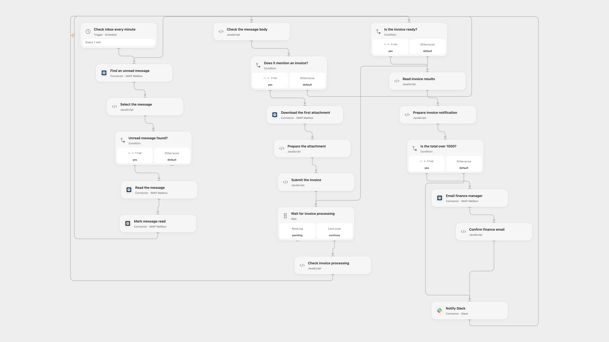

# Notify Invoice Emails in Slack

Extract an invoice total from an incoming email attachment and notify finance and Slack.

<picture>
  <source media="(prefers-color-scheme: dark)" srcset="preview-dark.png">
  
</picture>

[Open Flow JSON](templates/notify-invoice-emails-in-slack.openflow.json) · [n8n JSON](templates/notify-invoice-emails-in-slack.n8n.json)

## Setup

In Open Flow, connect the same IMAP account in **Find an unread message**, **Read the message**, **Mark message read** and **Download the first attachment**. Connect SMTP in **Email finance manager** and Slack in **Notify Slack**; set the finance recipient and Slack channel ID. Create a Mindee V2 Invoice model retaining total_amount. Set its model ID in **Submit the invoice**, create a secret Variable MINDEE_API_KEY and bind it to each Mindee Code node. Mindee must be able to fetch the attachment's HTTPS transit URL directly without authentication or redirects; the file is temporarily accessible through that URL.

In n8n, connect the IMAP trigger, SMTP sender and Slack. Configure finance sender, recipient and Slack channel. Set the same model ID in **Submit the receipt to Mindee** and configure an HTTP Header Auth credential named Authorization on the three Mindee HTTP nodes. n8n uploads the attachment bytes directly. Activate one format to avoid duplicate delivery.

## Behavior

Open Flow checks unread messages every minute; n8n listens for incoming messages. Messages are marked read and inspected for the word invoice in their plain text. The first attachment is submitted for invoice extraction. For totals above 1000, finance receives the attachment before Slack is notified. Other matching invoices go directly to Slack. Slack receives the amount, sender, subject and date. The threshold does not convert currencies.

Mindee polling stops after 200 checks at three-second intervals. A processing failure can leave a message marked read; inspect your inbox and deliveries before replaying. Concurrent Open Flow runs can select the same unread message and duplicate notifications. Unknown sends are not automatically retried.

Inspiration &amp; credits

## Changes to the source

- Open Flow polls the inbox; n8n retains its IMAP trigger. Both replace the legacy Mindee invoice API with its current V2 model.
- Remove the source setting that accepted untrusted IMAP certificates.
- Credentials, recipient and channel are configurable.

Adapted from [New invoice email notification](https://github.com/Zie619/n8n-workflows/blob/ae8cf6dc5b873cbb4f74587aa9180ed3a9f70682/workflows/Slack/1194_Slack_Emailreadimap_Create.json) in [Zie619/n8n-workflows](https://github.com/Zie619/n8n-workflows). The source export does not identify a separate template author or license.

The collection’s [MIT notice](https://github.com/Zie619/n8n-workflows/blob/94007c1445d9258a7da116646b79473e7c7c3282/LICENSE) is pinned at a later revision. This is the collection notice at that revision; it does not establish a separate original template author's license. Our changes are listed above; see [repository licensing](../../README.md#licensing).

> MIT License
>
> Copyright (c) 2025 Zie619
>
> Permission is hereby granted, free of charge, to any person obtaining a copy
> of this software and associated documentation files (the "Software"), to deal
> in the Software without restriction, including without limitation the rights
> to use, copy, modify, merge, publish, distribute, sublicense, and/or sell
> copies of the Software, and to permit persons to whom the Software is
> furnished to do so, subject to the following conditions:
>
> The above copyright notice and this permission notice shall be included in all
> copies or substantial portions of the Software.
>
> THE SOFTWARE IS PROVIDED "AS IS", WITHOUT WARRANTY OF ANY KIND, EXPRESS OR
> IMPLIED, INCLUDING BUT NOT LIMITED TO THE WARRANTIES OF MERCHANTABILITY,
> FITNESS FOR A PARTICULAR PURPOSE AND NONINFRINGEMENT. IN NO EVENT SHALL THE
> AUTHORS OR COPYRIGHT HOLDERS BE LIABLE FOR ANY CLAIM, DAMAGES OR OTHER
> LIABILITY, WHETHER IN AN ACTION OF CONTRACT, TORT OR OTHERWISE, ARISING FROM,
> OUT OF OR IN CONNECTION WITH THE SOFTWARE OR THE USE OR OTHER DEALINGS IN THE
> SOFTWARE.

