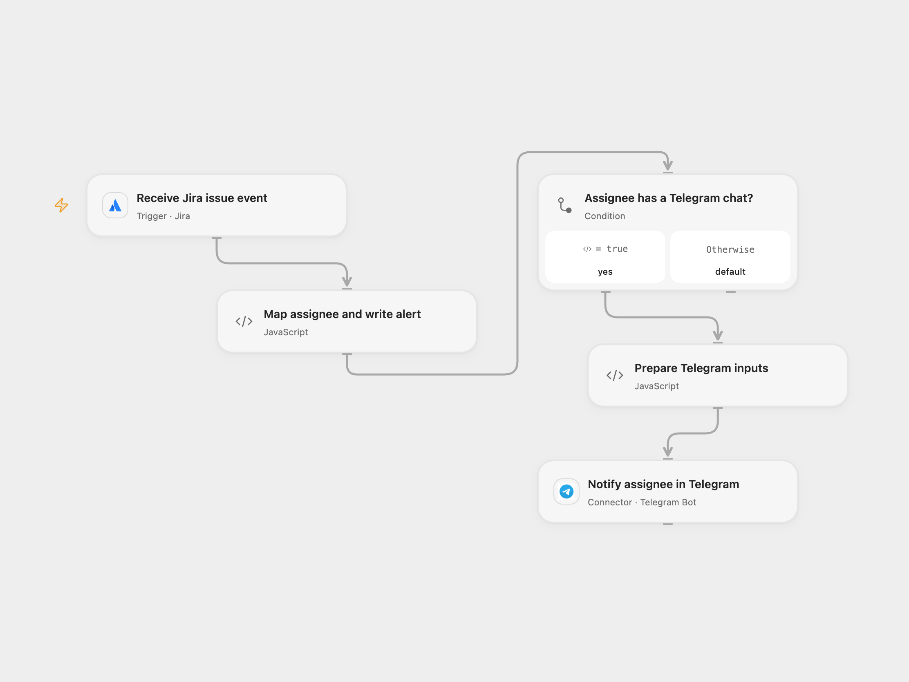

# Notify Jira Assignees in Telegram

Send a Telegram message to the mapped assignee when a Jira issue is created, updated, or reassigned.

<!-- template-actions:start -->
 
<!-- template-actions:end -->

<picture>
  <source media="(prefers-color-scheme: dark)" srcset="preview-dark.png">
  
</picture>

## Setup

1. Connect Jira Cloud in **Receive Jira issue event**. Choose or create a managed event source for your project and enable issue creation and updates.
2. Connect the bot in **Notify assignee in Telegram**. Each recipient must open a chat with the bot and press **Start**.
3. In **Map assignee and write alert**, set `chatIds` to a JSON object whose keys are Jira account IDs and whose values are numeric Telegram chat IDs as strings. Use private chats if the issues contain private details.
4. Deploy the workflow and create or update a test issue assigned to a mapped account.

## Behavior

The workflow reads the current assignee from each issue event. An update with an assignee change sends an assignment alert to the new assignee. Other updates send a regular update alert, and creation sends a new-issue alert. Unassigned issues and unmapped accounts are skipped.

The bot sends the issue type, project, key, title, description, and creation time when present. Creation times use UTC and long descriptions are shortened to fit Telegram. Check the destination chat before replaying a run with an uncertain delivery.

In n8n

Bind a Header Auth credential to **jira-webhook** and a bot credential to **Send alert**. Set the Jira account IDs and Telegram chat IDs in **Map assignee and write alert**.

Create Jira Automation rules for issue creation, issue updates, and changes to the Assignee field. Use **Send web request** with POST, the production webhook URL, and **Issue data (Automation format)** as the body. Include the header that matches the Header Auth credential and a separate `type` header with the value `created`, `updated`, or `change-assignee` for the rule. Restrict the generic update rule to skip assignee changes when the dedicated assignment rule is enabled.

Inspiration &amp; credits

## Changes to the source

- Open Flow uses the managed Jira Cloud project trigger and identifies assignment changes from the update changelog.
- Both formats map the current assignee before sending and escape issue text for Telegram.
- The [original n8n listing](https://n8n.io/workflows/2708-send-jira-task-notifications-to-telegram-user-via-bot/) credits Abolfazl Akbarzadeh.

Adapted from [Send Jira task notifications to Telegram user via Bot](https://github.com/Zie619/n8n-workflows/blob/ae8cf6dc5b873cbb4f74587aa9180ed3a9f70682/workflows/Webhook/0683_Webhook_Telegram_Create_Webhook.json) in [Zie619/n8n-workflows](https://github.com/Zie619/n8n-workflows). Attribution: Abolfazl Akbarzadeh (original workflow); Zie619 / n8n-workflows (collection).

The collection’s [MIT notice](https://github.com/Zie619/n8n-workflows/blob/94007c1445d9258a7da116646b79473e7c7c3282/LICENSE) is pinned at a later revision. This is the collection notice at that revision; it does not establish a separate original template author's license. Our changes are listed above; see [repository licensing](../../README.md#licensing).

> MIT License
>
> Copyright (c) 2025 Zie619
>
> Permission is hereby granted, free of charge, to any person obtaining a copy
> of this software and associated documentation files (the "Software"), to deal
> in the Software without restriction, including without limitation the rights
> to use, copy, modify, merge, publish, distribute, sublicense, and/or sell
> copies of the Software, and to permit persons to whom the Software is
> furnished to do so, subject to the following conditions:
>
> The above copyright notice and this permission notice shall be included in all
> copies or substantial portions of the Software.
>
> THE SOFTWARE IS PROVIDED "AS IS", WITHOUT WARRANTY OF ANY KIND, EXPRESS OR
> IMPLIED, INCLUDING BUT NOT LIMITED TO THE WARRANTIES OF MERCHANTABILITY,
> FITNESS FOR A PARTICULAR PURPOSE AND NONINFRINGEMENT. IN NO EVENT SHALL THE
> AUTHORS OR COPYRIGHT HOLDERS BE LIABLE FOR ANY CLAIM, DAMAGES OR OTHER
> LIABILITY, WHETHER IN AN ACTION OF CONTRACT, TORT OR OTHERWISE, ARISING FROM,
> OUT OF OR IN CONNECTION WITH THE SOFTWARE OR THE USE OR OTHER DEALINGS IN THE
> SOFTWARE.

