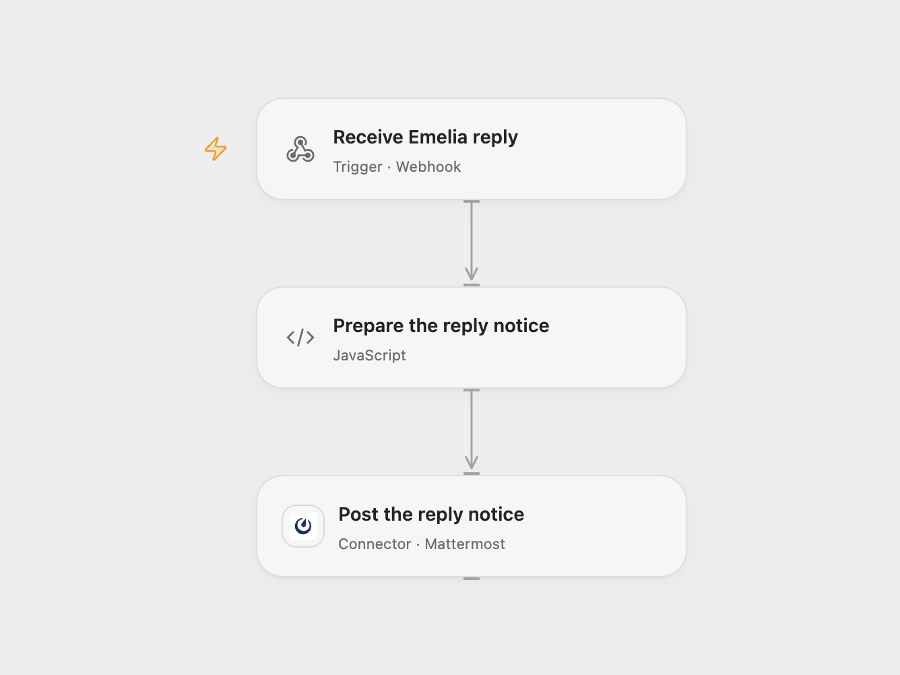

# Notify Mattermost of Emelia Replies

Send a Mattermost notice when a contact replies to a legacy Emelia email campaign.

<picture>
  <source media="(prefers-color-scheme: dark)" srcset="preview-dark.png">
  
</picture>

[Open Flow JSON](templates/notify-mattermost-of-emelia-replies.openflow.json) · [n8n JSON](templates/notify-mattermost-of-emelia-replies.n8n.json)

## Setup and use

Connect Mattermost and set the channel ID in **Prepare the reply notice**. Deploy the webhook and register its HTTPS URL for the legacy email campaign using Emelia's [webhook API](https://docs.emelia.io/docs/webhooks). Create a registration with the campaign ID, the webhook URL as `hookUrl`, and `events: ["REPLIED"]`; omit the `type` field for a legacy email campaign. In n8n, configure the Mattermost credential and channel, replace the webhook path with a hard-to-guess value, activate it, and register its URL in the same way. Remove the registration in Emelia when the workflow is no longer used.

Emelia does not sign these deliveries. Keep the webhook URL hard to guess and limit the Mattermost account's permissions. Anyone with the URL can send a notification.

## Behavior

For a `REPLIED` event, the workflow posts the contact's first name and company to the configured channel. The legacy event is sent for a contact's first reply. Emelia can retry network errors, so duplicate notifications are possible; HTTP error responses are not retried. Inspect Mattermost before replaying an uncertain post. Open Flow rejects other event types; register only `REPLIED` in either format.

Inspiration &amp; credits

## Changes to the source

- Register the webhook separately and replace the original campaign and channel identifiers with setup.

Adapted from [Notify Mattermost of Emelia replies](https://github.com/Zie619/n8n-workflows/blob/ae8cf6dc5b873cbb4f74587aa9180ed3a9f70682/workflows/Mattermost/0017_Mattermost_Emelia_Automate_Triggered.json) in [Zie619/n8n-workflows](https://github.com/Zie619/n8n-workflows). The source export does not identify a separate template author or license.

The collection’s [MIT notice](https://github.com/Zie619/n8n-workflows/blob/94007c1445d9258a7da116646b79473e7c7c3282/LICENSE) is pinned at a later revision. This is the collection notice at that revision; it does not establish a separate original template author's license. Our changes are listed above; see [repository licensing](../../README.md#licensing).

> MIT License
>
> Copyright (c) 2025 Zie619
>
> Permission is hereby granted, free of charge, to any person obtaining a copy
> of this software and associated documentation files (the "Software"), to deal
> in the Software without restriction, including without limitation the rights
> to use, copy, modify, merge, publish, distribute, sublicense, and/or sell
> copies of the Software, and to permit persons to whom the Software is
> furnished to do so, subject to the following conditions:
>
> The above copyright notice and this permission notice shall be included in all
> copies or substantial portions of the Software.
>
> THE SOFTWARE IS PROVIDED "AS IS", WITHOUT WARRANTY OF ANY KIND, EXPRESS OR
> IMPLIED, INCLUDING BUT NOT LIMITED TO THE WARRANTIES OF MERCHANTABILITY,
> FITNESS FOR A PARTICULAR PURPOSE AND NONINFRINGEMENT. IN NO EVENT SHALL THE
> AUTHORS OR COPYRIGHT HOLDERS BE LIABLE FOR ANY CLAIM, DAMAGES OR OTHER
> LIABILITY, WHETHER IN AN ACTION OF CONTRACT, TORT OR OTHERWISE, ARISING FROM,
> OUT OF OR IN CONNECTION WITH THE SOFTWARE OR THE USE OR OTHER DEALINGS IN THE
> SOFTWARE.

