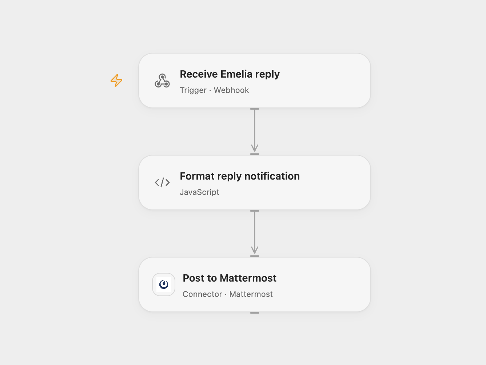

# Notify Mattermost on Emelia Replies

Notify a Mattermost channel when a contact replies to an Emelia email campaign.

<picture>
  <source media="(prefers-color-scheme: dark)" srcset="preview-dark.png">
  
</picture>

[Open Flow JSON](templates/notify-mattermost-on-emelia-replies.openflow.json) · [n8n JSON](templates/notify-mattermost-on-emelia-replies.n8n.json)

## Setup

Connect Mattermost and set the channel ID. Deploy the webhook and register it with Emelia using POST https://api.emelia.io/webhook and JSON containing hookUrl, campaignId and events set to [REPLIED]; omit type for a legacy email campaign. Authenticate with your Emelia API key in the Authorization header; see the [webhook API](https://docs.emelia.io/docs/webhooks/create-webhook) and [legacy email events](https://docs.emelia.io/docs/webhooks/legacy-email-activity). Configure the same registration and Mattermost connection for n8n. Use one workflow format.

## Behavior

Emelia sends a POST when a contact first replies. The message names the contact and company; either may be absent. Emelia's legacy email webhook has no signature, so restrict access as appropriate. A webhook acknowledgment confirms receipt, not Mattermost delivery. Repeated deliveries can create duplicate messages. The full webhook payload, including reply text and contact details, can appear in execution history.

Inspiration &amp; credits

## Changes to the source

- Register the webhook manually for both formats using Emelia's documented endpoint.

Adapted from [Mattermost notification for Emelia replies](https://github.com/Zie619/n8n-workflows/blob/ae8cf6dc5b873cbb4f74587aa9180ed3a9f70682/workflows/Mattermost/0020_Mattermost_Emelia_Automate_Triggered.json) in [Zie619/n8n-workflows](https://github.com/Zie619/n8n-workflows). The source export does not identify a separate template author or license.

The collection’s [MIT notice](https://github.com/Zie619/n8n-workflows/blob/94007c1445d9258a7da116646b79473e7c7c3282/LICENSE) is pinned at a later revision. This is the collection notice at that revision; it does not establish a separate original template author's license. Our changes are listed above; see [repository licensing](../../README.md#licensing).

> MIT License
>
> Copyright (c) 2025 Zie619
>
> Permission is hereby granted, free of charge, to any person obtaining a copy
> of this software and associated documentation files (the "Software"), to deal
> in the Software without restriction, including without limitation the rights
> to use, copy, modify, merge, publish, distribute, sublicense, and/or sell
> copies of the Software, and to permit persons to whom the Software is
> furnished to do so, subject to the following conditions:
>
> The above copyright notice and this permission notice shall be included in all
> copies or substantial portions of the Software.
>
> THE SOFTWARE IS PROVIDED "AS IS", WITHOUT WARRANTY OF ANY KIND, EXPRESS OR
> IMPLIED, INCLUDING BUT NOT LIMITED TO THE WARRANTIES OF MERCHANTABILITY,
> FITNESS FOR A PARTICULAR PURPOSE AND NONINFRINGEMENT. IN NO EVENT SHALL THE
> AUTHORS OR COPYRIGHT HOLDERS BE LIABLE FOR ANY CLAIM, DAMAGES OR OTHER
> LIABILITY, WHETHER IN AN ACTION OF CONTRACT, TORT OR OTHERWISE, ARISING FROM,
> OUT OF OR IN CONNECTION WITH THE SOFTWARE OR THE USE OR OTHER DEALINGS IN THE
> SOFTWARE.

