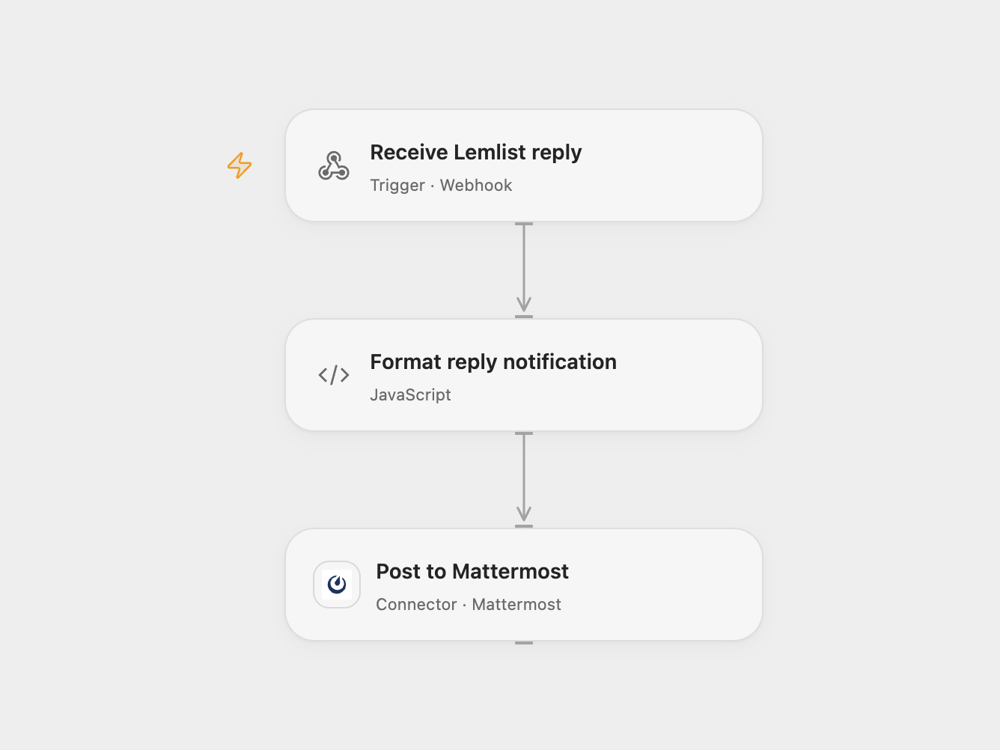

# Notify Mattermost on Lemlist Replies

Post a Lemlist email reply to a Mattermost channel.

<picture>
  <source media="(prefers-color-scheme: dark)" srcset="preview-dark.png">
  
</picture>

[Open Flow JSON](templates/notify-mattermost-on-lemlist-replies.openflow.json) · [n8n JSON](templates/notify-mattermost-on-lemlist-replies.n8n.json)

## Setup

Connect Mattermost and set the channel ID. In Open Flow, add any fields present in your Lemlist deliveries that are not already listed as optional body fields in **Receive Lemlist reply**. The example field industry is included. Lemlist merges contact fields into the event root; undeclared fields cause the webhook to reject the event, so update the field list when your contact schema changes. Deploy the webhook and register it for the campaign's emailsReplied event using the [Lemlist webhook API](https://developer.lemlist.com/api-reference/endpoints/webhooks/add-webhook). In n8n connect Lemlist and Mattermost, set the campaign and channel, and activate the workflow. Use one format.

## Behavior

The notification includes the contact's first name, campaign name and reply text. The Open Flow endpoint does not validate a sender; restrict access appropriately. Receipt does not confirm the Mattermost post. Repeated events may create duplicate messages. Reply text and contact details can appear in execution history.

Inspiration &amp; credits

## Changes to the source

- Configure the Lemlist webhook manually in Open Flow.

Adapted from [Mattermost notification for Lemlist replies](https://github.com/Zie619/n8n-workflows/blob/ae8cf6dc5b873cbb4f74587aa9180ed3a9f70682/workflows/Mattermost/1221_Mattermost_Lemlist_Automate_Triggered.json) in [Zie619/n8n-workflows](https://github.com/Zie619/n8n-workflows). The source export does not identify a separate template author or license.

The collection’s [MIT notice](https://github.com/Zie619/n8n-workflows/blob/94007c1445d9258a7da116646b79473e7c7c3282/LICENSE) is pinned at a later revision. This is the collection notice at that revision; it does not establish a separate original template author's license. Our changes are listed above; see [repository licensing](../../README.md#licensing).

> MIT License
>
> Copyright (c) 2025 Zie619
>
> Permission is hereby granted, free of charge, to any person obtaining a copy
> of this software and associated documentation files (the "Software"), to deal
> in the Software without restriction, including without limitation the rights
> to use, copy, modify, merge, publish, distribute, sublicense, and/or sell
> copies of the Software, and to permit persons to whom the Software is
> furnished to do so, subject to the following conditions:
>
> The above copyright notice and this permission notice shall be included in all
> copies or substantial portions of the Software.
>
> THE SOFTWARE IS PROVIDED "AS IS", WITHOUT WARRANTY OF ANY KIND, EXPRESS OR
> IMPLIED, INCLUDING BUT NOT LIMITED TO THE WARRANTIES OF MERCHANTABILITY,
> FITNESS FOR A PARTICULAR PURPOSE AND NONINFRINGEMENT. IN NO EVENT SHALL THE
> AUTHORS OR COPYRIGHT HOLDERS BE LIABLE FOR ANY CLAIM, DAMAGES OR OTHER
> LIABILITY, WHETHER IN AN ACTION OF CONTRACT, TORT OR OTHERWISE, ARISING FROM,
> OUT OF OR IN CONNECTION WITH THE SOFTWARE OR THE USE OR OTHER DEALINGS IN THE
> SOFTWARE.

