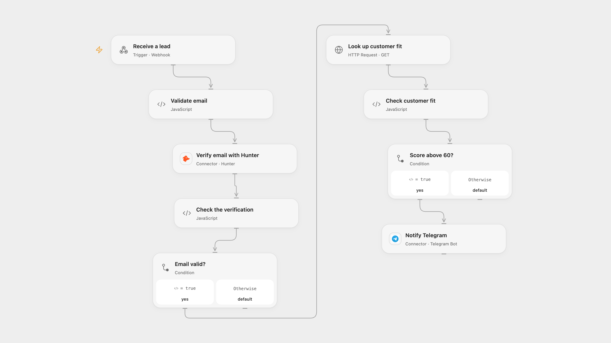

# Notify Qualified Form Leads on Telegram

Verify a lead email, look up its customer fit and notify Telegram when its score is above 60.

<picture>
  <source media="(prefers-color-scheme: dark)" srcset="preview-dark.png">
  
</picture>

[Open Flow JSON](templates/notify-qualified-form-leads-on-telegram.openflow.json) · [n8n JSON](templates/notify-qualified-form-leads-on-telegram.n8n.json)

## Setup

In Open Flow connect Hunter and Telegram, set the destination chat in **Notify Telegram**, and create the secret Variable **MADKUDU_AUTHORIZATION** containing the word Basic and a space followed by base64 of your API key and a colon for **Look up customer fit**. Configure a form or client to POST JSON such as {"email":"lead@example.com"} to the workflow webhook. In n8n configure the form, Hunter and Telegram credentials, the chat ID and HTTP Basic credentials with your MadKudu legacy API key as username and an empty password. Activate one format.

## Behavior

Each submission receives one Hunter assessment. Only the status valid proceeds to MadKudu; only a customer fit score strictly above 60 sends a Telegram message with the email and fit signals. Hunter pending or malformed results and API failures stop without a message. A form submission or webhook acknowledgment does not guarantee processing or notification. The APIs receive the submitted email; restrict access to the webhook and execution history. A failed or uncertain Telegram send may already have succeeded, so check the chat before retrying. No automatic retries or deduplication are added.

Inspiration &amp; credits

## Changes to the source

- Open Flow accepts JSON through a webhook; n8n retains the hosted form. Configure a form client separately for Open Flow.
- Replace the private destination and credentials; use the documented MadKudu Basic authentication and validate service responses before sending. Support the documented top_signals_formated field as well as the source spelling top_signals_formatted.

Adapted from [Get a Telegram alert when a great lead submits form with MadKudu and Hunter](https://github.com/Zie619/n8n-workflows/blob/ae8cf6dc5b873cbb4f74587aa9180ed3a9f70682/workflows/Telegram/0425_Telegram_Hunter_Send_Webhook.json) in [Zie619/n8n-workflows](https://github.com/Zie619/n8n-workflows). The matching [n8n listing](https://n8n.io/workflows/2121-get-a-telegram-alert-when-a-great-lead-submits-form-with-madkudu-and-hunter/) credits mutasem. The original template does not state a separate license.

The collection’s [MIT notice](https://github.com/Zie619/n8n-workflows/blob/94007c1445d9258a7da116646b79473e7c7c3282/LICENSE) is pinned at a later revision. This is the collection notice at that revision; it does not establish a separate original template author's license. Our changes are listed above; see [repository licensing](../../README.md#licensing).

> MIT License
>
> Copyright (c) 2025 Zie619
>
> Permission is hereby granted, free of charge, to any person obtaining a copy
> of this software and associated documentation files (the "Software"), to deal
> in the Software without restriction, including without limitation the rights
> to use, copy, modify, merge, publish, distribute, sublicense, and/or sell
> copies of the Software, and to permit persons to whom the Software is
> furnished to do so, subject to the following conditions:
>
> The above copyright notice and this permission notice shall be included in all
> copies or substantial portions of the Software.
>
> THE SOFTWARE IS PROVIDED "AS IS", WITHOUT WARRANTY OF ANY KIND, EXPRESS OR
> IMPLIED, INCLUDING BUT NOT LIMITED TO THE WARRANTIES OF MERCHANTABILITY,
> FITNESS FOR A PARTICULAR PURPOSE AND NONINFRINGEMENT. IN NO EVENT SHALL THE
> AUTHORS OR COPYRIGHT HOLDERS BE LIABLE FOR ANY CLAIM, DAMAGES OR OTHER
> LIABILITY, WHETHER IN AN ACTION OF CONTRACT, TORT OR OTHERWISE, ARISING FROM,
> OUT OF OR IN CONNECTION WITH THE SOFTWARE OR THE USE OR OTHER DEALINGS IN THE
> SOFTWARE.

