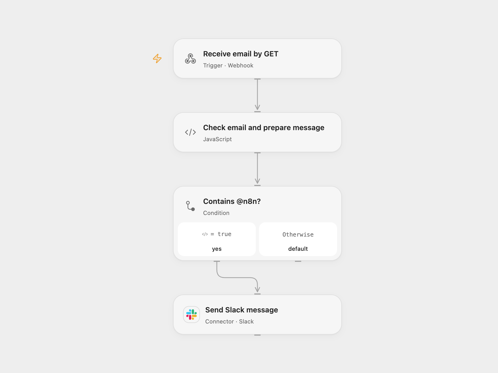

# Notify Slack for Matching Webhook Emails

Send a Slack message when a GET webhook email contains @n8n.

<picture>
  <source media="(prefers-color-scheme: dark)" srcset="preview-dark.png">
  
</picture>

[Open Flow JSON](templates/notify-slack-for-n8n-webhook-email.openflow.json) · [n8n JSON](templates/notify-slack-for-n8n-webhook-email.n8n.json)

## Setup and use

Connect Slack and choose a channel in **Send Slack message**. Deploy the Open Flow webhook or activate the n8n webhook and send a GET request with an email query parameter, for example `?email=person%40n8n.io`. Enable one format. The webhook is public and has no authentication; restrict access to its URL.

The match is case-sensitive and checks whether the email contains `@n8n` anywhere. A match posts the original email in a Slack message; other values do not post. An uncertain Slack response may mean the message was sent; inspect the channel before retrying. The webhook acknowledges admission rather than waiting for the Slack result.

Inspiration &amp; credits

## Changes to the source

- Extract the independent webhook-to-Slack demonstration from the larger multi-example workflow and remove its private Slack channel.

Adapted from [Webhook to Slack demonstration](https://github.com/Zie619/n8n-workflows/blob/ae8cf6dc5b873cbb4f74587aa9180ed3a9f70682/workflows/Code/0548_Code_Webhook_Create_Webhook.json) in [Zie619/n8n-workflows](https://github.com/Zie619/n8n-workflows). The source credits Max Tkacz. No separate original template license is stated.

The collection’s [MIT notice](https://github.com/Zie619/n8n-workflows/blob/94007c1445d9258a7da116646b79473e7c7c3282/LICENSE) is pinned at a later revision. This is the collection notice at that revision; it does not establish a separate original template author's license. Our changes are listed above; see [repository licensing](../../README.md#licensing).

> MIT License
>
> Copyright (c) 2025 Zie619
>
> Permission is hereby granted, free of charge, to any person obtaining a copy
> of this software and associated documentation files (the "Software"), to deal
> in the Software without restriction, including without limitation the rights
> to use, copy, modify, merge, publish, distribute, sublicense, and/or sell
> copies of the Software, and to permit persons to whom the Software is
> furnished to do so, subject to the following conditions:
>
> The above copyright notice and this permission notice shall be included in all
> copies or substantial portions of the Software.
>
> THE SOFTWARE IS PROVIDED "AS IS", WITHOUT WARRANTY OF ANY KIND, EXPRESS OR
> IMPLIED, INCLUDING BUT NOT LIMITED TO THE WARRANTIES OF MERCHANTABILITY,
> FITNESS FOR A PARTICULAR PURPOSE AND NONINFRINGEMENT. IN NO EVENT SHALL THE
> AUTHORS OR COPYRIGHT HOLDERS BE LIABLE FOR ANY CLAIM, DAMAGES OR OTHER
> LIABILITY, WHETHER IN AN ACTION OF CONTRACT, TORT OR OTHERWISE, ARISING FROM,
> OUT OF OR IN CONNECTION WITH THE SOFTWARE OR THE USE OR OTHER DEALINGS IN THE
> SOFTWARE.

