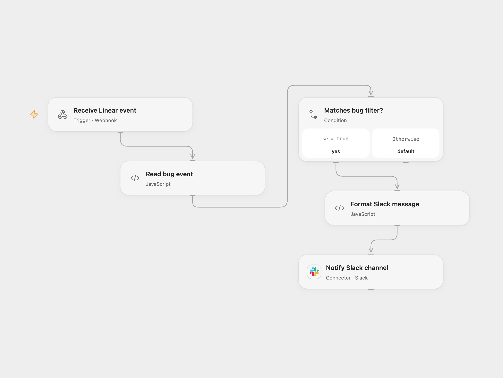

# Notify Slack About Linear Bugs

Send a Slack notification for Linear issue events that match the configured bug filter.

<picture>
  <source media="(prefers-color-scheme: dark)" srcset="preview-dark.png">
  
</picture>

[Open Flow JSON](templates/notify-slack-linear-bug.openflow.json) · [n8n JSON](templates/notify-slack-linear-bug.n8n.json)

## Setup and use

Configure the Linear team and credentials in the n8n trigger. For n8n mode enable **Linear Trigger**; for Open Flow mode disable it, enable **Linear Trigger (Open Flow)**, configure **Forward to Open Flow**, and deploy the Open Flow workflow. Configure the Slack connection and destination channel for the chosen mode. The Open Flow endpoint does not authenticate callers; restrict access.

## Behavior

The original filter matches events whose priority is at least 3 and whose first label is exactly `bug`. The source calls these urgent bugs, but Linear priority values of 3 and higher need not mean urgent. The message uses the issue URL and title-cased title and mentions the channel. The trigger accepts issue events without checking the action. n8n computes the title and forwards the complete Linear event in Open Flow mode. Inspect Slack before retrying an unknown send result.

Inspiration &amp; credits

## Changes to the source

- Replace the example team, channel and mock personal data with configuration, and add an optional n8n relay.

Adapted from [Linear bug notifications](https://github.com/Zie619/n8n-workflows/blob/ae8cf6dc5b873cbb4f74587aa9180ed3a9f70682/workflows/Code/0309_Code_Filter_Automate_Triggered.json) in [Zie619/n8n-workflows](https://github.com/Zie619/n8n-workflows). The source export does not identify a separate template author or license.

The collection’s [MIT notice](https://github.com/Zie619/n8n-workflows/blob/94007c1445d9258a7da116646b79473e7c7c3282/LICENSE) is pinned at a later revision. This is the collection notice at that revision; it does not establish a separate original template author's license. Our changes are listed above; see [repository licensing](../../README.md#licensing).

> MIT License
>
> Copyright (c) 2025 Zie619
>
> Permission is hereby granted, free of charge, to any person obtaining a copy
> of this software and associated documentation files (the "Software"), to deal
> in the Software without restriction, including without limitation the rights
> to use, copy, modify, merge, publish, distribute, sublicense, and/or sell
> copies of the Software, and to permit persons to whom the Software is
> furnished to do so, subject to the following conditions:
>
> The above copyright notice and this permission notice shall be included in all
> copies or substantial portions of the Software.
>
> THE SOFTWARE IS PROVIDED "AS IS", WITHOUT WARRANTY OF ANY KIND, EXPRESS OR
> IMPLIED, INCLUDING BUT NOT LIMITED TO THE WARRANTIES OF MERCHANTABILITY,
> FITNESS FOR A PARTICULAR PURPOSE AND NONINFRINGEMENT. IN NO EVENT SHALL THE
> AUTHORS OR COPYRIGHT HOLDERS BE LIABLE FOR ANY CLAIM, DAMAGES OR OTHER
> LIABILITY, WHETHER IN AN ACTION OF CONTRACT, TORT OR OTHERWISE, ARISING FROM,
> OUT OF OR IN CONNECTION WITH THE SOFTWARE OR THE USE OR OTHER DEALINGS IN THE
> SOFTWARE.

