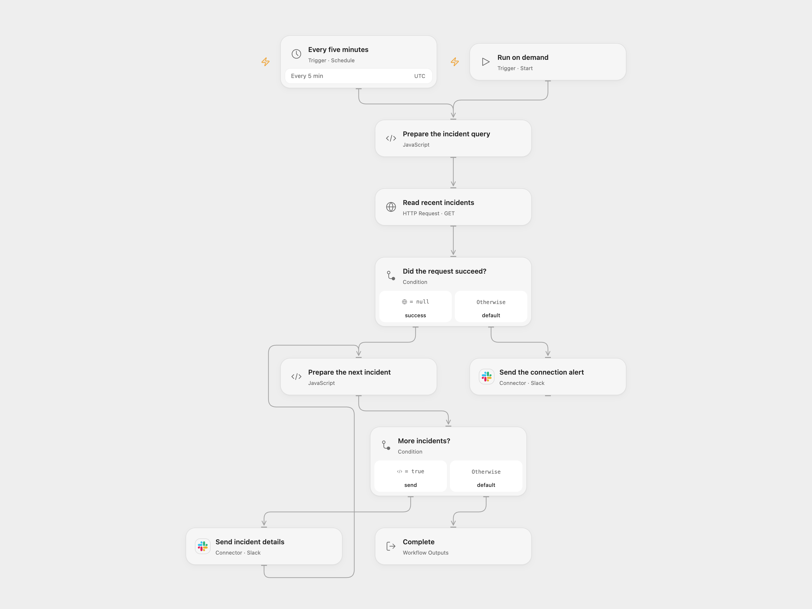

# Notify Slack of New ServiceNow Incidents

Check recent ServiceNow incidents and notify a Slack channel.

<picture>
  <source media="(prefers-color-scheme: dark)" srcset="preview-dark.png">
  
</picture>

[Open Flow JSON](templates/notify-slack-of-new-servicenow-incidents.openflow.json) · [n8n JSON](templates/notify-slack-of-new-servicenow-incidents.n8n.json)

## Setup

In Open Flow, enter your ServiceNow instance URL in **Prepare the incident query**. Store the ServiceNow username and password as secret Variables and bind them to the corresponding Basic Authentication inputs of **Read recent incidents**. Connect Slack and set the same destination channel ID on both Slack nodes. In n8n, connect the ServiceNow Basic Auth credential and Slack, select the destination channel on both Slack nodes, and replace the instance URL in **Post Incident Details to Slack Channel**. The ServiceNow account must interpret query times as UTC; verify its timezone before activation. Enable one format.

## Behavior

Every five minutes or on a manual run, the workflow requests incidents created since five minutes before the run. It sends the returned incidents to Slack in ascending incident-number order, with their description, severity, caller, priority, state, category, opened date and an instance link. The source defaults to a maximum of 50 returned records; this template retains that limit. Incidents beyond the first 50 may not be reported. Empty results send no incident alert. A failed ServiceNow request sends one connection alert. Messages can contain sensitive incident data; restrict channel and workflow access.

The query is a rolling five-minute window, not a durable checkpoint. Delayed runs, inaccessible records or overlapping runs can miss or duplicate incidents. In Open Flow, a response larger than 4 MiB stops the run without a connection alert. Slack delivery failures stop the run; a lost response can hide a delivered message, so inspect the channel before retrying. Open Flow uses UTC for its timestamp. n8n also uses UTC; confirm the ServiceNow account interprets query times as intended.

Inspiration &amp; credits

## Changes to the source

- Replace the private ServiceNow instance and Slack channel with configuration. Handle the ServiceNow caller display value when it is returned as text and escape Slack control characters.
- Open Flow sends incident details as a text message with a link; n8n retains the source Slack blocks. Both retain the source's 50-item read limit.

Adapted from [ServiceNow Incident Notifications](https://github.com/Zie619/n8n-workflows/blob/ae8cf6dc5b873cbb4f74587aa9180ed3a9f70682/workflows/Datetime/0682_Datetime_Schedule_Create_Scheduled.json) in [Zie619/n8n-workflows](https://github.com/Zie619/n8n-workflows). The matching [n8n listing](https://n8n.io/workflows/2704-servicenow-incident-notifications-to-slack-workflow/) credits Angel Menendez. No separate original template license was found.

The collection’s [MIT notice](https://github.com/Zie619/n8n-workflows/blob/94007c1445d9258a7da116646b79473e7c7c3282/LICENSE) is pinned at a later revision. This is the collection notice at that revision; it does not establish a separate original template author's license. Our changes are listed above; see [repository licensing](../../README.md#licensing).

> MIT License
>
> Copyright (c) 2025 Zie619
>
> Permission is hereby granted, free of charge, to any person obtaining a copy
> of this software and associated documentation files (the "Software"), to deal
> in the Software without restriction, including without limitation the rights
> to use, copy, modify, merge, publish, distribute, sublicense, and/or sell
> copies of the Software, and to permit persons to whom the Software is
> furnished to do so, subject to the following conditions:
>
> The above copyright notice and this permission notice shall be included in all
> copies or substantial portions of the Software.
>
> THE SOFTWARE IS PROVIDED "AS IS", WITHOUT WARRANTY OF ANY KIND, EXPRESS OR
> IMPLIED, INCLUDING BUT NOT LIMITED TO THE WARRANTIES OF MERCHANTABILITY,
> FITNESS FOR A PARTICULAR PURPOSE AND NONINFRINGEMENT. IN NO EVENT SHALL THE
> AUTHORS OR COPYRIGHT HOLDERS BE LIABLE FOR ANY CLAIM, DAMAGES OR OTHER
> LIABILITY, WHETHER IN AN ACTION OF CONTRACT, TORT OR OTHERWISE, ARISING FROM,
> OUT OF OR IN CONNECTION WITH THE SOFTWARE OR THE USE OR OTHER DEALINGS IN THE
> SOFTWARE.

