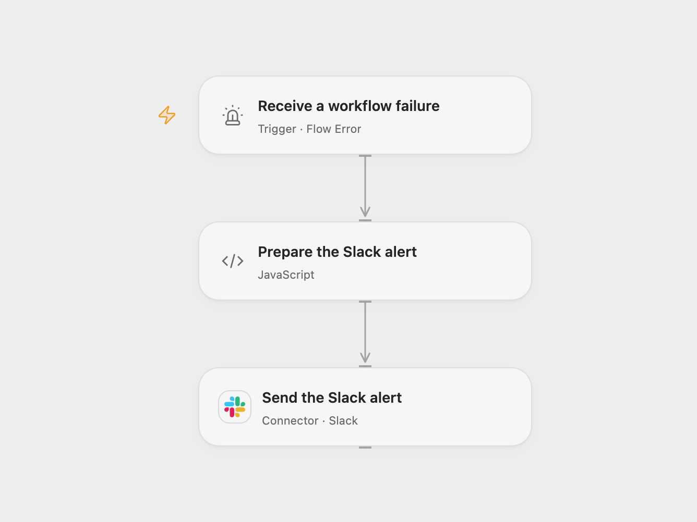

# Notify Slack When a Workflow Fails

Send a Slack alert when a configured workflow fails.

<picture>
  <source media="(prefers-color-scheme: dark)" srcset="preview-dark.png">
  
</picture>

[Open Flow JSON](templates/notify-slack-when-a-workflow-fails.openflow.json) · [n8n JSON](templates/notify-slack-when-a-workflow-fails.n8n.json)

## Setup

In Open Flow, select the published source workflows in **Receive a workflow failure**, publish and enable this workflow, connect Slack, and set the destination channel ID. In n8n, connect Slack, set the destination channel, and assign this workflow as the error workflow in each source workflow's settings. Do not assign the workflow to itself.

## Behavior

An automatic failure sends an alert containing the workflow name. Open Flow includes the run ID; n8n includes the execution URL when available. Open Flow does not supply an execution URL in its error event. Manual test runs do not represent automatic failure dispatch.

If a send fails or its outcome is uncertain, check Slack before retrying; the alert may already have been delivered.

Inspiration &amp; credits

## Changes to the source

- Configure the previously empty Slack channel and bind source workflows. Open Flow reports a run ID instead of the n8n execution URL.

Adapted from [Get a Slack alert when a workflow went wrong](https://github.com/Zie619/n8n-workflows/blob/ae8cf6dc5b873cbb4f74587aa9180ed3a9f70682/workflows/Error/0126_Error_Slack_Automate_Triggered.json) in [Zie619/n8n-workflows](https://github.com/Zie619/n8n-workflows). The matching [n8n community listing](https://n8n.io/workflows/1326-get-a-slack-alert-when-a-workflow-went-wrong/) credits Pauline. The original template does not state a separate license.

The collection’s [MIT notice](https://github.com/Zie619/n8n-workflows/blob/94007c1445d9258a7da116646b79473e7c7c3282/LICENSE) is pinned at a later revision. This is the collection notice at that revision; it does not establish a separate original template author's license. Our changes are listed above; see [repository licensing](../../README.md#licensing).

> MIT License
>
> Copyright (c) 2025 Zie619
>
> Permission is hereby granted, free of charge, to any person obtaining a copy
> of this software and associated documentation files (the "Software"), to deal
> in the Software without restriction, including without limitation the rights
> to use, copy, modify, merge, publish, distribute, sublicense, and/or sell
> copies of the Software, and to permit persons to whom the Software is
> furnished to do so, subject to the following conditions:
>
> The above copyright notice and this permission notice shall be included in all
> copies or substantial portions of the Software.
>
> THE SOFTWARE IS PROVIDED "AS IS", WITHOUT WARRANTY OF ANY KIND, EXPRESS OR
> IMPLIED, INCLUDING BUT NOT LIMITED TO THE WARRANTIES OF MERCHANTABILITY,
> FITNESS FOR A PARTICULAR PURPOSE AND NONINFRINGEMENT. IN NO EVENT SHALL THE
> AUTHORS OR COPYRIGHT HOLDERS BE LIABLE FOR ANY CLAIM, DAMAGES OR OTHER
> LIABILITY, WHETHER IN AN ACTION OF CONTRACT, TORT OR OTHERWISE, ARISING FROM,
> OUT OF OR IN CONNECTION WITH THE SOFTWARE OR THE USE OR OTHER DEALINGS IN THE
> SOFTWARE.

