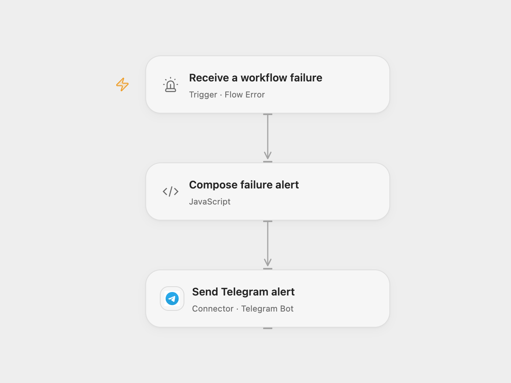

# Notify Telegram of a Failed Workflow

Send a Telegram alert identifying a failed workflow.

<picture>
  <source media="(prefers-color-scheme: dark)" srcset="preview-dark.png">
  
</picture>

[Open Flow JSON](templates/notify-telegram-of-failed-workflow.openflow.json) · [n8n JSON](templates/notify-telegram-of-failed-workflow.n8n.json)

## Setup

Connect Telegram and set the destination chat ID. In Open Flow, choose the published source workflows in **Receive a workflow failure**, then publish and enable this error workflow. In n8n, assign the error workflow to each source workflow and activate it. Avoid assigning the workflow to itself. Enable only one format.

## Behavior

An automatic failure sends a message naming the workflow. Open Flow includes its run ID; n8n includes the execution URL if present. Open Flow does not expose that URL in its error event. Manual test runs do not represent automatic error dispatch. If sending fails or its outcome is unknown, inspect Telegram before retrying because the message may already have been delivered.

Inspiration &amp; credits

## Changes to the source

- Replace the personal chat ID with configuration. Open Flow shows the run ID instead of an execution URL.

Adapted from [Send workflow failure alerts to Telegram](https://github.com/Zie619/n8n-workflows/blob/ae8cf6dc5b873cbb4f74587aa9180ed3a9f70682/workflows/Error/0454_Error_Telegram_Send_Triggered.json) in [Zie619/n8n-workflows](https://github.com/Zie619/n8n-workflows). The source export does not identify a separate template author or license.

The collection’s [MIT notice](https://github.com/Zie619/n8n-workflows/blob/94007c1445d9258a7da116646b79473e7c7c3282/LICENSE) is pinned at a later revision. This is the collection notice at that revision; it does not establish a separate original template author's license. Our changes are listed above; see [repository licensing](../../README.md#licensing).

> MIT License
>
> Copyright (c) 2025 Zie619
>
> Permission is hereby granted, free of charge, to any person obtaining a copy
> of this software and associated documentation files (the "Software"), to deal
> in the Software without restriction, including without limitation the rights
> to use, copy, modify, merge, publish, distribute, sublicense, and/or sell
> copies of the Software, and to permit persons to whom the Software is
> furnished to do so, subject to the following conditions:
>
> The above copyright notice and this permission notice shall be included in all
> copies or substantial portions of the Software.
>
> THE SOFTWARE IS PROVIDED "AS IS", WITHOUT WARRANTY OF ANY KIND, EXPRESS OR
> IMPLIED, INCLUDING BUT NOT LIMITED TO THE WARRANTIES OF MERCHANTABILITY,
> FITNESS FOR A PARTICULAR PURPOSE AND NONINFRINGEMENT. IN NO EVENT SHALL THE
> AUTHORS OR COPYRIGHT HOLDERS BE LIABLE FOR ANY CLAIM, DAMAGES OR OTHER
> LIABILITY, WHETHER IN AN ACTION OF CONTRACT, TORT OR OTHERWISE, ARISING FROM,
> OUT OF OR IN CONNECTION WITH THE SOFTWARE OR THE USE OR OTHER DEALINGS IN THE
> SOFTWARE.

