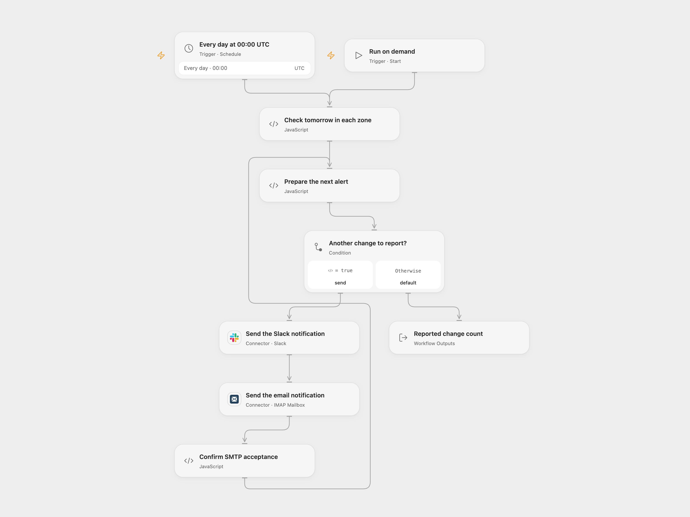

# Notify Upcoming Daylight Saving Changes

Notify Slack and email when daylight saving time changes tomorrow in a selected time zone.

<picture>
  <source media="(prefers-color-scheme: dark)" srcset="preview-dark.png">
  
</picture>

[Open Flow JSON](templates/notify-upcoming-daylight-saving-changes.openflow.json) · [n8n JSON](templates/notify-upcoming-daylight-saving-changes.n8n.json)

## Setup

Connect Slack and an SMTP mailbox, choose a Slack channel and email recipient, and set the IANA time zones in **Check tomorrow in each zone**. The defaults are `America/New_York` and `Europe/Warsaw`. The schedule starts at 00:00 UTC; choose a time that suits the zones you monitor. Open Flow runs at the minute boundary; n8n chooses a fixed second within that minute. In n8n, configure the zone list in **Check tomorrow in each zone**, the Slack channel, SMTP credentials, sender and recipient. Activate one format or run it manually.

## Behavior

For each configured zone, the workflow checks whether its daylight saving status changes during the next local calendar day. For each change it sends a Slack message followed by an email. No change means no notification. Time zone rules come from the runtime and should be kept current. An invalid or duplicate zone stops the run before any message.

If a notification fails, subsequent notifications stop and earlier messages are not undone. A lost response may hide a completed send, so inspect the destination before retrying. Runs are not deduplicated.

Inspiration &amp; credits

## Changes to the source

- Compare the start and end of the next local calendar day rather than adding one day in the n8n instance timezone; this keeps “tomorrow” aligned with each monitored zone.
- Set the schedule to UTC as an explicit starting point instead of inheriting the n8n instance timezone and add the missing Slack and email destinations. Send Slack and email in a defined order without automatic n8n attribution.

Adapted from [Daylight saving time notification for different timezones](https://github.com/Zie619/n8n-workflows/blob/ae8cf6dc5b873cbb4f74587aa9180ed3a9f70682/workflows/Datetime/1523_Datetime_Code_Automation_Scheduled.json) in [Zie619/n8n-workflows](https://github.com/Zie619/n8n-workflows). The matching [n8n listing](https://n8n.io/workflows/3276-daylight-saving-time-notification-for-different-timezones/) credits Łukasz (lukaszpp). No separate original template license was found.

The collection’s [MIT notice](https://github.com/Zie619/n8n-workflows/blob/94007c1445d9258a7da116646b79473e7c7c3282/LICENSE) is pinned at a later revision. This is the collection notice at that revision; it does not establish a separate original template author's license. Our changes are listed above; see [repository licensing](../../README.md#licensing).

> MIT License
>
> Copyright (c) 2025 Zie619
>
> Permission is hereby granted, free of charge, to any person obtaining a copy
> of this software and associated documentation files (the "Software"), to deal
> in the Software without restriction, including without limitation the rights
> to use, copy, modify, merge, publish, distribute, sublicense, and/or sell
> copies of the Software, and to permit persons to whom the Software is
> furnished to do so, subject to the following conditions:
>
> The above copyright notice and this permission notice shall be included in all
> copies or substantial portions of the Software.
>
> THE SOFTWARE IS PROVIDED "AS IS", WITHOUT WARRANTY OF ANY KIND, EXPRESS OR
> IMPLIED, INCLUDING BUT NOT LIMITED TO THE WARRANTIES OF MERCHANTABILITY,
> FITNESS FOR A PARTICULAR PURPOSE AND NONINFRINGEMENT. IN NO EVENT SHALL THE
> AUTHORS OR COPYRIGHT HOLDERS BE LIABLE FOR ANY CLAIM, DAMAGES OR OTHER
> LIABILITY, WHETHER IN AN ACTION OF CONTRACT, TORT OR OTHERWISE, ARISING FROM,
> OUT OF OR IN CONNECTION WITH THE SOFTWARE OR THE USE OR OTHER DEALINGS IN THE
> SOFTWARE.

