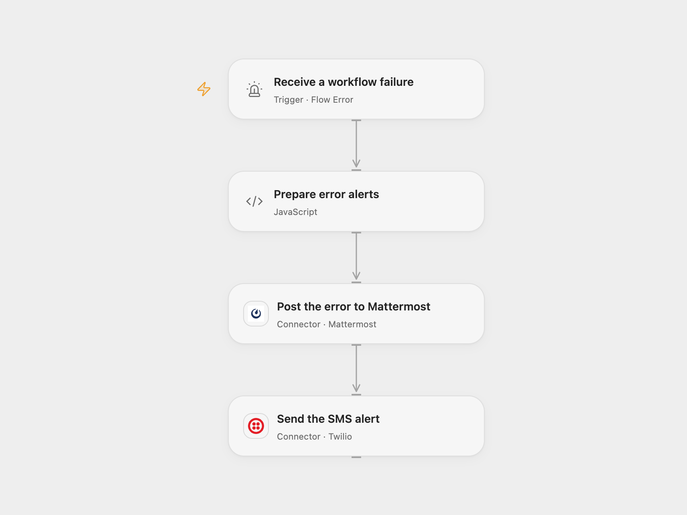

# Notify Workflow Errors by Mattermost and SMS

Post a workflow failure to Mattermost and send an SMS using Twilio.

<picture>
  <source media="(prefers-color-scheme: dark)" srcset="preview-dark.png">
  
</picture>

[Open Flow JSON](templates/notify-workflow-errors-by-mattermost-and-sms.openflow.json) · [n8n JSON](templates/notify-workflow-errors-by-mattermost-and-sms.n8n.json)

## Setup

In Open Flow, select the published source workflows in **Receive a workflow failure**, then publish and enable this error workflow. Connect Mattermost and Twilio, and set the channel ID and both E.164 phone numbers in **Prepare error alerts**. The Twilio sender must be able to send to the destination.

In n8n, connect Mattermost and Twilio, set the destination channel and phone numbers in their nodes, and assign this workflow as the error workflow in each source workflow’s settings. Activate it before relying on the alerts.

## Behavior

On an automatic run failure from a configured workflow, the workflow posts the workflow name and ID plus the failed node identifier in Mattermost. It then sends an SMS with the workflow name and ID. Open Flow reports a node ID when available; n8n uses the last executed node name. If the failure does not identify a node, the alert says it is unavailable.

Mattermost errors stop the SMS step. A failed or uncertain message may already have been delivered; inspect the channel and phone before retrying. Avoid binding the error workflow to itself. Restrict access to workflow names and execution history.

Inspiration &amp; credits

## Changes to the source

- Configure the previously empty Mattermost and Twilio destinations. Open Flow validates phone numbers before posting.
- Use the respective platform’s error trigger and explicitly bind source workflows. Open Flow’s error event provides a failed node ID rather than n8n’s last executed node name.

Adapted from [Send workflow error notifications to Mattermost and Twilio](https://github.com/Zie619/n8n-workflows/blob/ae8cf6dc5b873cbb4f74587aa9180ed3a9f70682/workflows/Mattermost/0865_Mattermost_Twilio_Automate_Triggered.json) in [Zie619/n8n-workflows](https://github.com/Zie619/n8n-workflows). The source export does not identify a separate template author or license.

The collection’s [MIT notice](https://github.com/Zie619/n8n-workflows/blob/94007c1445d9258a7da116646b79473e7c7c3282/LICENSE) is pinned at a later revision. This is the collection notice at that revision; it does not establish a separate original template author's license. Our changes are listed above; see [repository licensing](../../README.md#licensing).

> MIT License
>
> Copyright (c) 2025 Zie619
>
> Permission is hereby granted, free of charge, to any person obtaining a copy
> of this software and associated documentation files (the "Software"), to deal
> in the Software without restriction, including without limitation the rights
> to use, copy, modify, merge, publish, distribute, sublicense, and/or sell
> copies of the Software, and to permit persons to whom the Software is
> furnished to do so, subject to the following conditions:
>
> The above copyright notice and this permission notice shall be included in all
> copies or substantial portions of the Software.
>
> THE SOFTWARE IS PROVIDED "AS IS", WITHOUT WARRANTY OF ANY KIND, EXPRESS OR
> IMPLIED, INCLUDING BUT NOT LIMITED TO THE WARRANTIES OF MERCHANTABILITY,
> FITNESS FOR A PARTICULAR PURPOSE AND NONINFRINGEMENT. IN NO EVENT SHALL THE
> AUTHORS OR COPYRIGHT HOLDERS BE LIABLE FOR ANY CLAIM, DAMAGES OR OTHER
> LIABILITY, WHETHER IN AN ACTION OF CONTRACT, TORT OR OTHERWISE, ARISING FROM,
> OUT OF OR IN CONNECTION WITH THE SOFTWARE OR THE USE OR OTHER DEALINGS IN THE
> SOFTWARE.

