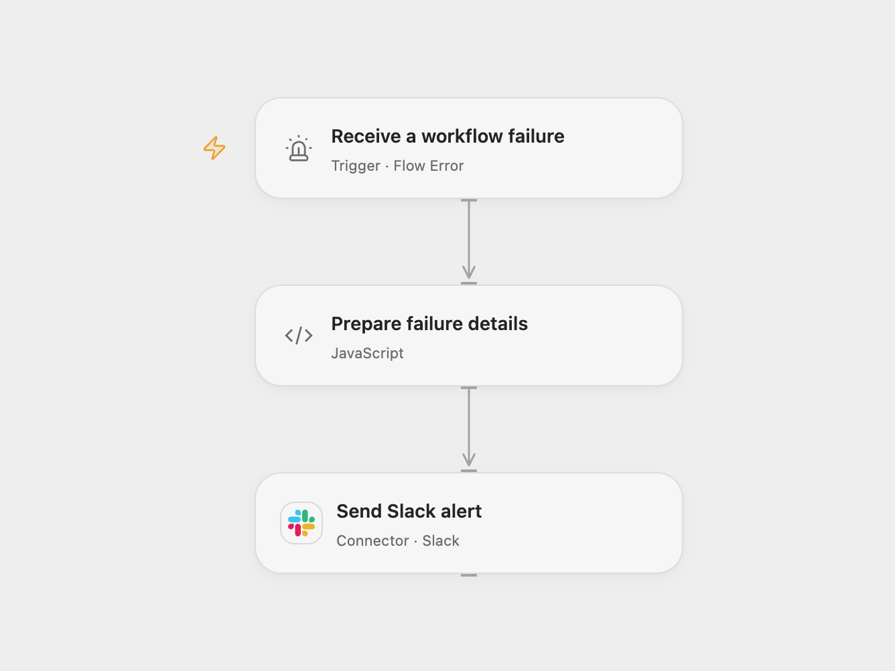

# Notify Workflow Failures on Slack

Send workflow failure details to a Slack channel.

<picture>
  <source media="(prefers-color-scheme: dark)" srcset="preview-dark.png">
  
</picture>

[Open Flow JSON](templates/notify-workflow-failures-on-slack.openflow.json) · [n8n JSON](templates/notify-workflow-failures-on-slack.n8n.json)

## Setup

Connect Slack with permission to post in the destination channel. In Open Flow, set its channel ID on **Send Slack alert**, select the published source workflows in **Receive a workflow failure**, then publish and enable this workflow. In n8n, select the channel and connect Slack on **Slack**, enable this workflow, and choose it as the error workflow in each source workflow's settings. Enable one format. Avoid assigning the error workflow to itself.

## Behavior

An automatic workflow failure sends its workflow name, execution reference, failed node and error message to Slack. Open Flow sends the run ID and, when available, the node ID. n8n sends the execution URL and last node name. Missing details are shown as not available.

Error messages can contain sensitive information. Restrict access to the channel and workflow history. Open Flow stops before sending if the alert exceeds 40,000 characters; Slack may reject oversized messages in either format. A failed or uncertain send may already have been delivered; inspect the channel before retrying.

## Changes to the source

- Configure the Slack channel and bind the relevant source workflows through each platform's error trigger. Open Flow reports its run ID and node ID instead of n8n's execution URL and node name.
- Escape Slack control characters in error details to prevent them from becoming channel or user mentions.

Source and license

Adapted from [Slack Workflow](https://github.com/Zie619/n8n-workflows/blob/ae8cf6dc5b873cbb4f74587aa9180ed3a9f70682/workflows/Error/0447_Error_Slack_Send_Triggered.json) in [Zie619/n8n-workflows](https://github.com/Zie619/n8n-workflows). The source export does not identify a separate template author or license.

The collection’s [MIT notice](https://github.com/Zie619/n8n-workflows/blob/94007c1445d9258a7da116646b79473e7c7c3282/LICENSE) is pinned at a later revision. This is the collection notice at that revision; it does not establish a separate original template author's license. Our changes are listed above; see [repository licensing](../../README.md#licensing).

> MIT License
>
> Copyright (c) 2025 Zie619
>
> Permission is hereby granted, free of charge, to any person obtaining a copy
> of this software and associated documentation files (the "Software"), to deal
> in the Software without restriction, including without limitation the rights
> to use, copy, modify, merge, publish, distribute, sublicense, and/or sell
> copies of the Software, and to permit persons to whom the Software is
> furnished to do so, subject to the following conditions:
>
> The above copyright notice and this permission notice shall be included in all
> copies or substantial portions of the Software.
>
> THE SOFTWARE IS PROVIDED "AS IS", WITHOUT WARRANTY OF ANY KIND, EXPRESS OR
> IMPLIED, INCLUDING BUT NOT LIMITED TO THE WARRANTIES OF MERCHANTABILITY,
> FITNESS FOR A PARTICULAR PURPOSE AND NONINFRINGEMENT. IN NO EVENT SHALL THE
> AUTHORS OR COPYRIGHT HOLDERS BE LIABLE FOR ANY CLAIM, DAMAGES OR OTHER
> LIABILITY, WHETHER IN AN ACTION OF CONTRACT, TORT OR OTHERWISE, ARISING FROM,
> OUT OF OR IN CONNECTION WITH THE SOFTWARE OR THE USE OR OTHER DEALINGS IN THE
> SOFTWARE.

