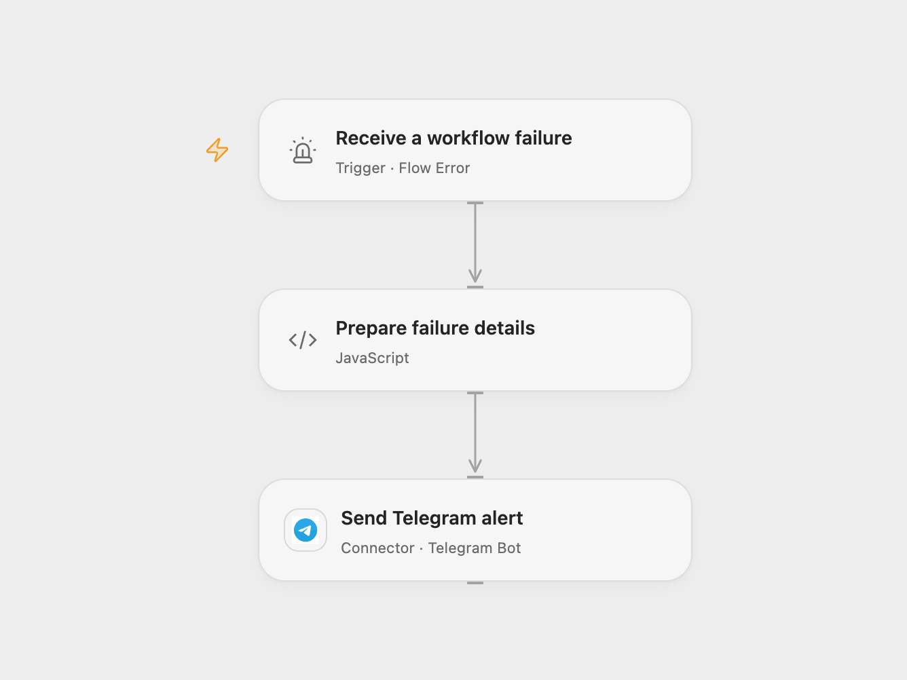

# Notify Workflow Failures on Telegram

Send workflow failure details to a Telegram chat.

<picture>
  <source media="(prefers-color-scheme: dark)" srcset="preview-dark.png">
  
</picture>

[Open Flow JSON](templates/notify-workflow-failures-on-telegram.openflow.json) · [n8n JSON](templates/notify-workflow-failures-on-telegram.n8n.json)

## Setup

Connect a Telegram bot that can post to the destination. In Open Flow, set the numeric chat ID or public @channel in **Prepare failure details**, select the published source workflows in **Receive a workflow failure**, then publish and enable this workflow. In n8n, set the chat ID in **Config**, connect Telegram, enable the workflow, and select it as the error workflow in each source workflow’s settings. Enable one format.

## Behavior

An automatic workflow failure sends the workflow name, time, execution reference, failed node and error message to Telegram. Open Flow sends the run ID and, if available, the node ID; n8n sends an execution URL and last node name. Open Flow uses the failure finish time; n8n uses the notification time. Missing node details are shown as not available.

Error messages can contain sensitive data. Restrict access to the destination chat and workflow history. Telegram limits messages to 4096 characters; Open Flow stops if the alert is too long. A failed or uncertain send may already have been delivered; check the chat before retrying. Avoid assigning the error workflow to itself.

Inspiration &amp; credits

## Changes to the source

- Configure the Telegram destination and bind source workflows using each platform’s error trigger. Open Flow exposes the run ID and node ID rather than n8n’s execution URL and node name.
- Open Flow sends plain text; n8n escapes error details for Telegram HTML so they are displayed literally.

Adapted from [Error Handler send Telegram](https://github.com/Zie619/n8n-workflows/blob/ae8cf6dc5b873cbb4f74587aa9180ed3a9f70682/workflows/Error/1948_Error_Telegram_Send_Triggered.json) in [Zie619/n8n-workflows](https://github.com/Zie619/n8n-workflows). The source export does not identify a separate template author or license.

The collection’s [MIT notice](https://github.com/Zie619/n8n-workflows/blob/94007c1445d9258a7da116646b79473e7c7c3282/LICENSE) is pinned at a later revision. This is the collection notice at that revision; it does not establish a separate original template author's license. Our changes are listed above; see [repository licensing](../../README.md#licensing).

> MIT License
>
> Copyright (c) 2025 Zie619
>
> Permission is hereby granted, free of charge, to any person obtaining a copy
> of this software and associated documentation files (the "Software"), to deal
> in the Software without restriction, including without limitation the rights
> to use, copy, modify, merge, publish, distribute, sublicense, and/or sell
> copies of the Software, and to permit persons to whom the Software is
> furnished to do so, subject to the following conditions:
>
> The above copyright notice and this permission notice shall be included in all
> copies or substantial portions of the Software.
>
> THE SOFTWARE IS PROVIDED "AS IS", WITHOUT WARRANTY OF ANY KIND, EXPRESS OR
> IMPLIED, INCLUDING BUT NOT LIMITED TO THE WARRANTIES OF MERCHANTABILITY,
> FITNESS FOR A PARTICULAR PURPOSE AND NONINFRINGEMENT. IN NO EVENT SHALL THE
> AUTHORS OR COPYRIGHT HOLDERS BE LIABLE FOR ANY CLAIM, DAMAGES OR OTHER
> LIABILITY, WHETHER IN AN ACTION OF CONTRACT, TORT OR OTHERWISE, ARISING FROM,
> OUT OF OR IN CONNECTION WITH THE SOFTWARE OR THE USE OR OTHER DEALINGS IN THE
> SOFTWARE.

