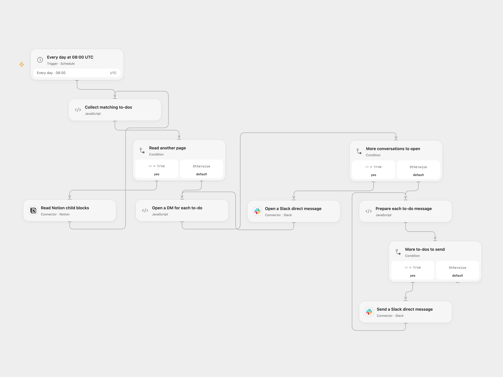

# Notion Mentioned To-Dos to Slack DM

Send a daily Slack direct message for each unchecked Notion to-do mentioning a selected user.

<picture>
  <source media="(prefers-color-scheme: dark)" srcset="preview-dark.png">
  
</picture>

[Open Flow JSON](templates/notion-mentioned-todos-to-slack-dm.openflow.json) · [n8n JSON](templates/notion-mentioned-todos-to-slack-dm.n8n.json)

## Setup

Connect Notion in **Read Notion child blocks** and set the parent block or page ID. The integration needs access to its direct children. In **Collect matching to-dos**, set the Notion user ID; in **Open a Slack direct message**, connect Slack and set the recipient Slack user ID. The two IDs refer to the same person on different services. In n8n set the parent ID in **Get To Dos**, the Notion user ID in **Filter to-dos**, and the Slack user ID in **Create a Direct Message**, then connect both credentials. Enable one format only.

Both formats start at 08:00 UTC each day. The original used the n8n instance timezone; check the schedule and timezone before enabling it. The n8n Cron V1 uses a fixed randomized second, while Open Flow runs on the minute boundary.

## Behavior

The workflow reads all pages of direct child blocks. It selects unchecked to-do blocks whose second rich-text element mentions the configured Notion user, and uses the first text element as the task title. It opens a Slack DM for each match, then sends one message per task in the same order. No matches means no message. Nested child blocks are not searched. A mention is not a separate assignment field.

A read error stops before Slack. Open Flow also stops on an incomplete page or repeated pagination cursor; n8n uses the native Notion node’s pagination. A later Slack error stops the remaining operations; earlier opens or messages may already have succeeded. Check Slack before rerunning after an uncertain write. Very large sets must fit the execution platform's state limits; oversized task titles stop the run before messages.

Inspiration &amp; credits

## Changes to the source

- Use Notion's current rich-text format and a stable mentioned user ID instead of a display name; upgrade the n8n Notion node to version 2. Replace private IDs with configuration.
- Explicitly paginate and keep each title associated with its direct message; validate responses and use UTC as the schedule starting point.

Adapted from [Check To Do on Notion and send message on Slack](https://github.com/Zie619/n8n-workflows/blob/ae8cf6dc5b873cbb4f74587aa9180ed3a9f70682/workflows/Noop/0809_Noop_Slack_Send_Scheduled.json) in [Zie619/n8n-workflows](https://github.com/Zie619/n8n-workflows). The matching [n8n community listing](https://n8n.io/workflows/1105-check-to-do-on-notion-and-send-message-on-slack/) credits Harshil Agrawal. The original template does not state a separate license.

The collection’s [MIT notice](https://github.com/Zie619/n8n-workflows/blob/94007c1445d9258a7da116646b79473e7c7c3282/LICENSE) is pinned at a later revision. This is the collection notice at that revision; it does not establish a separate original template author's license. Our changes are listed above; see [repository licensing](../../README.md#licensing).

> MIT License
>
> Copyright (c) 2025 Zie619
>
> Permission is hereby granted, free of charge, to any person obtaining a copy
> of this software and associated documentation files (the "Software"), to deal
> in the Software without restriction, including without limitation the rights
> to use, copy, modify, merge, publish, distribute, sublicense, and/or sell
> copies of the Software, and to permit persons to whom the Software is
> furnished to do so, subject to the following conditions:
>
> The above copyright notice and this permission notice shall be included in all
> copies or substantial portions of the Software.
>
> THE SOFTWARE IS PROVIDED "AS IS", WITHOUT WARRANTY OF ANY KIND, EXPRESS OR
> IMPLIED, INCLUDING BUT NOT LIMITED TO THE WARRANTIES OF MERCHANTABILITY,
> FITNESS FOR A PARTICULAR PURPOSE AND NONINFRINGEMENT. IN NO EVENT SHALL THE
> AUTHORS OR COPYRIGHT HOLDERS BE LIABLE FOR ANY CLAIM, DAMAGES OR OTHER
> LIABILITY, WHETHER IN AN ACTION OF CONTRACT, TORT OR OTHERWISE, ARISING FROM,
> OUT OF OR IN CONNECTION WITH THE SOFTWARE OR THE USE OR OTHER DEALINGS IN THE
> SOFTWARE.

