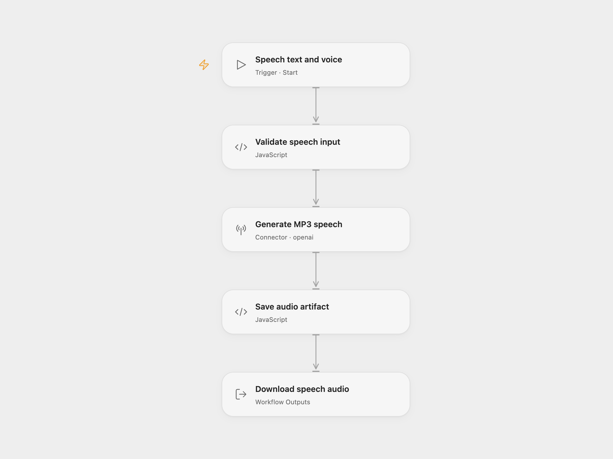

# OpenAI Text to Speech

Convert text into an MP3 using OpenAI `tts-1`. Download `speech.mp3` from the Open Flow run result, or use the binary `data` output in n8n.

<picture>
  <source media="(prefers-color-scheme: dark)" srcset="preview-dark.png">
  
</picture>

[Open Flow JSON](templates/openai-text-to-speech.openflow.json) · [n8n JSON](templates/openai-text-to-speech.n8n.json)

## Setup and use

Connect OpenAI in **Generate MP3 speech**. Use Run and supply:

```json
{
  "input_text": "The quick brown fox jumped over the lazy dog.",
  "voice": "alloy"
}
```

The text must be nonempty and contain at most 4,096 characters. `voice` defaults to `alloy`; supported choices are `alloy`, `ash`, `coral`, `echo`, `fable`, `onyx`, `nova`, `sage`, and `shimmer`. Text is sent to OpenAI and generation uses your account’s API allowance.

For n8n, edit **Set input text and TTS voice**, select an OpenAI credential in **Send HTTP Request to OpenAI's TTS Endpoint**, and use Execute Workflow. The request returns an MP3 in binary field `data`, ready for download or a cloud upload node.

Each run has one synthesis step, with no workflow-level retries configured. The provider manages any internal request retries. A failed request or invalid audio response stops without a successful file result. Open Flow stores the resulting audio as a run artifact. If you share the recording with listeners, disclose that the voice is AI-generated.

OpenAI has [announced that `tts-1` will shut down on January 6, 2027](https://developers.openai.com/api/docs/guides/text-to-speech). This template retains the source model while that endpoint remains available. Plan a migration before that date; the replacement Realtime API requires a different workflow.

## Changes to the source

- Remove the redundant literal Authorization header and keep authentication in the account credential.
- Validate text and voice before synthesis, and make MP3 output explicit.
- Correct the source input-limit note to 4,096 characters.
- Preserve binary audio as a downloadable Open Flow artifact or n8n binary output.

<details>
<summary>Source and license</summary>

Adapted from [Convert text to speech with OpenAI](https://github.com/enescingoz/awesome-n8n-templates/blob/827110332c21cbe000ab13f6d292d5adb1f1f8db/OpenAI_and_LLMs/Convert%20text%20to%20speech%20with%20OpenAI.json) in [enescingoz/awesome-n8n-templates](https://github.com/enescingoz/awesome-n8n-templates).

Source collection notice: © 2024–2026 Enes Cingoz, [CC BY 4.0](https://github.com/enescingoz/awesome-n8n-templates/blob/827110332c21cbe000ab13f6d292d5adb1f1f8db/LICENSE). The source export does not identify a separate template author or license. See [repository licensing](../../README.md#licensing) for the scope of OOMOL contributions and third-party material.

</details>
