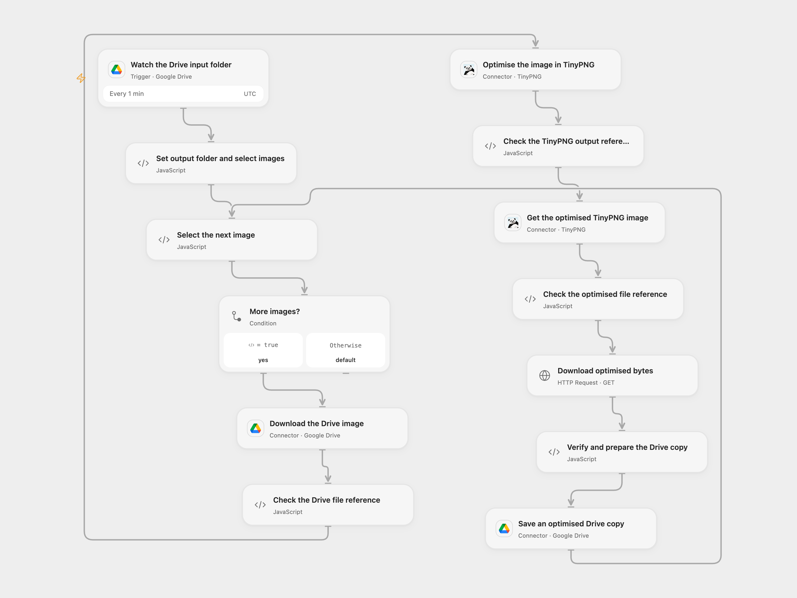

# Optimise Google Drive Images with TinyPNG

Compress new images in one Google Drive folder and save optimised copies in a separate folder.

<!-- template-actions:start -->
 
<!-- template-actions:end -->

<picture>
  <source media="(prefers-color-scheme: dark)" srcset="preview-dark.png">
  
</picture>

## Setup

1. Create separate input and output folders in Google Drive. Select the Google Drive connection and enter the input folder ID in **Watch the Drive input folder**.
2. Enter the output folder ID in **Set output folder and select images**. Select the same Google Drive account in **Download the Drive image** and **Save an optimised Drive copy**. The account needs read access to the input folder and permission to upload to the output folder.
3. Select the same TinyPNG connection in **Optimise the image in TinyPNG** and **Get the optimised TinyPNG image**. Deploy the workflow.

## Behavior

The workflow checks the input folder every minute for newly created files. It processes PNG, JPEG, WebP, AVIF, JPEG XL and HEIC images. TinyPNG converts HEIC to JPEG. The original images remain in place. Each optimised copy retains its base name with `-optimised` before the extension.

Each download is checked before upload. The optimised output can be up to 2 MiB per image. A failure stops the run before that image is uploaded. Copies saved earlier in the run remain in Drive.

In n8n

Connect the same Google Drive OAuth account in **Watch the Drive input folder**, **Download the Drive image**, and **Save an optimised Drive copy**. Select the input folder in the trigger and choose the destination drive in the upload node. Enter the output folder ID in **Set output folder and select images**. It must be a different folder from the input. Bind the same Basic Auth credential in **Optimise the image in TinyPNG** and **Get the optimised TinyPNG image** with username `api` and your TinyPNG API key as the password. Activate the workflow. The n8n import moves the binary directly and is subject to your n8n and TinyPNG file size limits.

Inspiration &amp; credits

## Changes to the source

- Select supported images, validate TinyPNG's output link and binary, and write named copies into a separate folder.
- [Original n8n listing by Jonathan](https://n8n.io/workflows/2185-automatically-optimise-images-added-to-a-google-drive-folder/) and [Tinify HTTP API](https://tinypng.com/developers/reference).

Adapted from [Automatically optimise images added to a Google Drive folder](https://github.com/Zie619/n8n-workflows/blob/ae8cf6dc5b873cbb4f74587aa9180ed3a9f70682/workflows/Http/1458_HTTP_Stickynote_Import_Webhook.json) in [Zie619/n8n-workflows](https://github.com/Zie619/n8n-workflows). Attribution: Jonathan (original workflow); Zie619 / n8n-workflows (collection).

The collection’s [MIT notice](https://github.com/Zie619/n8n-workflows/blob/94007c1445d9258a7da116646b79473e7c7c3282/LICENSE) is pinned at a later revision. This is the collection notice at that revision; it does not establish a separate original template author's license. Our changes are listed above; see [repository licensing](../../README.md#licensing).

> MIT License
>
> Copyright (c) 2025 Zie619
>
> Permission is hereby granted, free of charge, to any person obtaining a copy
> of this software and associated documentation files (the "Software"), to deal
> in the Software without restriction, including without limitation the rights
> to use, copy, modify, merge, publish, distribute, sublicense, and/or sell
> copies of the Software, and to permit persons to whom the Software is
> furnished to do so, subject to the following conditions:
>
> The above copyright notice and this permission notice shall be included in all
> copies or substantial portions of the Software.
>
> THE SOFTWARE IS PROVIDED "AS IS", WITHOUT WARRANTY OF ANY KIND, EXPRESS OR
> IMPLIED, INCLUDING BUT NOT LIMITED TO THE WARRANTIES OF MERCHANTABILITY,
> FITNESS FOR A PARTICULAR PURPOSE AND NONINFRINGEMENT. IN NO EVENT SHALL THE
> AUTHORS OR COPYRIGHT HOLDERS BE LIABLE FOR ANY CLAIM, DAMAGES OR OTHER
> LIABILITY, WHETHER IN AN ACTION OF CONTRACT, TORT OR OTHERWISE, ARISING FROM,
> OUT OF OR IN CONNECTION WITH THE SOFTWARE OR THE USE OR OTHER DEALINGS IN THE
> SOFTWARE.

