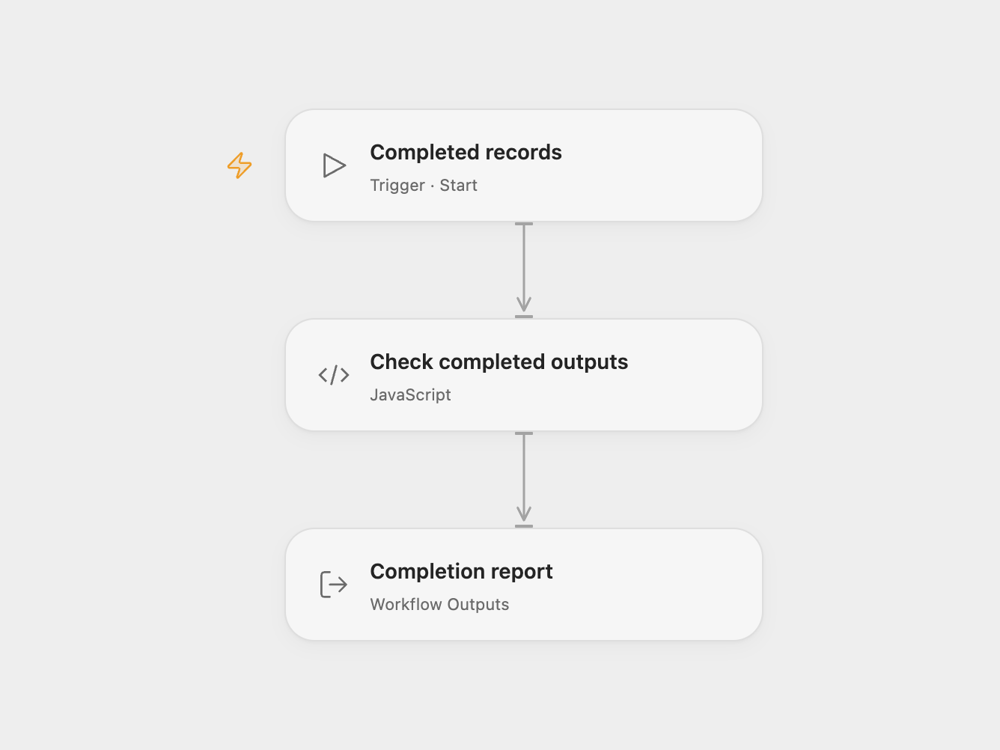

# Output Completion Check

Check whether a completed-record batch contains enough distinct nonempty IDs. The report counts invalid IDs and duplicates, including when no records were produced.

<picture>
  <source media="(prefers-color-scheme: dark)" srcset="preview-dark.png">
  
</picture>

[Open Flow JSON](templates/output-completion-check.openflow.json) · [n8n JSON](templates/output-completion-check.n8n.json)

## Setup

In Open Flow, import the JSON and configure `minimumItems` and `recordIdField` on **Check completed outputs**. The defaults are `1` and `recordId`. Start it with a `records` array, for example:

```json
{
  "records": [
    { "recordId": "ORDER-001" },
    { "recordId": "ORDER-001" },
    { "recordId": "ORDER-002" }
  ]
}
```

In n8n, set the same values on **Configure check** and replace the fictional example records on **Completed records**. To use the check after real processing, connect your completed-output node to **Check completed outputs** and keep **Configure check** upstream. Enable **Always Output Data** on the producer so an empty result reaches the check. The included producer already enables this setting.

No accounts or network requests are required. This adaptation includes the source's independent local validation component. The optional Keptick receipt integration is outside this template.

## Report

| Field | Meaning |
| --- | --- |
| `checkPassed` | Distinct IDs meet the minimum and no nonempty row has an invalid ID. |
| `checkStatus` | `healthy`, `below_minimum`, or `invalid_output`. Invalid IDs take precedence over the minimum check. |
| `items` | Number of distinct valid IDs. |
| `minimumItems` | Configured minimum, an integer from 0 to 1,000,000,000. |
| `invalidItems` | Nonempty rows with missing, empty, or invalid IDs. |
| `duplicateItems` | Valid rows beyond the first occurrence of each normalized ID. |

IDs may be nonempty strings or finite numbers. Their string forms are trimmed before comparing, so `1`, `"1"`, and `" 1 "` count as one ID. Duplicates reduce the distinct count but do not independently fail the check. Empty objects are ignored, including n8n's empty-batch placeholder. With minimum zero, an empty batch is healthy; any invalid nonempty row still fails.

This checks IDs and counts. It does not establish that upstream work was correct, detect a run that never started, or catch errors before the check. A failed check is returned as report data, not thrown as a workflow error. Invalid configuration fails the workflow.

## Changes to the source

- Expose completed records as a real input in Open Flow and a replaceable input step in n8n.
- Retain the independent local check, including zero records and n8n's empty-output placeholder.
- Return the report without the optional external receipt branch or fixed demo-case selector.

<details>
<summary>Source and license</summary>

Adapted from the **completed-output validation component** of [Detect Empty Workflow Outputs with an Optional Keptick Receipt](https://github.com/enescingoz/awesome-n8n-templates/blob/827110332c21cbe000ab13f6d292d5adb1f1f8db/devops/Detect%20Empty%20Workflow%20Outputs%20with%20an%20Optional%20Keptick%20Receipt.json) in [enescingoz/awesome-n8n-templates](https://github.com/enescingoz/awesome-n8n-templates).

Original workflow made by **Keptick, with AI assistance**. No affiliation with n8n.

Source collection notice: © 2024–2026 Enes Cingoz, [CC BY 4.0](https://github.com/enescingoz/awesome-n8n-templates/blob/827110332c21cbe000ab13f6d292d5adb1f1f8db/LICENSE). The adaptation changes are listed above; see [repository licensing](../../README.md#licensing) for the scope of OOMOL contributions and third-party material.

</details>
