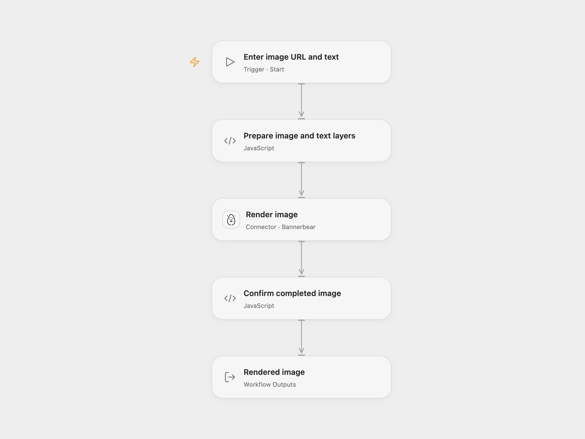

# Overlay Text on a Remote Image

Add text to a remotely hosted image and return the rendered image.

<picture>
  <source media="(prefers-color-scheme: dark)" srcset="preview-dark.png">
  
</picture>

[Open Flow JSON](templates/overlay-text-on-remote-image.openflow.json) · [n8n JSON](templates/overlay-text-on-remote-image.n8n.json)

## Setup

In Open Flow, create a Bannerbear image template sized for your source image. Add an image layer named `background` covering the canvas and a text layer named `message` above it. Place the text at the desired position, for example x=300, y=500, and set the font size to 100 to match the source example. Adjust image fitting, canvas size, font and text fitting for your images. Set the template UID and Bannerbear connection in **Render image**. The connection needs a V2 project API key and permission to create images. Supply a publicly reachable image URL and text when starting the workflow. Bannerbear fetches the image and processes the text.

In n8n, enter the image URL in **HTTP Request** and the text and position in **Edit Image**. The image editing node operates on the downloaded binary and outputs the edited binary.

## Behavior

Each manual run overlays the supplied text on one image. Open Flow returns the completed Bannerbear image record and its image URL; n8n returns image binary. Open Flow uses the dimensions and fitting of the configured template, while n8n uses the downloaded image dimensions. Use matching image and canvas dimensions when preserving the source framing matters.

The Bannerbear synchronous request waits up to 10 seconds. A failed or uncertain request may already have created an image; check Bannerbear before repeating it. No automatic retry is configured.

Inspiration &amp; credits

## Changes to the source

- Replace the unavailable example URL with user configuration.
- Use a Bannerbear template in Open Flow and return its hosted image URL. n8n retains native binary editing.

Adapted from [Add text to an image downloaded from the internet](https://github.com/Zie619/n8n-workflows/blob/ae8cf6dc5b873cbb4f74587aa9180ed3a9f70682/workflows/Manual/0343_Manual_Editimage_Create_Webhook.json) in [Zie619/n8n-workflows](https://github.com/Zie619/n8n-workflows). The source export does not identify a separate template author or license.

The collection’s [MIT notice](https://github.com/Zie619/n8n-workflows/blob/94007c1445d9258a7da116646b79473e7c7c3282/LICENSE) is pinned at a later revision. This is the collection notice at that revision; it does not establish a separate original template author's license. Our changes are listed above; see [repository licensing](../../README.md#licensing).

> MIT License
>
> Copyright (c) 2025 Zie619
>
> Permission is hereby granted, free of charge, to any person obtaining a copy
> of this software and associated documentation files (the "Software"), to deal
> in the Software without restriction, including without limitation the rights
> to use, copy, modify, merge, publish, distribute, sublicense, and/or sell
> copies of the Software, and to permit persons to whom the Software is
> furnished to do so, subject to the following conditions:
>
> The above copyright notice and this permission notice shall be included in all
> copies or substantial portions of the Software.
>
> THE SOFTWARE IS PROVIDED "AS IS", WITHOUT WARRANTY OF ANY KIND, EXPRESS OR
> IMPLIED, INCLUDING BUT NOT LIMITED TO THE WARRANTIES OF MERCHANTABILITY,
> FITNESS FOR A PARTICULAR PURPOSE AND NONINFRINGEMENT. IN NO EVENT SHALL THE
> AUTHORS OR COPYRIGHT HOLDERS BE LIABLE FOR ANY CLAIM, DAMAGES OR OTHER
> LIABILITY, WHETHER IN AN ACTION OF CONTRACT, TORT OR OTHERWISE, ARISING FROM,
> OUT OF OR IN CONNECTION WITH THE SOFTWARE OR THE USE OR OTHER DEALINGS IN THE
> SOFTWARE.

