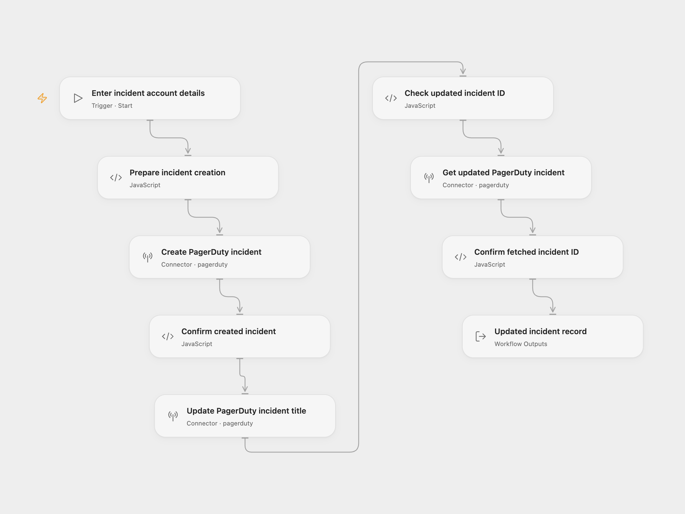

# PagerDuty Incident Create and Update

Create a PagerDuty incident, change its title and retrieve the same incident.

<picture>
  <source media="(prefers-color-scheme: dark)" srcset="preview-dark.png">
  
</picture>

[Open Flow JSON](templates/pagerduty-incident-create-and-update.openflow.json) · [n8n JSON](templates/pagerduty-incident-create-and-update.n8n.json)

## Setup

Use a US PagerDuty account served by `https://api.pagerduty.com`. In **Create PagerDuty incident**, select the account and allow **Provider API** access. Select the same account in **Update PagerDuty incident title** and **Get updated PagerDuty incident**. Provider API access is separate from individual Action permissions.

Run with **From**, the email address of a valid PagerDuty member on that account, and **Service ID**, an existing service that accepts incidents. The connected account and member must have permission to perform these operations.

The example creates an incident titled `Firewall on Fire` and changes it to `Firewalls on Fire`. Edit both titles in **Prepare incident creation** before running. In n8n, configure the three PagerDuty accounts, email, service and titles in **PagerDuty** and **PagerDuty1**.

Each run makes three requests in order: create, update that incident’s title, then retrieve its current record. Creation can notify on-call responders through the service’s escalation policy. Use a service where creating this incident is intended. The workflow leaves the incident open; it does not acknowledge or resolve it.

If creation fails, later requests do not run. If an update or read fails, the already-created incident remains. There is no rollback, duplicate check, incident key or automatic retry. Check PagerDuty before rerunning an uncertain write. Concurrent changes can appear in the final retrieved record.

Open Flow returns the complete incident object; n8n returns the final incident record. No other incident properties are intentionally changed.

## Changes to the source

- Require the member email and service as Open Flow run inputs and replace n8n’s empty setup fields.
- Use the PagerDuty Provider API for creation, which has no equivalent current Action; retain native Actions for update and get.
- Confirm completed creation and keep the same returned incident ID through both later requests.

Source and license

Adapted from [Create, update, and get an incident on PagerDuty](https://github.com/Zie619/n8n-workflows/blob/ae8cf6dc5b873cbb4f74587aa9180ed3a9f70682/workflows/Manual/0195_Manual_Pagerduty_Create_Triggered.json) in [Zie619/n8n-workflows](https://github.com/Zie619/n8n-workflows). The source export does not identify a separate template author or license.

The collection’s [MIT notice](https://github.com/Zie619/n8n-workflows/blob/94007c1445d9258a7da116646b79473e7c7c3282/LICENSE) is pinned at a later revision. This is the collection notice at that revision; it does not establish a separate original template author's license. Our changes are listed above; see [repository licensing](../../README.md#licensing).

> MIT License
>
> Copyright (c) 2025 Zie619
>
> Permission is hereby granted, free of charge, to any person obtaining a copy
> of this software and associated documentation files (the "Software"), to deal
> in the Software without restriction, including without limitation the rights
> to use, copy, modify, merge, publish, distribute, sublicense, and/or sell
> copies of the Software, and to permit persons to whom the Software is
> furnished to do so, subject to the following conditions:
>
> The above copyright notice and this permission notice shall be included in all
> copies or substantial portions of the Software.
>
> THE SOFTWARE IS PROVIDED "AS IS", WITHOUT WARRANTY OF ANY KIND, EXPRESS OR
> IMPLIED, INCLUDING BUT NOT LIMITED TO THE WARRANTIES OF MERCHANTABILITY,
> FITNESS FOR A PARTICULAR PURPOSE AND NONINFRINGEMENT. IN NO EVENT SHALL THE
> AUTHORS OR COPYRIGHT HOLDERS BE LIABLE FOR ANY CLAIM, DAMAGES OR OTHER
> LIABILITY, WHETHER IN AN ACTION OF CONTRACT, TORT OR OTHERWISE, ARISING FROM,
> OUT OF OR IN CONNECTION WITH THE SOFTWARE OR THE USE OR OTHER DEALINGS IN THE
> SOFTWARE.

