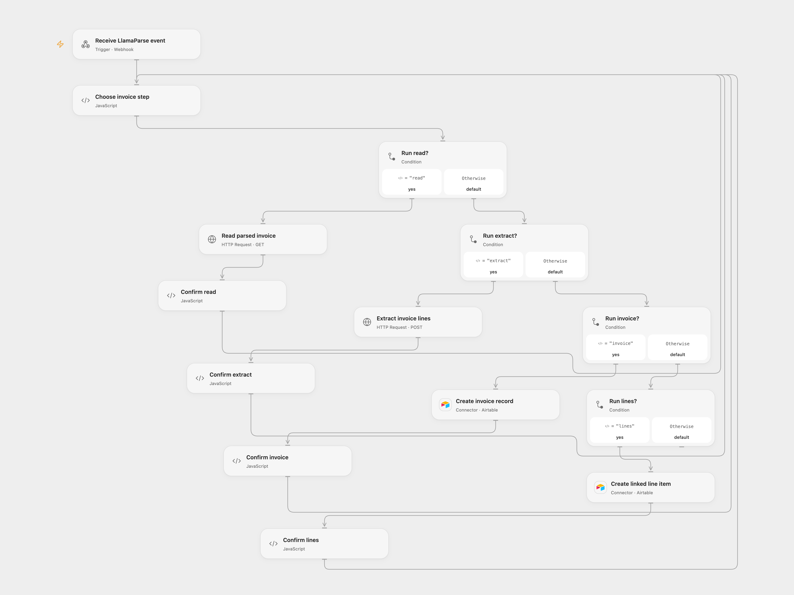

# Parse Drive Invoices into Airtable

Parse new Google Drive invoices and create linked Airtable invoice and line-item records.

<!-- template-actions:start -->
 
<!-- template-actions:end -->

<picture>
  <source media="(prefers-color-scheme: dark)" srcset="preview-dark.png">
  
</picture>

## Setup

For relay, set YOUR_OPEN_FLOW_WEBHOOK_URL in **Relay Llama event to Open Flow**. For direct, connect OpenAI and Airtable and set the base and table IDs.

In Open Flow set the Airtable base and table names in **Choose invoice step**, connect Airtable, enable persistent State, and bind Secret Variables `LLAMA_CLOUD_API_KEY` and `OPENAI_API_KEY`. The Airtable invoice table must support blank records; the line table needs Description, Qty, Unit price, Amount, and Invoices linked to the invoice table. Prevent overlapping executions. Use one mode to avoid duplicate writes.

## Behavior

New invoices are uploaded to LlamaParse, then the completed job is retrieved and passed to OpenAI for line extraction. One Airtable invoice is created with linked line items. Uploaded documents and parsed content are sent to the configured services; review model output against the invoice. If a write result is unknown, inspect Airtable. In **Choose invoice step**, enter its pending key and `confirmed` or `absent` as the resolution; for a confirmed invoice also enter its Airtable record ID. Run the same callback again, then clear these fields.

In n8n

In the supplied n8n workflow, select the Drive folder and credential, bind a LlamaCloud HTTP bearer credential to **Upload File**, **Create parse job**, and **Read parse result**, and replace YOUR_PUBLIC_N8N_WEBHOOK_URL in **Create parse job** with the production URL of **Webhook**. In **Choose processing mode**, replace YOUR_MODE with relay or direct. Set the same Data Table on every checkpoint node; it needs text columns item_key and status. In n8n inspect Airtable or LlamaParse and resolve the matching pending Data Table row only after checking the outcome.

Inspiration &amp; credits

## Changes to the source

- Use the current asynchronous LlamaParse job and callback contract, replace personal IDs and add write checkpoints.

Adapted from [Parse invoices with LlamaParse](https://github.com/Zie619/n8n-workflows/blob/ae8cf6dc5b873cbb4f74587aa9180ed3a9f70682/workflows/Code/0669_Code_Webhook_Create_Webhook.json) in [Zie619/n8n-workflows](https://github.com/Zie619/n8n-workflows). The source credits Mark Shcherbakov from 5minAI; no separate original template license is stated.

The collection’s [MIT notice](https://github.com/Zie619/n8n-workflows/blob/94007c1445d9258a7da116646b79473e7c7c3282/LICENSE) is pinned at a later revision. This is the collection notice at that revision; it does not establish a separate original template author's license. Our changes are listed above; see [repository licensing](../../README.md#licensing).

> MIT License
>
> Copyright (c) 2025 Zie619
>
> Permission is hereby granted, free of charge, to any person obtaining a copy
> of this software and associated documentation files (the "Software"), to deal
> in the Software without restriction, including without limitation the rights
> to use, copy, modify, merge, publish, distribute, sublicense, and/or sell
> copies of the Software, and to permit persons to whom the Software is
> furnished to do so, subject to the following conditions:
>
> The above copyright notice and this permission notice shall be included in all
> copies or substantial portions of the Software.
>
> THE SOFTWARE IS PROVIDED "AS IS", WITHOUT WARRANTY OF ANY KIND, EXPRESS OR
> IMPLIED, INCLUDING BUT NOT LIMITED TO THE WARRANTIES OF MERCHANTABILITY,
> FITNESS FOR A PARTICULAR PURPOSE AND NONINFRINGEMENT. IN NO EVENT SHALL THE
> AUTHORS OR COPYRIGHT HOLDERS BE LIABLE FOR ANY CLAIM, DAMAGES OR OTHER
> LIABILITY, WHETHER IN AN ACTION OF CONTRACT, TORT OR OTHERWISE, ARISING FROM,
> OUT OF OR IN CONNECTION WITH THE SOFTWARE OR THE USE OR OTHER DEALINGS IN THE
> SOFTWARE.

