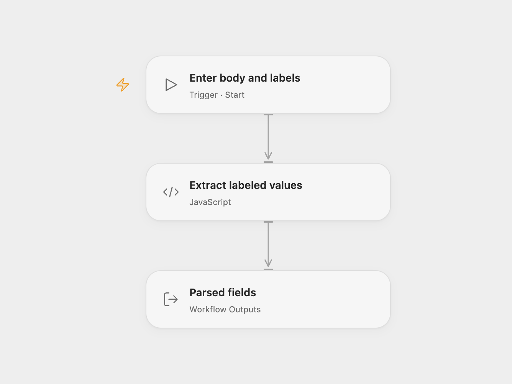

# Parse a Labeled Email Body

Extract labeled values from a sample plain-text email body.

<picture>
  <source media="(prefers-color-scheme: dark)" srcset="preview-dark.png">
  
</picture>

[Open Flow JSON](templates/parse-labeled-email-body.openflow.json) · [n8n JSON](templates/parse-labeled-email-body.n8n.json)

## Setup and use

Start Open Flow with a plain-text **body** and comma-separated **labels**, such as `Name,Email,Subject,Message`. In n8n edit **Set values** and run manually. The example contains placeholder contact data.

## Behavior

Each label matches without regard to case and captures the text after spaces or a colon. Non-final labels capture to a newline or dollar sign; the last label can span lines until a dollar sign. Missing labels are omitted. Labels are interpreted as regular-expression text, so use simple label names unless that behavior is intended. Open Flow returns the parsed object as **fields**; n8n emits it as the item JSON. This example parses supplied text and does not fetch email.

Inspiration &amp; credits

## Changes to the source

- Replace personal example data with a placeholder and expose the body and labels as Open Flow inputs.

Adapted from [Email body parser](https://github.com/Zie619/n8n-workflows/blob/ae8cf6dc5b873cbb4f74587aa9180ed3a9f70682/workflows/Manual/0827_Manual_Functionitem_Send_Triggered.json) in [Zie619/n8n-workflows](https://github.com/Zie619/n8n-workflows). The source names aprenden8n.com in its workflow title; it does not specify a separate template license.

The collection’s [MIT notice](https://github.com/Zie619/n8n-workflows/blob/94007c1445d9258a7da116646b79473e7c7c3282/LICENSE) is pinned at a later revision. This is the collection notice at that revision; it does not establish a separate original template author's license. Our changes are listed above; see [repository licensing](../../README.md#licensing).

> MIT License
>
> Copyright (c) 2025 Zie619
>
> Permission is hereby granted, free of charge, to any person obtaining a copy
> of this software and associated documentation files (the "Software"), to deal
> in the Software without restriction, including without limitation the rights
> to use, copy, modify, merge, publish, distribute, sublicense, and/or sell
> copies of the Software, and to permit persons to whom the Software is
> furnished to do so, subject to the following conditions:
>
> The above copyright notice and this permission notice shall be included in all
> copies or substantial portions of the Software.
>
> THE SOFTWARE IS PROVIDED "AS IS", WITHOUT WARRANTY OF ANY KIND, EXPRESS OR
> IMPLIED, INCLUDING BUT NOT LIMITED TO THE WARRANTIES OF MERCHANTABILITY,
> FITNESS FOR A PARTICULAR PURPOSE AND NONINFRINGEMENT. IN NO EVENT SHALL THE
> AUTHORS OR COPYRIGHT HOLDERS BE LIABLE FOR ANY CLAIM, DAMAGES OR OTHER
> LIABILITY, WHETHER IN AN ACTION OF CONTRACT, TORT OR OTHERWISE, ARISING FROM,
> OUT OF OR IN CONNECTION WITH THE SOFTWARE OR THE USE OR OTHER DEALINGS IN THE
> SOFTWARE.

