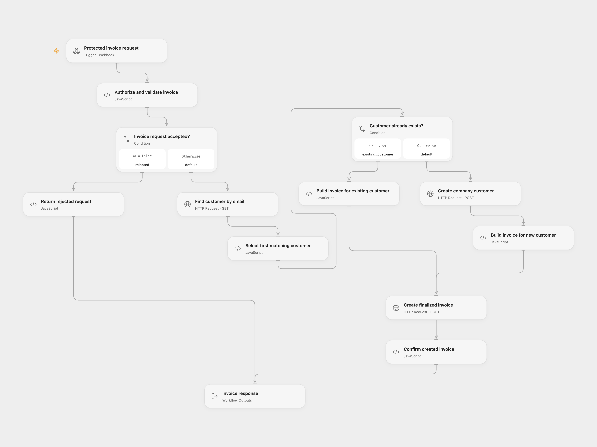

# Pennylane Invoice Creator

Receive invoice data through a POST webhook protected by HTTP Basic authorization. Find an existing Pennylane customer by email, create a company customer when no match exists, and create a finalized invoice. Return the invoice details to the caller.

This template provides the original workflow's `send_email: false` path. Omit that field or set it to `false`. Other values return HTTP 422 before any Pennylane request. The source also contains an email delivery path with minute-long waits; that path is outside this template.

<picture>
  <source media="(prefers-color-scheme: dark)" srcset="preview-dark.png">
  
</picture>

## Configure

You need a Pennylane **company** API token with `customers:all` and `customer_invoices:all` scopes. Configure sequential invoice numbering in Pennylane before running the workflow. Use customer details, currency and VAT codes appropriate to the invoice.

For Open Flow, import `templates/pennylane-invoice-creator.openflow.json` and configure secret Variables:

| Variable | Bind to |
| --- | --- |
| `PENNYLANE_API_TOKEN` | The Bearer `auth.token` input on each of the three HTTP nodes |
| `PENNYLANE_WEBHOOK_BASIC_AUTH` | `expectedAuthorization` on **Authorize and validate invoice** |

Store the complete authorization header value, `Basic <base64(username:password)>`, in the webhook secret. Use dedicated credentials and keep the value secret. The validation node compares the incoming Authorization header before making any Pennylane request. Publish and enable the Webhook, then use the URL generated by your Open Flow deployment. Variable bindings and endpoint/account identities are intentionally unset in the downloadable file.

For n8n, import `templates/pennylane-invoice-creator.n8n.json`. Select an **HTTP Basic Auth** credential on **Receive Invoice Request**. Select an **HTTP Header Auth** credential on all three Pennylane HTTP Request nodes, with name `Authorization` and value `Bearer <your Pennylane company token>`. Activate the workflow and use its production webhook URL.

## Request

Send a JSON object with `Content-Type: application/json` and the configured Basic Authorization header. This example uses fictional customer details:

```json
{
  "customer_name": "Example Company",
  "customer_email": "billing@example.com",
  "customer_address": "1 Example Street",
  "customer_postal_code": "75001",
  "customer_city": "Paris",
  "customer_country": "FR",
  "items": [
    { "label": "Consulting", "quantity": 2, "unit_price": 150, "vat_rate": "FR_200" }
  ],
  "currency": "EUR",
  "reference": "YOUR_UNIQUE_INVOICE_REFERENCE",
  "send_email": false
}
```

`customer_name`, `customer_email` and a nonempty `items` array are required. Each item needs a label and positive numeric quantity and unit price. Missing country, currency and item VAT code default to `FR`, `EUR` and `FR_200`. Missing address, postal code and city use the source defaults `""`, `"00000"` and `"Non renseigné"`; provide the actual billing address when creating a new customer.

Optional `due_date` must be a real `YYYY-MM-DD` date. It defaults to 30 days after the run starts, in UTC. The invoice date is the run's UTC date. An optional nonempty `reference` becomes the invoice's `external_reference`; Pennylane requires that reference to be unique. VAT codes are Pennylane API codes, for example `FR_200`, `FR_100`, `FR_55` or `exempt`. The API validates the selected currency and VAT code.

Labels and the customer name are trimmed; the email is lowercased. Unit prices use the source's JavaScript `toFixed(2)` conversion and are sent as decimal strings with unit `piece`. Fractional quantities and item order are preserved. The template adds null-item, field-type, real-date and decimal-representation checks before any API write. It also fixes the source's customer creation payload to send the API's required `billing_address.country_alpha2` field.

## Result and limits

A successful HTTP 200 response contains `success`, `invoice_id`, `invoice_number`, `amount`, `customer`, `public_url` and `email_sent: false`. The invoice ID and amount are strings. `public_url` can be null while Pennylane generates the PDF; when present, its documented lifetime is 30 minutes. This workflow does not fetch the URL again.

Customer lookup retains the source's single filtered request using `emails` / `in` and the first match in Pennylane's default descending-ID order. Its filter value uses the [documented array form for `in`](https://pennylane.readme.io/docs/setting-up-filters), `[email]`, replacing the source's scalar value. The API's default page size is 20. The first record must contain the requested email; an empty or mismatched email list stops before any write rather than choosing a different record. It does not scan further pages or update an existing customer's billing details. A missing match causes one company customer creation, followed by one invoice creation with `draft: false`.

The template rejects an unauthorized request before any business request. Open Flow starts a run and returns JSON with HTTP 401 from its first validation gate; n8n's built-in Basic Auth rejects it at the Webhook before the workflow runs. Both include a Basic authentication challenge on HTTP 401. Authorized invalid input returns HTTP 400, and unsupported email requests return HTTP 422. Both return JSON with `Cache-Control: no-store` for workflow responses. API errors, redirects, malformed success responses and missing IDs stop the run without a success response.

Open Flow waits up to 60 seconds for the final response. Each HTTP node has a 15-second execution timeout. A caller timeout or API error can happen after a customer or invoice has already been created. There is no rollback, workflow retry, overwrite, invoice deduplication or email delivery. Check Pennylane before repeating an uncertain request; reusing a reference is not a guarantee of a cached response. The Open Flow Webhook also applies its deployment's body-size and admission limits.

The two downloads were checked against the public Open Flow SDK and fixed native n8n implementations using offline API fixtures. They have not been tested with a live Pennylane account or an activated webhook.

<details>
<summary>Inspiration &amp; credits</summary>

Adapted from [Create and send Pennylane invoices from webhook data](https://github.com/enescingoz/awesome-n8n-templates/blob/827110332c21cbe000ab13f6d292d5adb1f1f8db/Other_Integrations_and_Use_Cases/Create%20and%20send%20Pennylane%20invoices%20from%20webhook%20data.json) at revision `827110332c21cbe000ab13f6d292d5adb1f1f8db` in [awesome-n8n-templates](https://github.com/enescingoz/awesome-n8n-templates), whose collection is [CC BY 4.0](https://github.com/enescingoz/awesome-n8n-templates/blob/827110332c21cbe000ab13f6d292d5adb1f1f8db/LICENSE). This adaptation extracts the creation-without-email path, adds explicit validation and confirmation, and removes account identities and sample private data. It does not represent the email path as migrated.

Original workflow by **Gauthier Huguenin**: [n8n-pennylane-auto-invoicing](https://github.com/Gauthier-Huguenin/n8n-pennylane-auto-invoicing). The original MIT notice is retained in both workflow downloads and below.

```text
MIT License

Copyright (c) 2026 Gauthier Huguenin

Permission is hereby granted, free of charge, to any person obtaining a copy
of this software and associated documentation files (the "Software"), to deal
in the Software without restriction, including without limitation the rights
to use, copy, modify, merge, publish, distribute, sublicense, and/or sell
copies of the Software, and to permit persons to whom the Software is
furnished to do so, subject to the following conditions:

The above copyright notice and this permission notice shall be included in
all copies or substantial portions of the Software.

THE SOFTWARE IS PROVIDED "AS IS", WITHOUT WARRANTY OF ANY KIND, EXPRESS OR
IMPLIED, INCLUDING BUT NOT LIMITED TO THE WARRANTIES OF MERCHANTABILITY,
FITNESS FOR A PARTICULAR PURPOSE AND NONINFRINGEMENT. IN NO EVENT SHALL THE
AUTHORS OR COPYRIGHT HOLDERS BE LIABLE FOR ANY CLAIM, DAMAGES OR OTHER
LIABILITY, WHETHER IN AN ACTION OF CONTRACT, TORT OR OTHERWISE, ARISING FROM,
OUT OF OR IN CONNECTION WITH THE SOFTWARE OR THE USE OR OTHER DEALINGS IN
THE SOFTWARE.
```

API references: [customer lookup](https://pennylane.readme.io/reference/getcustomers), [company customer creation](https://pennylane.readme.io/reference/postcompanycustomer), [invoice creation](https://pennylane.readme.io/reference/postcustomerinvoices).

</details>
