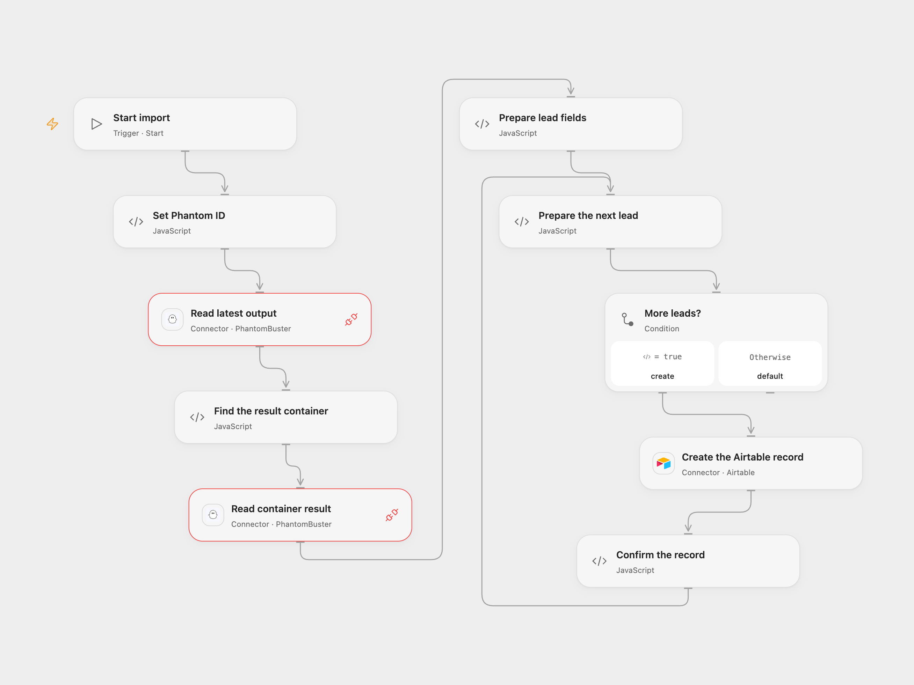

# Save PhantomBuster Leads to Airtable

Read the latest Phantom output and save lead names, emails and companies to Airtable.

<picture>
  <source media="(prefers-color-scheme: dark)" srcset="preview-dark.png">
  
</picture>

[Open Flow JSON](templates/phantombuster-leads-to-airtable.openflow.json) · [n8n JSON](templates/phantombuster-leads-to-airtable.n8n.json)

## Setup

Connect PhantomBuster with Provider API Request permission in **Read latest output** and **Read container result**, using the same account. Set the Phantom ID in **Set Phantom ID**. Connect Airtable in **Create the Airtable record** and configure its base and table. Create text fields named **Name**, **Email** and **Company**.

The Phantom's latest result must be a JSON object or array of objects with `general.fullName`, `details.mail` and `jobs[0].companyName` strings. Different Phantoms have different output structures; adjust the field mapping if yours differs. In n8n, connect PhantomBuster and Airtable Personal Access Token credentials, set the Phantom ID, and select the Airtable base and table. Run one format.

## Behavior

Each run reads the latest container result and creates one Airtable record per lead. A null result or empty array creates no records. The workflow validates all lead fields before creating records. It does not deduplicate: repeated runs can add the same leads again.

A read or validation failure stops before writes. Open Flow creates records sequentially and stops if a create fails or cannot be confirmed; earlier records can already exist. An uncertain write in either format may have succeeded. Inspect Airtable before retrying. Large results may exceed the Provider API Request response size limit.

## Changes to the source

- Replace the empty Phantom and Airtable identifiers with configuration, and validate lead fields before writing.
- Use the PhantomBuster Provider API Request for the latest output and container result in Open Flow. Null results produce no records.

Source and license

Adapted from [Store the output of a phantom in Airtable](https://github.com/Zie619/n8n-workflows/blob/ae8cf6dc5b873cbb4f74587aa9180ed3a9f70682/workflows/Manual/0369_Manual_Airtable_Automation_Triggered.json) in [Zie619/n8n-workflows](https://github.com/Zie619/n8n-workflows). The matching [n8n community listing](https://n8n.io/workflows/882-store-the-output-of-a-phantom-in-airtable/) credits Harshil Agrawal. The original template does not state a separate license.

The collection’s [MIT notice](https://github.com/Zie619/n8n-workflows/blob/94007c1445d9258a7da116646b79473e7c7c3282/LICENSE) is pinned at a later revision. This is the collection notice at that revision; it does not establish a separate original template author's license. Our changes are listed above; see [repository licensing](../../README.md#licensing).

> MIT License
>
> Copyright (c) 2025 Zie619
>
> Permission is hereby granted, free of charge, to any person obtaining a copy
> of this software and associated documentation files (the "Software"), to deal
> in the Software without restriction, including without limitation the rights
> to use, copy, modify, merge, publish, distribute, sublicense, and/or sell
> copies of the Software, and to permit persons to whom the Software is
> furnished to do so, subject to the following conditions:
>
> The above copyright notice and this permission notice shall be included in all
> copies or substantial portions of the Software.
>
> THE SOFTWARE IS PROVIDED "AS IS", WITHOUT WARRANTY OF ANY KIND, EXPRESS OR
> IMPLIED, INCLUDING BUT NOT LIMITED TO THE WARRANTIES OF MERCHANTABILITY,
> FITNESS FOR A PARTICULAR PURPOSE AND NONINFRINGEMENT. IN NO EVENT SHALL THE
> AUTHORS OR COPYRIGHT HOLDERS BE LIABLE FOR ANY CLAIM, DAMAGES OR OTHER
> LIABILITY, WHETHER IN AN ACTION OF CONTRACT, TORT OR OTHERWISE, ARISING FROM,
> OUT OF OR IN CONNECTION WITH THE SOFTWARE OR THE USE OR OTHER DEALINGS IN THE
> SOFTWARE.

