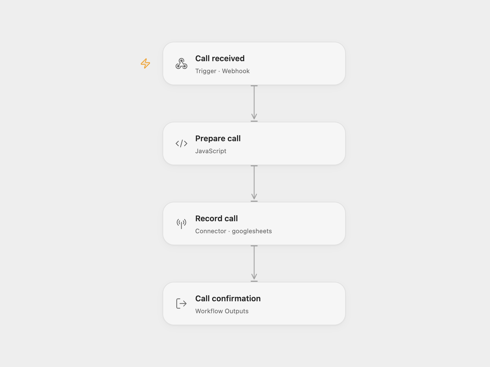

# Phone Call Log

Save completed call details to Google Sheets from a webhook. Your calling service supplies the transcript and summary. The workflow records them and returns the call ID and caller after the row is saved.

## Setup

Create a sheet named `Calls` with these headers in columns A–G:

| Call ID | Date | Caller | Phone | Duration | Summary | Transcript |
| --- | --- | --- | --- | --- | --- | --- |

For Open Flow, import the JSON, connect Google Sheets in `Record call`, and replace `YOUR_SPREADSHEET_ID`. The default range is `'Calls'!A:G`.

For n8n, configure the Google Sheets account and spreadsheet in `Log to Sheets`.

The n8n Code node uses the `crypto` built-in to create missing call IDs. It is available in n8n Cloud. Self-hosted n8n must [allow the `crypto` module](https://docs.n8n.io/hosting/configuration/configuration-examples/modules-in-code-node/).

Publish and enable the configured workflow and send a POST request to its webhook URL:

```json
{
  "call_id": "call-001",
  "caller_name": "Ada",
  "caller_phone": "+1 555 0100",
  "duration": 45,
  "summary": "Asked for a product demo.",
  "transcript": "Hello, I would like to book a demo."
}
```

If `call_id` is missing, the workflow generates a UUID. `from` is accepted as a fallback for caller and phone; the caller defaults to `Unknown`. Duration must be a nonnegative number and defaults to zero. The transcript is limited to its first 500 characters. The received timestamp is written in UTC.

The success body is `{"success":true,"callId":"call-001","caller":"Ada"}`. The sheet write retains the source's two-attempt limit with a one-second retry interval. Open Flow retries only failures the platform identifies as safe to retry and stops when a write's result is unknown; n8n retries any node error. Requests append rows without deduplication, even when the same call ID is supplied. Retrying after a write failure or timeout may add a duplicate row. The webhook waits up to 30 seconds in Open Flow; a timeout does not cancel work already running.

## Changes to the source

- Normalize text fields and validate duration before writing the row.
- Bind the response to the parsed call so a Sheets write receipt cannot erase its ID and caller.
- Write literal sheet values with RAW formatting, preserving phone numbers and transcript text.
- Replace the server's spreadsheet environment variable with editable template configuration.

<picture>
  <source media="(prefers-color-scheme: dark)" srcset="preview-dark.png">
  
</picture>

[Open Flow JSON](templates/phone-call-log.openflow.json) · [n8n JSON](templates/phone-call-log.n8n.json)

## Source and license

Adapted from [VoiceAgent Lite - Phone Call Logger](https://github.com/enescingoz/awesome-n8n-templates/blob/827110332c21cbe000ab13f6d292d5adb1f1f8db/Other_Integrations_and_Use_Cases/VoiceAgent%20Lite%20-%20Phone%20Call%20Logger.json) in [enescingoz/awesome-n8n-templates](https://github.com/enescingoz/awesome-n8n-templates).

Source collection notice: © 2024–2026 Enes Cingoz, [CC BY 4.0](https://github.com/enescingoz/awesome-n8n-templates/blob/827110332c21cbe000ab13f6d292d5adb1f1f8db/LICENSE). The source export does not identify a separate template author or license. See [repository licensing](../../README.md#licensing) for the scope of OOMOL contributions and third-party material.
