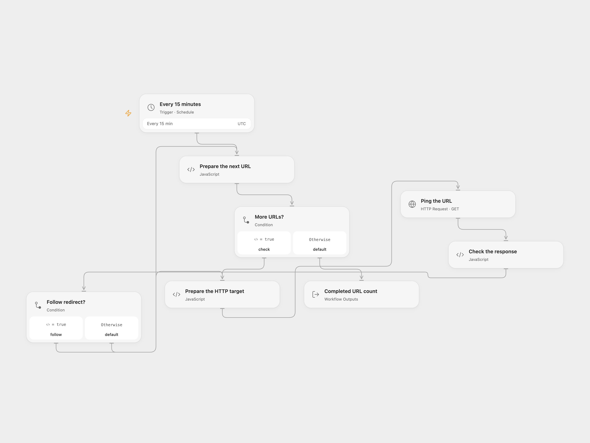

# Ping Configured URLs

Send an HTTP GET to each configured URL every 15 minutes.

<picture>
  <source media="(prefers-color-scheme: dark)" srcset="preview-dark.png">
  
</picture>

[Open Flow JSON](templates/ping-configured-urls.openflow.json) · [n8n JSON](templates/ping-configured-urls.n8n.json)

## Setup

Replace the example list in **Prepare the next URL** with the HTTP or HTTPS URLs to contact. In n8n, edit the array in **URLs List**. Configure only destinations you intend to contact, without embedded credentials. Activate one format.

## Behavior

Every 15 minutes the workflow requests each URL. It follows up to 21 redirects and attempts the remaining URLs after a request error or a non-2xx final response. As in the source, those errors do not by themselves fail the run. An empty list makes no requests. This workflow sends no alert; inspect individual request results to see failures. Each run repeats the requests, and a GET endpoint may itself have side effects.

Open Flow checks URLs sequentially; n8n may issue requests concurrently. Open Flow applies a 30-second timeout per redirect hop and a 4 MiB response limit; exceeding that limit stops the run immediately. Redirect targets must be HTTP or HTTPS without credentials. n8n uses its HTTP node defaults. Both schedules use UTC as a starting point; the source inherited its n8n instance timezone.

Inspiration &amp; credits

## Changes to the source

- Replace the example domains with a configurable list and validate URLs before use. Explicitly set UTC.

Adapted from [URL Pinger](https://github.com/Zie619/n8n-workflows/blob/ae8cf6dc5b873cbb4f74587aa9180ed3a9f70682/workflows/Http/1447_HTTP_Schedule_Automation_Webhook.json) in [Zie619/n8n-workflows](https://github.com/Zie619/n8n-workflows). The source export does not identify a separate template author or license.

The collection’s [MIT notice](https://github.com/Zie619/n8n-workflows/blob/94007c1445d9258a7da116646b79473e7c7c3282/LICENSE) is pinned at a later revision. This is the collection notice at that revision; it does not establish a separate original template author's license. Our changes are listed above; see [repository licensing](../../README.md#licensing).

> MIT License
>
> Copyright (c) 2025 Zie619
>
> Permission is hereby granted, free of charge, to any person obtaining a copy
> of this software and associated documentation files (the "Software"), to deal
> in the Software without restriction, including without limitation the rights
> to use, copy, modify, merge, publish, distribute, sublicense, and/or sell
> copies of the Software, and to permit persons to whom the Software is
> furnished to do so, subject to the following conditions:
>
> The above copyright notice and this permission notice shall be included in all
> copies or substantial portions of the Software.
>
> THE SOFTWARE IS PROVIDED "AS IS", WITHOUT WARRANTY OF ANY KIND, EXPRESS OR
> IMPLIED, INCLUDING BUT NOT LIMITED TO THE WARRANTIES OF MERCHANTABILITY,
> FITNESS FOR A PARTICULAR PURPOSE AND NONINFRINGEMENT. IN NO EVENT SHALL THE
> AUTHORS OR COPYRIGHT HOLDERS BE LIABLE FOR ANY CLAIM, DAMAGES OR OTHER
> LIABILITY, WHETHER IN AN ACTION OF CONTRACT, TORT OR OTHERWISE, ARISING FROM,
> OUT OF OR IN CONNECTION WITH THE SOFTWARE OR THE USE OR OTHER DEALINGS IN THE
> SOFTWARE.

