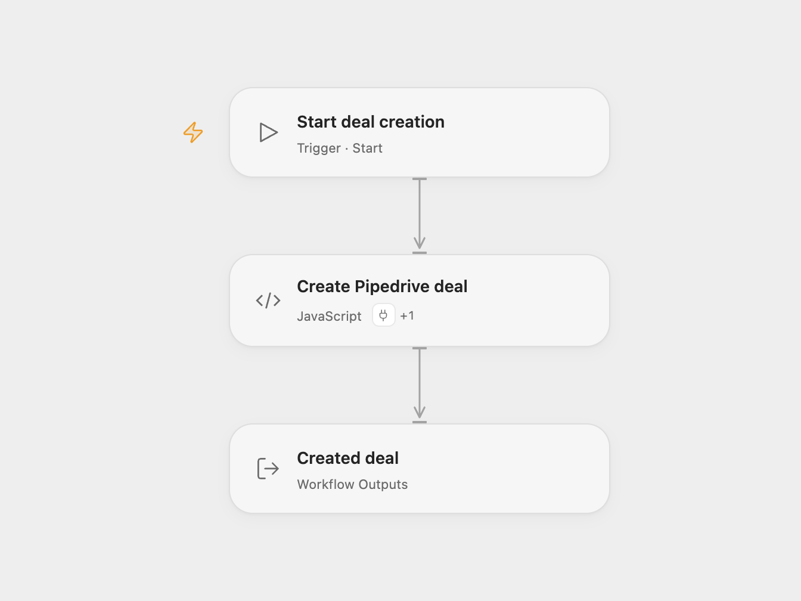

# Pipedrive Deal Creator

Create one Pipedrive deal with a configured title using API v2.

<picture>
  <source media="(prefers-color-scheme: dark)" srcset="preview-dark.png">
  
</picture>

[Open Flow JSON](templates/pipedrive-deal-creator.openflow.json) · [n8n JSON](templates/pipedrive-deal-creator.n8n.json)

## Setup

Select a Pipedrive account under **Actions** in **Create Pipedrive deal** and replace its title input. In n8n, choose an **HTTP Header Auth** credential in **Create Pipedrive deal**. Set its header name to `x-api-token` and save your Pipedrive API token as the credential value. Edit the title in the node’s JSON body. Run manually after setup.

The workflow creates one deal and returns its complete record. It supplies only the title; the account, pipeline, stage, visibility and other unset properties follow Pipedrive defaults. It does not create or link a person or organization.

Each manual run creates another deal. There is no search, upsert or duplicate detection. A service error stops the workflow without an automatic retry. If a creation request times out, check the service before running it again.

Inspiration &amp; credits

## Changes to the source

- Replace the empty title with a setup placeholder.
- Use API v2 for deal creation. The source used a legacy API v1 call whose availability is no longer guaranteed.
- In n8n, use HTTP Request with a managed Header Auth credential for the current `x-api-token` authentication and extract the returned deal. The current Pipedrive V2 node requires an association that this source does not supply.

Adapted from [Create a deal in Pipedrive](https://github.com/Zie619/n8n-workflows/blob/ae8cf6dc5b873cbb4f74587aa9180ed3a9f70682/workflows/Manual/0062_Manual_Pipedrive_Create_Triggered.json) in [Zie619/n8n-workflows](https://github.com/Zie619/n8n-workflows). The source export does not identify a separate template author or license.

The collection’s [MIT notice](https://github.com/Zie619/n8n-workflows/blob/94007c1445d9258a7da116646b79473e7c7c3282/LICENSE) is pinned at a later revision. This is the collection notice at that revision; it does not establish a separate original template author's license. Our changes are listed above; see [repository licensing](../../README.md#licensing).

> MIT License
>
> Copyright (c) 2025 Zie619
>
> Permission is hereby granted, free of charge, to any person obtaining a copy
> of this software and associated documentation files (the "Software"), to deal
> in the Software without restriction, including without limitation the rights
> to use, copy, modify, merge, publish, distribute, sublicense, and/or sell
> copies of the Software, and to permit persons to whom the Software is
> furnished to do so, subject to the following conditions:
>
> The above copyright notice and this permission notice shall be included in all
> copies or substantial portions of the Software.
>
> THE SOFTWARE IS PROVIDED "AS IS", WITHOUT WARRANTY OF ANY KIND, EXPRESS OR
> IMPLIED, INCLUDING BUT NOT LIMITED TO THE WARRANTIES OF MERCHANTABILITY,
> FITNESS FOR A PARTICULAR PURPOSE AND NONINFRINGEMENT. IN NO EVENT SHALL THE
> AUTHORS OR COPYRIGHT HOLDERS BE LIABLE FOR ANY CLAIM, DAMAGES OR OTHER
> LIABILITY, WHETHER IN AN ACTION OF CONTRACT, TORT OR OTHERWISE, ARISING FROM,
> OUT OF OR IN CONNECTION WITH THE SOFTWARE OR THE USE OR OTHER DEALINGS IN THE
> SOFTWARE.

