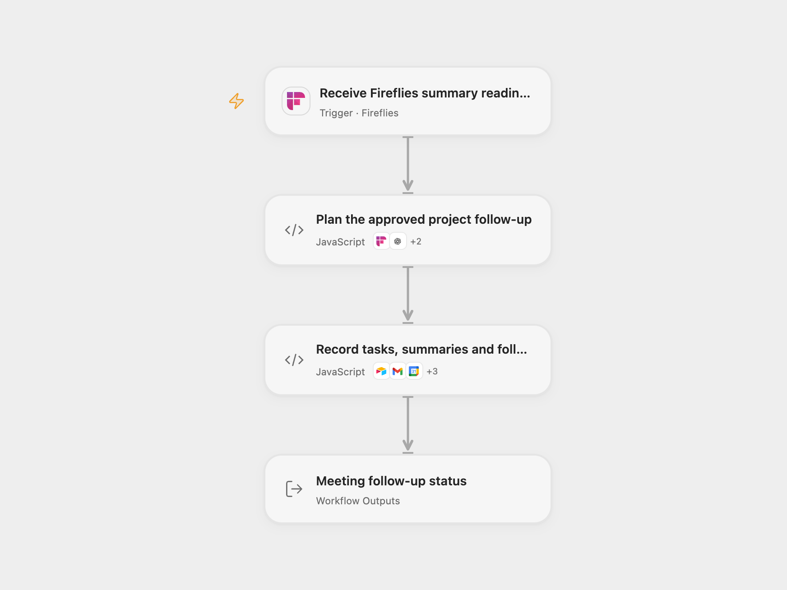

# Follow Up on Fireflies Project Meetings

Turn a completed Fireflies project meeting into Airtable tasks, individual summaries, and a confirmed Google Meet follow-up.

<!-- template-actions:start -->
 
<!-- template-actions:end -->

<picture>
  <source media="(prefers-color-scheme: dark)" srcset="preview-dark.png">
  
</picture>

## Setup

1. In Workbench, create a Fireflies event source with the account that owns the project meetings and a Webhooks V2 signing secret. Register its HTTPS callback and the same secret in Fireflies with only `meeting.summarized` selected. Keep note-change resends off. Select that source and its Fireflies connection in **Receive Fireflies summary readiness**. Connect the same Fireflies account in **Plan the approved project follow-up** and connect OpenAI there.
2. In Airtable, create a tasks table with `Name`, `Description`, a `Due Date` date field, a `Priority` single select with `Low`, `Medium` and `Urgent`, and a `Project` link to existing project records. Connect Airtable, Gmail and Google Calendar in **Record tasks, summaries and follow-up**. Select a Calendar connection that can create Google Meet conferences on the calendars you list.
3. Set `settings` in **Plan the approved project follow-up**. Enter your name as spoken in meetings and the Fireflies participant email as `ownerName` and `ownerEmail`. Set the Airtable `baseId` and `tableId`. Add one `routes` entry per approved meeting title. A route has the exact `title`, a linked Airtable `projectRecordId`, and `recipients` as an array of `{ "name": "Client Name", "email": "client@example.invalid" }`. To allow a follow-up on that project, also set `calendarId` and `followUpEmail` to one of those approved attendee addresses. An empty routes list disables processing. Publish after configuring the source and connections. Fireflies marks the source ready after a signed event for a meeting the connection can read. [Fireflies Webhooks V2](https://docs.fireflies.ai/graphql-api/webhooks-v2)

## Behavior

Titles must contain “project” and match one configured route, ignoring case and surrounding spaces. The workflow reads the transcript by the signed event’s meeting ID and requires the configured owner on its participant list. OpenAI extracts named assignments from the transcript without access to the write actions. Only the owner’s assignments become Airtable tasks, linked to the configured project record. An unstated due date is left blank. Meetings with more than ten owner tasks or more than 100,000 transcript characters stop before writes for manual review.

Each approved contact present in the Fireflies participant list gets an individual plain-text **Meeting Summary** with Fireflies’ bullet gist and only that contact’s tasks. Configure recipients who may receive that meeting’s summary and use provider accounts authorized for the transcript. The workflow compares the model’s assignment to the named person in its source line.

The workflow creates one Google Meet event when the last nonempty transcript line is a complete standalone confirmation, for example, “Agreed to schedule a follow-up with Client Name on 2027-03-12, 14:00 to 15:00 UTC.” Use the configured client name or email, an ISO date, two 24-hour times, and UTC or an explicit offset such as +02:00. The sentence ends after the time zone and period. Review other phrasing, qualifications, or any later nonempty transcript line manually. The event uses the configured calendar and lists the one client as its attendee. Calendar handles guest notifications and conference provisioning.

The workflow reserves the Fireflies meeting ID before any write. A repeated delivery does not send again. If Airtable, Gmail or Calendar cannot confirm a write, the workflow returns the affected step and any earlier confirmed IDs. Check that provider for the meeting’s effects before completing the remaining steps manually. Keep the workflow’s state while stale deliveries can arrive.

In n8n

Create a Data Table for Fireflies receipts with a string column named `meeting_id`. Select that table in **Skip existing meeting reservations** and **Reserve the meeting**. Use a trusted self-hosted n8n deployment in regular mode with `N8N_CONCURRENCY_PRODUCTION_LIMIT=1`. Avoid overlapping manual runs so the Data Table check and insert stay serialized. Keep receipt rows to prevent replays. [n8n concurrency controls](https://docs.n8n.io/hosting/scaling/concurrency-control/)

Configure the same owner and routes in **Configure owner and project routes**. Use separate Bearer Auth credentials for Fireflies and OpenAI in their respective HTTP nodes. Connect Airtable Personal Access Token, Gmail OAuth2 and Google Calendar OAuth2 in their write nodes. Set `FIREFLIES_WEBHOOK_SIGNING_SECRET` in a managed secret accessible to the HMAC node. Use an external secret expression if available. The exported environment-variable expression needs `N8N_BLOCK_ENV_ACCESS_IN_NODE=false`. Restrict workflow editing and execution-history access. Register the production HTTPS webhook in Fireflies Webhooks V2 with the same secret and only `meeting.summarized`. Missing or invalid signatures receive HTTP 401. Once a queued notification starts, the workflow verifies its signature and acknowledges it before the transcript lookup.

A failed task creation, email or event stops later writes. Check the failed node and prior receipts in the run before performing any outstanding step manually. Receipt rows remain reserved after failures. Execution logs may contain meeting content and contact details.

Inspiration &amp; credits

Adapted from [AI Agent for project management and meetings with Airtable and Fireflies](https://github.com/enescingoz/awesome-n8n-templates/blob/827110332c21cbe000ab13f6d292d5adb1f1f8db/Airtable/AI%20Agent%20for%20project%20management%20and%20meetings%20with%20Airtable%20and%20Fireflies.json) in [enescingoz/awesome-n8n-templates](https://github.com/enescingoz/awesome-n8n-templates).

Source collection notice: © 2024–2026 Enes Cingoz, [CC BY 4.0](https://github.com/enescingoz/awesome-n8n-templates/blob/827110332c21cbe000ab13f6d292d5adb1f1f8db/LICENSE). The source credits Philipp Bekher of 5minAI. Mark Shcherbakov published the [n8n gallery template](https://n8n.io/workflows/2683-ai-agent-for-project-management-and-meetings-with-airtable-and-fireflies/). See [repository licensing](../../README.md#licensing) for the scope of OOMOL contributions and third-party material.

The adaptation uses signed summary-ready events, an explicit project-to-record and recipient mapping, and validated actions instead of an agent with write tools.

