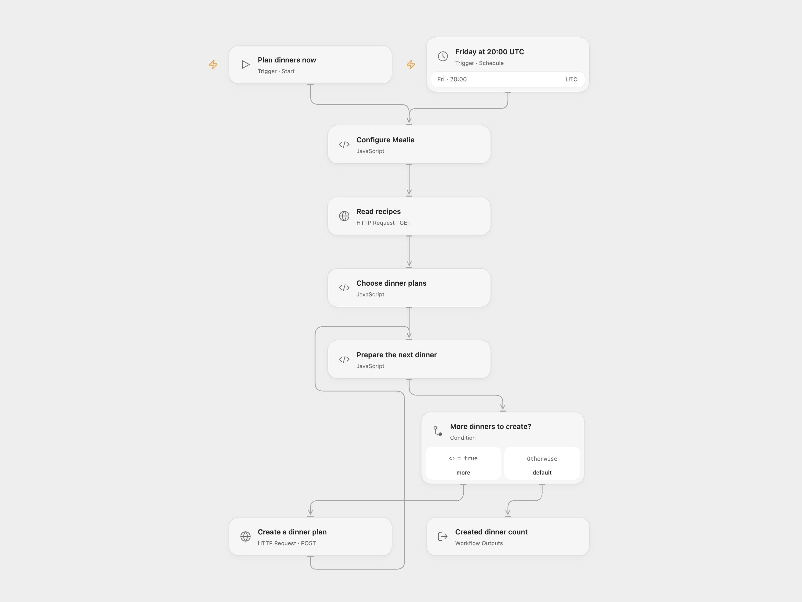

# Plan Random Mealie Dinners

Choose random recipes from a Mealie category and create dinner plans for consecutive days.

<picture>
  <source media="(prefers-color-scheme: dark)" srcset="preview-dark.png">
  
</picture>

[Open Flow JSON](templates/plan-random-mealie-dinners.openflow.json) · [n8n JSON](templates/plan-random-mealie-dinners.n8n.json)

## Setup

Provide a Mealie server URL and optional category ID in **Configure Mealie**. Leave the category ID empty to include all categories. Create a secret Variable containing a Mealie API token and bind it to **Read recipes** and **Create a dinner plan**. In **Choose dinner plans**, set the number of recipes and the offset in days. In n8n, set these values in **Configure Mealie** and configure HTTP Header Auth with name `Authorization` and value `Bearer YOUR_MEALIE_TOKEN` on both HTTP nodes. Use HTTPS to protect the token. Activate one format.

## Behavior

Run manually or every Friday at 20:00 UTC. The workflow reads the first 100 recipes in the selected category, or across all categories if none is set, chooses distinct recipes at random and creates one dinner entry per consecutive date. Defaults are five recipes starting three days from the run date. The count can be 1–100 and the offset 0–365 days. If fewer recipes are available than requested, it stops before creating any entries. Existing meal plans are not checked; running twice can create duplicates.

Dates use UTC. The source schedule inherited its n8n instance timezone and its date code used the execution environment's local time. Verify the schedule and dates for your household. The source n8n schedule uses a stable second within the minute; Open Flow uses the minute boundary.

Entries are created one at a time. If a request fails or its outcome is unknown, earlier entries remain and the current entry may have been created. Check Mealie before rerunning. No automatic retry or rollback is configured. HTTP timeouts and response-size limits can stop a run; the first 100 recipes do not necessarily include every matching recipe.

Inspiration &amp; credits

## Changes to the source

- Replace personal server and category details with configuration and credentials; make timezone and date handling UTC.
- Stop when too few recipes are available instead of failing or looping indefinitely, and confirm each creation before sending the next.

Adapted from [Random Mealie meal planner](https://github.com/Zie619/n8n-workflows/blob/ae8cf6dc5b873cbb4f74587aa9180ed3a9f70682/workflows/Code/0651_Code_Schedule_Create_Webhook.json) in [Zie619/n8n-workflows](https://github.com/Zie619/n8n-workflows). The matching [n8n listing](https://n8n.io/workflows/2586-weekly-dinner-meal-plan-using-recipes-from-mealie/) credits Damian Karzon. The original template does not state a separate license.

The collection’s [MIT notice](https://github.com/Zie619/n8n-workflows/blob/94007c1445d9258a7da116646b79473e7c7c3282/LICENSE) is pinned at a later revision. This is the collection notice at that revision; it does not establish a separate original template author's license. Our changes are listed above; see [repository licensing](../../README.md#licensing).

> MIT License
>
> Copyright (c) 2025 Zie619
>
> Permission is hereby granted, free of charge, to any person obtaining a copy
> of this software and associated documentation files (the "Software"), to deal
> in the Software without restriction, including without limitation the rights
> to use, copy, modify, merge, publish, distribute, sublicense, and/or sell
> copies of the Software, and to permit persons to whom the Software is
> furnished to do so, subject to the following conditions:
>
> The above copyright notice and this permission notice shall be included in all
> copies or substantial portions of the Software.
>
> THE SOFTWARE IS PROVIDED "AS IS", WITHOUT WARRANTY OF ANY KIND, EXPRESS OR
> IMPLIED, INCLUDING BUT NOT LIMITED TO THE WARRANTIES OF MERCHANTABILITY,
> FITNESS FOR A PARTICULAR PURPOSE AND NONINFRINGEMENT. IN NO EVENT SHALL THE
> AUTHORS OR COPYRIGHT HOLDERS BE LIABLE FOR ANY CLAIM, DAMAGES OR OTHER
> LIABILITY, WHETHER IN AN ACTION OF CONTRACT, TORT OR OTHERWISE, ARISING FROM,
> OUT OF OR IN CONNECTION WITH THE SOFTWARE OR THE USE OR OTHER DEALINGS IN THE
> SOFTWARE.

