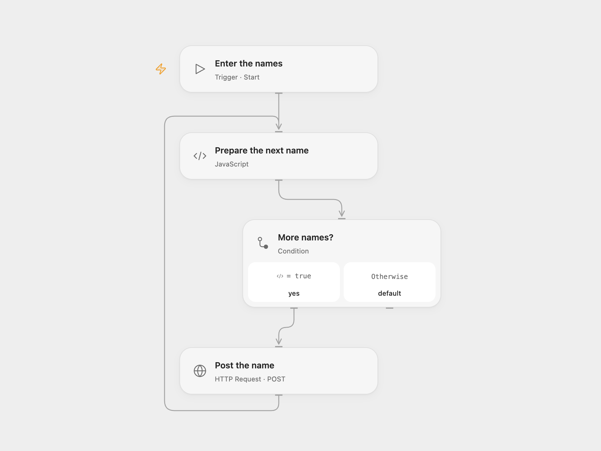

# Post a List of Names to a Webhook

Send each name in a supplied list to an authenticated HTTP endpoint.

<picture>
  <source media="(prefers-color-scheme: dark)" srcset="preview-dark.png">
  
</picture>

[Open Flow JSON](templates/post-a-list-of-names-to-a-webhook.openflow.json) · [n8n JSON](templates/post-a-list-of-names-to-a-webhook.n8n.json)

## Setup

Configure a destination that accepts a JSON object containing name and checks an api-key request header. In Open Flow set its URL and bind the API key as a secret Variable on **Post the name**. Start with an array of names. In n8n configure the names in **Enter names**, the destination URL and a Header Auth credential named api-key.

## Behavior

Each name is sent in its own POST request, in order. An empty list makes no requests. A failed or uncertain request stops processing; inspect the destination before retrying because a previous request may have succeeded.

Inspiration &amp; credits

## Changes to the source

- Replace the training node's hard-coded fictional people with a configurable list and replace its embedded key and private webhook URL with user configuration. Process one name at a time in both formats.

Adapted from [Post each name to a webhook](https://github.com/Zie619/n8n-workflows/blob/ae8cf6dc5b873cbb4f74587aa9180ed3a9f70682/workflows/Manual/0128_Manual_N8Ntrainingcustomerdatastore_Automation_Webhook.json) in [Zie619/n8n-workflows](https://github.com/Zie619/n8n-workflows). The source export does not identify a separate template author or license.

The collection’s [MIT notice](https://github.com/Zie619/n8n-workflows/blob/94007c1445d9258a7da116646b79473e7c7c3282/LICENSE) is pinned at a later revision. This is the collection notice at that revision; it does not establish a separate original template author's license. Our changes are listed above; see [repository licensing](../../README.md#licensing).

> MIT License
>
> Copyright (c) 2025 Zie619
>
> Permission is hereby granted, free of charge, to any person obtaining a copy
> of this software and associated documentation files (the "Software"), to deal
> in the Software without restriction, including without limitation the rights
> to use, copy, modify, merge, publish, distribute, sublicense, and/or sell
> copies of the Software, and to permit persons to whom the Software is
> furnished to do so, subject to the following conditions:
>
> The above copyright notice and this permission notice shall be included in all
> copies or substantial portions of the Software.
>
> THE SOFTWARE IS PROVIDED "AS IS", WITHOUT WARRANTY OF ANY KIND, EXPRESS OR
> IMPLIED, INCLUDING BUT NOT LIMITED TO THE WARRANTIES OF MERCHANTABILITY,
> FITNESS FOR A PARTICULAR PURPOSE AND NONINFRINGEMENT. IN NO EVENT SHALL THE
> AUTHORS OR COPYRIGHT HOLDERS BE LIABLE FOR ANY CLAIM, DAMAGES OR OTHER
> LIABILITY, WHETHER IN AN ACTION OF CONTRACT, TORT OR OTHERWISE, ARISING FROM,
> OUT OF OR IN CONNECTION WITH THE SOFTWARE OR THE USE OR OTHER DEALINGS IN THE
> SOFTWARE.

