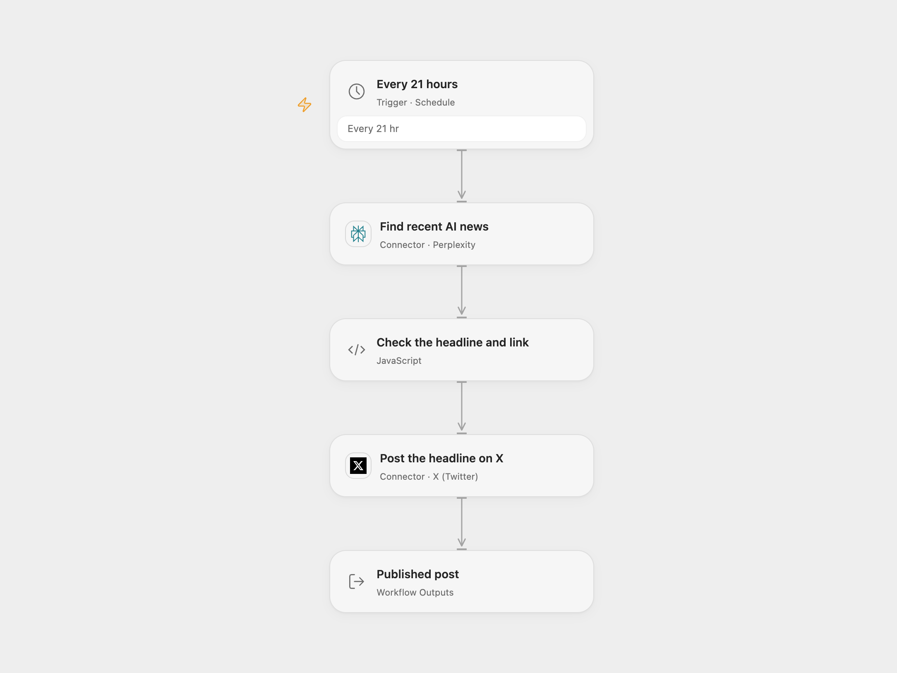

# Post AI News to X with Perplexity

Search recent AI news with Perplexity and post one headline and link to X.

<picture>
  <source media="(prefers-color-scheme: dark)" srcset="preview-dark.png">
  
</picture>

[Open Flow JSON](templates/post-ai-news-to-x-with-perplexity.openflow.json) · [n8n JSON](templates/post-ai-news-to-x-with-perplexity.n8n.json)

## Setup

Connect Perplexity in **Find recent AI news** and X in **Post the headline on X**. The X account needs permission to publish. In n8n configure a Header Auth credential named `Authorization` with value `Bearer YOUR_PERPLEXITY_API_KEY` on **Perplexity**, and connect an X account on **Post to X**. Review the question, source-domain filter and schedule before activating one format.

## Behavior

The workflow searches for AI news from the past day, with search restricted to `perplexity.ai`, and asks for one short headline and article link. It posts a nonempty response of at most 200 characters containing a link. Perplexity may generate incorrect or repeated content; the workflow does not independently verify the article or keep post history. Review the account and topic before enabling automatic public posting.

Open Flow runs every 21 hours on its UTC interval grid. n8n uses a 21-hour recurrence starting at minute 00; its scheduler and start time can differ. The source selected a random minute and inherited its instance timezone. A failed or uncertain post may already have been published; check X before retrying. No automatic post retry or deduplication is added.

Inspiration &amp; credits

## Changes to the source

- Use the current Sonar model and a secret credential instead of a literal key. Validate the headline and link before publishing.
- Use an explicit minute and UTC starting point, and remove the source's private error-workflow reference.

Adapted from [Search AI news with Perplexity and post to X](https://github.com/Zie619/n8n-workflows/blob/ae8cf6dc5b873cbb4f74587aa9180ed3a9f70682/workflows/Http/1989_HTTP_Schedule_Create_Webhook.json) in [Zie619/n8n-workflows](https://github.com/Zie619/n8n-workflows). The source export does not identify a separate template author or license.

The collection’s [MIT notice](https://github.com/Zie619/n8n-workflows/blob/94007c1445d9258a7da116646b79473e7c7c3282/LICENSE) is pinned at a later revision. This is the collection notice at that revision; it does not establish a separate original template author's license. Our changes are listed above; see [repository licensing](../../README.md#licensing).

> MIT License
>
> Copyright (c) 2025 Zie619
>
> Permission is hereby granted, free of charge, to any person obtaining a copy
> of this software and associated documentation files (the "Software"), to deal
> in the Software without restriction, including without limitation the rights
> to use, copy, modify, merge, publish, distribute, sublicense, and/or sell
> copies of the Software, and to permit persons to whom the Software is
> furnished to do so, subject to the following conditions:
>
> The above copyright notice and this permission notice shall be included in all
> copies or substantial portions of the Software.
>
> THE SOFTWARE IS PROVIDED "AS IS", WITHOUT WARRANTY OF ANY KIND, EXPRESS OR
> IMPLIED, INCLUDING BUT NOT LIMITED TO THE WARRANTIES OF MERCHANTABILITY,
> FITNESS FOR A PARTICULAR PURPOSE AND NONINFRINGEMENT. IN NO EVENT SHALL THE
> AUTHORS OR COPYRIGHT HOLDERS BE LIABLE FOR ANY CLAIM, DAMAGES OR OTHER
> LIABILITY, WHETHER IN AN ACTION OF CONTRACT, TORT OR OTHERWISE, ARISING FROM,
> OUT OF OR IN CONNECTION WITH THE SOFTWARE OR THE USE OR OTHER DEALINGS IN THE
> SOFTWARE.

