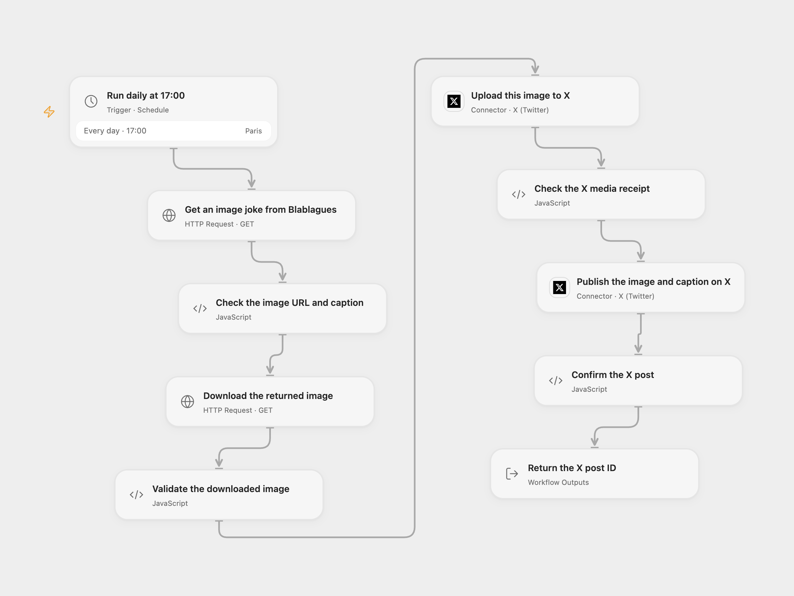

# Post Blablagues Images to X

Get a random image and its caption from Blablagues each day and publish them together on X.

<!-- template-actions:start -->
 
<!-- template-actions:end -->

<picture>
  <source media="(prefers-color-scheme: dark)" srcset="preview-dark.png">
  
</picture>

## Setup

1. Select the same authorized X connection in **Upload this image to X** and **Publish the image and caption on X**. The connection needs permission to upload media and publish posts.
2. The schedule runs at 17:00 Europe/Paris by default. Set your time zone in **Run daily at 17:00** and publish the workflow.
3. The image URL must use HTTPS on `blablagues.net` or one of its subdomains. If your Blablagues response uses a separate image CDN, enter its confirmed public hostname as `extraImageHost` in **Check the image URL and caption**.

## Behavior

The workflow asks Blablagues for one image joke. It downloads and checks the image, uploads those bytes to X, and attaches the resulting media ID to the caption from the same response. Each post includes a link to Blablagues. [Blablagues API](https://www.blablagues.net/apix.html)

The template accepts PNG, JPEG, GIF and WebP images up to 2 MiB. An unavailable source, unexpected response, rejected image or unconfirmed upload stops the run before posting. The workflow uses the published request contract and was tested with synthetic responses. If posting returns no confirmation, check the X account before retrying.

In n8n

Set the same generic **OAuth2 API** credential on **Upload this image to X** and **Publish the image and caption on X**. Configure an X app with your credential's callback URL and authorization code with PKCE. Set **Authorization URL** to `https://x.com/i/oauth2/authorize`, **Access Token URL** to `https://api.x.com/2/oauth2/token`, and scopes to `tweet.read tweet.write users.read media.write offline.access`. Use the app's authentication method, connect the X account, and activate the schedule. [X OAuth 2.0 setup](https://docs.x.com/fundamentals/authentication/oauth-2-0/authorization-code)

If the response points to a separate Blablagues image CDN, set `extraImageHost` in **Check the image URL and caption** to its confirmed public hostname.

Inspiration &amp; credits

Adapted from [Scheduled Blablagues image jokes](https://github.com/Zie619/n8n-workflows/blob/ae8cf6dc5b873cbb4f74587aa9180ed3a9f70682/workflows/Http/0144_HTTP_Twitter_Automation_Scheduled.json) in [Zie619/n8n-workflows](https://github.com/Zie619/n8n-workflows). Attribution: Zie619 / n8n-workflows.

The collection’s [MIT notice](https://github.com/Zie619/n8n-workflows/blob/94007c1445d9258a7da116646b79473e7c7c3282/LICENSE) is pinned at a later revision. This is the collection notice at that revision; it does not establish a separate original template author's license. Our changes are listed above; see [repository licensing](../../README.md#licensing).

> MIT License
>
> Copyright (c) 2025 Zie619
>
> Permission is hereby granted, free of charge, to any person obtaining a copy
> of this software and associated documentation files (the "Software"), to deal
> in the Software without restriction, including without limitation the rights
> to use, copy, modify, merge, publish, distribute, sublicense, and/or sell
> copies of the Software, and to permit persons to whom the Software is
> furnished to do so, subject to the following conditions:
>
> The above copyright notice and this permission notice shall be included in all
> copies or substantial portions of the Software.
>
> THE SOFTWARE IS PROVIDED "AS IS", WITHOUT WARRANTY OF ANY KIND, EXPRESS OR
> IMPLIED, INCLUDING BUT NOT LIMITED TO THE WARRANTIES OF MERCHANTABILITY,
> FITNESS FOR A PARTICULAR PURPOSE AND NONINFRINGEMENT. IN NO EVENT SHALL THE
> AUTHORS OR COPYRIGHT HOLDERS BE LIABLE FOR ANY CLAIM, DAMAGES OR OTHER
> LIABILITY, WHETHER IN AN ACTION OF CONTRACT, TORT OR OTHERWISE, ARISING FROM,
> OUT OF OR IN CONNECTION WITH THE SOFTWARE OR THE USE OR OTHER DEALINGS IN THE
> SOFTWARE.

