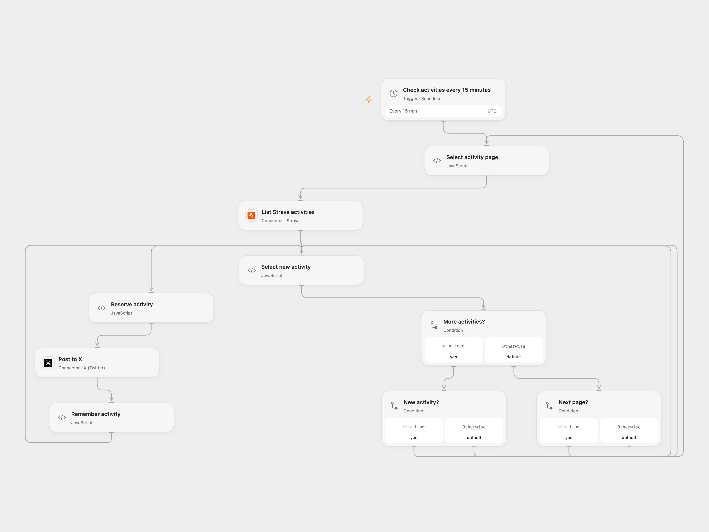

# Post New Strava Activities to X

Post the distance and name of new Strava activities to X.

<picture>
  <source media="(prefers-color-scheme: dark)" srcset="preview-dark.png">
  
</picture>

[Open Flow JSON](templates/post-new-strava-activities-to-x.openflow.json) · [n8n JSON](templates/post-new-strava-activities-to-x.n8n.json)

## Setup

Connect Strava and X. Authorize activity:read_all if private activities should be included. Enable persistent State and prevent overlapping runs. Configure Strava and X credentials in n8n and use one format.

## Behavior

Open Flow scans the connected athlete's complete activity list every 15 minutes, using pages of 200. The first completed scan establishes the baseline; later scans post unseen activity IDs, including backfilled activities. Activities added during the initial scan may become part of the baseline. A changing list can shift page boundaries, so an activity may appear on a subsequent scan; an activity removed before it is observed cannot be posted. IDs accumulate in State and must fit its limits. Strava limits API calls per application: adjust the schedule for the total pages and other application usage to stay within its 15-minute and daily read limits. Each post uses the source text, including its wording for all activity types.

Before posting, Open Flow stores the activity ID as pending. If a run stops after this point, later runs stop until the outcome is inspected on X. In **Select new activity**, enter that ID in acknowledgeActivityId and set resolution to confirmed if the post exists, or retry if it is safe to send again. Run once, then clear both fields. Activity details may be retained in execution history.

Inspiration &amp; credits

## Changes to the source

- Open Flow polls the connected athlete's complete activity list; n8n retains its real-time Strava trigger.

Adapted from [Post new Strava activities on X](https://github.com/Zie619/n8n-workflows/blob/ae8cf6dc5b873cbb4f74587aa9180ed3a9f70682/workflows/Twitter/1211_Twitter_Strava_Create_Triggered.json) in [Zie619/n8n-workflows](https://github.com/Zie619/n8n-workflows). The source export does not identify a separate template author or license.

The collection’s [MIT notice](https://github.com/Zie619/n8n-workflows/blob/94007c1445d9258a7da116646b79473e7c7c3282/LICENSE) is pinned at a later revision. This is the collection notice at that revision; it does not establish a separate original template author's license. Our changes are listed above; see [repository licensing](../../README.md#licensing).

> MIT License
>
> Copyright (c) 2025 Zie619
>
> Permission is hereby granted, free of charge, to any person obtaining a copy
> of this software and associated documentation files (the "Software"), to deal
> in the Software without restriction, including without limitation the rights
> to use, copy, modify, merge, publish, distribute, sublicense, and/or sell
> copies of the Software, and to permit persons to whom the Software is
> furnished to do so, subject to the following conditions:
>
> The above copyright notice and this permission notice shall be included in all
> copies or substantial portions of the Software.
>
> THE SOFTWARE IS PROVIDED "AS IS", WITHOUT WARRANTY OF ANY KIND, EXPRESS OR
> IMPLIED, INCLUDING BUT NOT LIMITED TO THE WARRANTIES OF MERCHANTABILITY,
> FITNESS FOR A PARTICULAR PURPOSE AND NONINFRINGEMENT. IN NO EVENT SHALL THE
> AUTHORS OR COPYRIGHT HOLDERS BE LIABLE FOR ANY CLAIM, DAMAGES OR OTHER
> LIABILITY, WHETHER IN AN ACTION OF CONTRACT, TORT OR OTHERWISE, ARISING FROM,
> OUT OF OR IN CONNECTION WITH THE SOFTWARE OR THE USE OR OTHER DEALINGS IN THE
> SOFTWARE.

