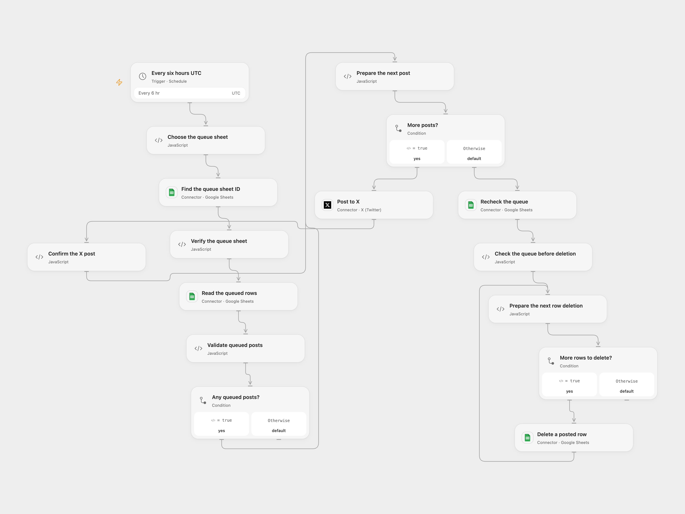

# Post Queued Google Sheets Rows to X

Post queued sheet rows to X every six hours and remove the posted rows.

<picture>
  <source media="(prefers-color-scheme: dark)" srcset="preview-dark.png">
  
</picture>

[Open Flow JSON](templates/post-queued-sheet-rows-to-x.openflow.json) · [n8n JSON](templates/post-queued-sheet-rows-to-x.n8n.json)

## Setup

Create a Google spreadsheet with a sheet named **Tweets** and a header named **tweet**. Add one post per row. Set the spreadsheet ID and sheet name in **Choose the queue sheet**, connect Google Sheets with edit access to the spreadsheet and connect X with permission to post. In n8n, edit the spreadsheet ID and sheet name in **Choose the queue sheet**, and connect the Google Sheets OAuth2 and X credentials. Enable one format.

## Behavior

Every six hours at 00:00, 06:00, 12:00 and 18:00 UTC, the workflow reads all populated rows and posts their tweet text to X in order. It posts the entire batch before deleting any rows. Empty rows are skipped; a populated row without tweet text stops the batch before posting. After all posts are confirmed, it rechecks the sheet and deletes the posted rows from bottom to top. A changed sheet stops before deletion. Avoid editing the queue or running overlapping copies while it runs; the recheck and deletions are not atomic. Deleting a row removes all of its columns.

An X failure leaves every row in place, although earlier posts may already exist. A deletion failure leaves earlier deletions in place. If a write outcome is uncertain, inspect X and the sheet before restarting; reruns may duplicate posts. Open Flow requires the collected sheet to fit its run limits. The n8n schedule uses a fixed second within the selected minute; Open Flow starts at the minute boundary. n8n OAuth2 may refresh credentials and retry a request once after an HTTP 401.

Inspiration &amp; credits

## Changes to the source

- Configure the private spreadsheet and credentials, and use UTC. The source's no-filter read returns all populated rows despite its first-match option.
- Check the full sheet after posting and delete the corresponding rows bottom-up; the source repeatedly deletes row 2 and can remove the wrong rows when the queue has gaps.

Adapted from [Post queued Google Sheets rows to X](https://github.com/Zie619/n8n-workflows/blob/ae8cf6dc5b873cbb4f74587aa9180ed3a9f70682/workflows/Schedule/0474_Schedule_GoogleSheets_Automation_Scheduled.json) in [Zie619/n8n-workflows](https://github.com/Zie619/n8n-workflows). The source credits n8n.ninja. No separate original template license was found.

The collection’s [MIT notice](https://github.com/Zie619/n8n-workflows/blob/94007c1445d9258a7da116646b79473e7c7c3282/LICENSE) is pinned at a later revision. This is the collection notice at that revision; it does not establish a separate original template author's license. Our changes are listed above; see [repository licensing](../../README.md#licensing).

> MIT License
>
> Copyright (c) 2025 Zie619
>
> Permission is hereby granted, free of charge, to any person obtaining a copy
> of this software and associated documentation files (the "Software"), to deal
> in the Software without restriction, including without limitation the rights
> to use, copy, modify, merge, publish, distribute, sublicense, and/or sell
> copies of the Software, and to permit persons to whom the Software is
> furnished to do so, subject to the following conditions:
>
> The above copyright notice and this permission notice shall be included in all
> copies or substantial portions of the Software.
>
> THE SOFTWARE IS PROVIDED "AS IS", WITHOUT WARRANTY OF ANY KIND, EXPRESS OR
> IMPLIED, INCLUDING BUT NOT LIMITED TO THE WARRANTIES OF MERCHANTABILITY,
> FITNESS FOR A PARTICULAR PURPOSE AND NONINFRINGEMENT. IN NO EVENT SHALL THE
> AUTHORS OR COPYRIGHT HOLDERS BE LIABLE FOR ANY CLAIM, DAMAGES OR OTHER
> LIABILITY, WHETHER IN AN ACTION OF CONTRACT, TORT OR OTHERWISE, ARISING FROM,
> OUT OF OR IN CONNECTION WITH THE SOFTWARE OR THE USE OR OTHER DEALINGS IN THE
> SOFTWARE.

