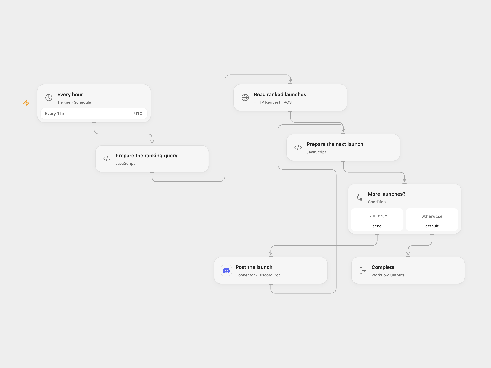

# Post Ranked Product Hunt Launches to Discord

Post recent Product Hunt launches to a Discord channel every hour.

<picture>
  <source media="(prefers-color-scheme: dark)" srcset="preview-dark.png">
  
</picture>

[Open Flow JSON](templates/post-ranked-product-hunt-launches-to-discord.openflow.json) · [n8n JSON](templates/post-ranked-product-hunt-launches-to-discord.n8n.json)

## Setup

Create a Product Hunt API access token with public read access. In Open Flow, store it as a secret Variable and bind it to **Read ranked launches**. In n8n, create a Header Auth credential with the Authorization value Bearer YOUR_PRODUCT_HUNT_TOKEN and select it on **Read ranked launches**. Connect a Discord bot that can post to the destination channel. Set the channel ID on **Post the launch** in Open Flow; in n8n select the Discord Bot credential, server and channel. Enable one format.

[Product Hunt's API terms](https://api.producthunt.com/v2/docs) prohibit commercial use without its permission; contact Product Hunt before using the API for a business.

## Behavior

During minute 00 of each hour, the workflow requests up to five Product Hunt posts from the preceding 24 hours, ordered by Product Hunt ranking. It sends one Discord message per post in that order with its name, description and vote count. An empty result sends nothing. Product Hunt's ranking can change, so the same launch may be posted again on later runs. Open Flow starts at the minute boundary; n8n chooses a fixed second at registration. Both formats use UTC.

A GraphQL error, missing product field or message longer than Discord's 2,000-character limit stops the run before any messages are sent. A failed or uncertain Discord send can leave earlier messages delivered; check the channel before retrying. User and role mentions are neutralized in product text.

Inspiration &amp; credits

## Changes to the source

- Use ISO timestamps accepted by the current Product Hunt DateTime API, keep GraphQL errors from becoming messages, and validate all returned products before sending.
- Replace the source incoming webhook with a Discord Bot connection and configured server/channel. Disable mentions in generated messages.

Adapted from [Product Hunt Discord ranking](https://github.com/Zie619/n8n-workflows/blob/ae8cf6dc5b873cbb4f74587aa9180ed3a9f70682/workflows/Graphql/0116_Graphql_Discord_Automate_Scheduled.json) in [Zie619/n8n-workflows](https://github.com/Zie619/n8n-workflows). The matching [n8n listing](https://n8n.io/workflows/1298-get-top-5-products-on-product-hunt-every-hour/) credits Harshil Agrawal. No separate original template license was found.

The collection’s [MIT notice](https://github.com/Zie619/n8n-workflows/blob/94007c1445d9258a7da116646b79473e7c7c3282/LICENSE) is pinned at a later revision. This is the collection notice at that revision; it does not establish a separate original template author's license. Our changes are listed above; see [repository licensing](../../README.md#licensing).

> MIT License
>
> Copyright (c) 2025 Zie619
>
> Permission is hereby granted, free of charge, to any person obtaining a copy
> of this software and associated documentation files (the "Software"), to deal
> in the Software without restriction, including without limitation the rights
> to use, copy, modify, merge, publish, distribute, sublicense, and/or sell
> copies of the Software, and to permit persons to whom the Software is
> furnished to do so, subject to the following conditions:
>
> The above copyright notice and this permission notice shall be included in all
> copies or substantial portions of the Software.
>
> THE SOFTWARE IS PROVIDED "AS IS", WITHOUT WARRANTY OF ANY KIND, EXPRESS OR
> IMPLIED, INCLUDING BUT NOT LIMITED TO THE WARRANTIES OF MERCHANTABILITY,
> FITNESS FOR A PARTICULAR PURPOSE AND NONINFRINGEMENT. IN NO EVENT SHALL THE
> AUTHORS OR COPYRIGHT HOLDERS BE LIABLE FOR ANY CLAIM, DAMAGES OR OTHER
> LIABILITY, WHETHER IN AN ACTION OF CONTRACT, TORT OR OTHERWISE, ARISING FROM,
> OUT OF OR IN CONNECTION WITH THE SOFTWARE OR THE USE OR OTHER DEALINGS IN THE
> SOFTWARE.

