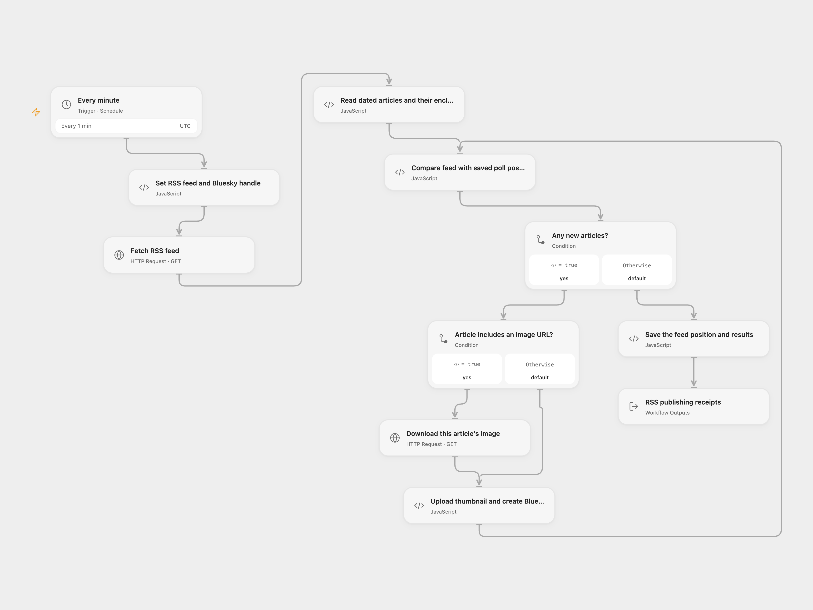

# Post RSS Articles with Image Cards to Bluesky

Publish each new RSS article to Bluesky with its own link, title, description, and image thumbnail.

<!-- template-actions:start -->
[](https://openflow.run/templates/post-rss-image-cards-to-bluesky/) [](templates/post-rss-image-cards-to-bluesky.n8n.json)
<!-- template-actions:end -->

<picture>
  <source media="(prefers-color-scheme: dark)" srcset="preview-dark.png">
  
</picture>

## Setup

1. In **Set RSS feed and Bluesky handle**, enter a trusted public RSS 2.0 feed and the handle of your Bluesky-hosted account.
2. Create an [app password](https://bsky.app/settings/app-passwords) and bind it as the secret variable `BLUESKY_APP_PASSWORD`. Keep **Thumbnail Override** empty to use each article’s own enclosure, or enter a fixed public image URL.
3. Enable the schedule. The first successful poll establishes the starting position. Existing articles are left alone.

## Behavior

The workflow checks every minute. New articles need a publication date, a title, a link, and an image enclosure or configured override. The link card uses the article title and description. The post uses up to 200 characters of the article snippet, sets Spanish (Spain) as its language, and uses the current posting time.

Use direct image URLs for JPEG, PNG, GIF, or WebP thumbnails up to 1 MB. Missing and invalid thumbnails are skipped. A failed Bluesky request stops the current poll so the workflow can check that same post on the next poll. The receipt identifies the exact post. Keep article links and publication dates stable so retries refer to the same Bluesky record.

<details>
<summary>In n8n</summary>

Set the feed URL in **New RSS articles**. In **Start a Bluesky session**, create a **Custom Auth** credential with this shape and save the actual app password in the credential editor.

```json
{"body":{"identifier":"YOUR_BLUESKY_HANDLE","password":"YOUR_APP_PASSWORD"}}
```

The native RSS trigger establishes its date watermark on activation. Manual trigger testing selects the latest existing article, so use a separate test account for manual runs. Test the first scheduled poll to establish the baseline. To use a fixed thumbnail, set the override at the top of **Prepare this article**. The workflow disables saved execution data because the session response contains short-lived tokens.

If publishing stops on a request, check the account’s posts before replaying a failed article. The native RSS trigger may already have advanced its watermark. The same article link and publication date use the same record key.

</details>

<details>
<summary>Inspiration &amp; credits</summary>

Adapted from [Post new RSS feed items as BlueSky posts](https://github.com/Zie619/n8n-workflows/blob/ae8cf6dc5b873cbb4f74587aa9180ed3a9f70682/workflows/Http/0641_HTTP_Rssfeedread_Create_Webhook.json) in [Zie619/n8n-workflows](https://github.com/Zie619/n8n-workflows). Attribution: Nukeador (original workflow) / Zie619 (collection). See the [original n8n gallery template](https://n8n.io/workflows/2571-post-new-rss-feed-items-as-bluesky-posts/).

The collection’s [MIT notice](https://github.com/Zie619/n8n-workflows/blob/94007c1445d9258a7da116646b79473e7c7c3282/LICENSE) is pinned at a later revision. This is the collection notice at that revision; it does not establish a separate original template author's license. Our changes are listed above; see [repository licensing](../../README.md#licensing).

> MIT License
>
> Copyright (c) 2025 Zie619
>
> Permission is hereby granted, free of charge, to any person obtaining a copy
> of this software and associated documentation files (the "Software"), to deal
> in the Software without restriction, including without limitation the rights
> to use, copy, modify, merge, publish, distribute, sublicense, and/or sell
> copies of the Software, and to permit persons to whom the Software is
> furnished to do so, subject to the following conditions:
>
> The above copyright notice and this permission notice shall be included in all
> copies or substantial portions of the Software.
>
> THE SOFTWARE IS PROVIDED "AS IS", WITHOUT WARRANTY OF ANY KIND, EXPRESS OR
> IMPLIED, INCLUDING BUT NOT LIMITED TO THE WARRANTIES OF MERCHANTABILITY,
> FITNESS FOR A PARTICULAR PURPOSE AND NONINFRINGEMENT. IN NO EVENT SHALL THE
> AUTHORS OR COPYRIGHT HOLDERS BE LIABLE FOR ANY CLAIM, DAMAGES OR OTHER
> LIABILITY, WHETHER IN AN ACTION OF CONTRACT, TORT OR OTHERWISE, ARISING FROM,
> OUT OF OR IN CONNECTION WITH THE SOFTWARE OR THE USE OR OTHER DEALINGS IN THE
> SOFTWARE.

Open Flow bundles [fast-xml-parser](https://github.com/NaturalIntelligence/fast-xml-parser) and its dependencies. Their license notices are included in the workflow code.

</details>
