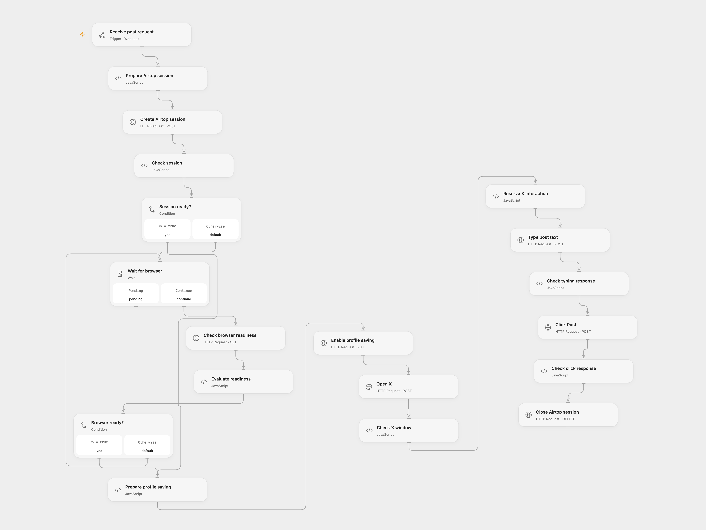

# Post to X with an Airtop Profile

Use an authenticated Airtop browser profile to submit text to X.

<!-- template-actions:start -->
 
<!-- template-actions:end -->

<picture>
  <source media="(prefers-color-scheme: dark)" srcset="preview-dark.png">
  
</picture>

## Setup

Create an Airtop profile signed in to X, bind `AIRTOP_API_KEY` as a secret variable, and enable persistent State. Publish the workflow and open the hosted Webhook form URL (or POST JSON `{"profile": "my-x-profile", "text": "..."}`).

## Behavior

A five-minute browser session opens X using the selected profile, types the provided text and clicks Post, then closes the session and saves the profile. Airtop interaction completion does not prove that X published the post. Check X directly before treating it as published. The text and browser state are sent to Airtop.

The interaction is reserved before typing because Enter or a click could submit the post. If typing or clicking is uncertain, inspect X before retrying. Open Flow keeps the pending key after interaction; to mark a verified post, enter the key and `confirmed` in **Reserve X interaction** and replay once, then clear the fields. Use `absent` only after verifying no post exists. A failed run may leave a browser session active until timeout; close it in Airtop if needed.

In n8n

Import the n8n workflow, connect Airtop, and select a Data Table with `item_key` and `status` text columns; prevent overlapping runs. The form and workflow trigger accept the profile name and text. Inspect the Data Table row and mark it `done` after checking X, or delete it only when no post exists.

Inspiration &amp; credits

Added hosted form intake, per-submission checkpoints, and interaction completion reporting without claiming publication.

Adapted from [Post on X](https://github.com/Zie619/n8n-workflows/blob/ae8cf6dc5b873cbb4f74587aa9180ed3a9f70682/workflows/Form/1957_Form_Stickynote_Automation_Triggered.json) in [Zie619/n8n-workflows](https://github.com/Zie619/n8n-workflows). The source export does not identify a separate template author or license.

The collection’s [MIT notice](https://github.com/Zie619/n8n-workflows/blob/94007c1445d9258a7da116646b79473e7c7c3282/LICENSE) is pinned at a later revision. This is the collection notice at that revision; it does not establish a separate original template author's license. Our changes are listed above; see [repository licensing](../../README.md#licensing).

> MIT License
>
> Copyright (c) 2025 Zie619
>
> Permission is hereby granted, free of charge, to any person obtaining a copy
> of this software and associated documentation files (the "Software"), to deal
> in the Software without restriction, including without limitation the rights
> to use, copy, modify, merge, publish, distribute, sublicense, and/or sell
> copies of the Software, and to permit persons to whom the Software is
> furnished to do so, subject to the following conditions:
>
> The above copyright notice and this permission notice shall be included in all
> copies or substantial portions of the Software.
>
> THE SOFTWARE IS PROVIDED "AS IS", WITHOUT WARRANTY OF ANY KIND, EXPRESS OR
> IMPLIED, INCLUDING BUT NOT LIMITED TO THE WARRANTIES OF MERCHANTABILITY,
> FITNESS FOR A PARTICULAR PURPOSE AND NONINFRINGEMENT. IN NO EVENT SHALL THE
> AUTHORS OR COPYRIGHT HOLDERS BE LIABLE FOR ANY CLAIM, DAMAGES OR OTHER
> LIABILITY, WHETHER IN AN ACTION OF CONTRACT, TORT OR OTHERWISE, ARISING FROM,
> OUT OF OR IN CONNECTION WITH THE SOFTWARE OR THE USE OR OTHER DEALINGS IN THE
> SOFTWARE.

