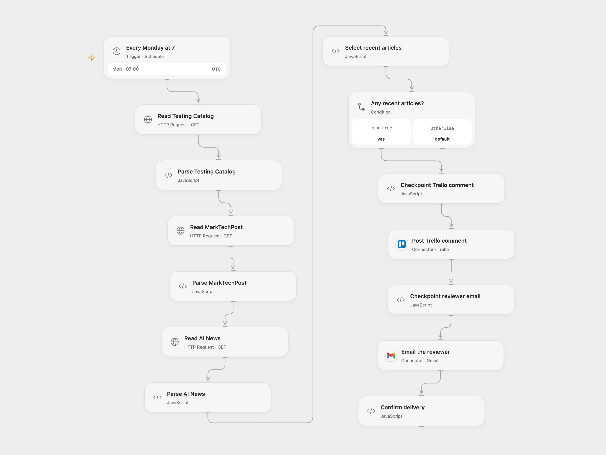

# Post Weekly RSS News to Trello

Collect recent RSS articles, post a weekly Trello comment, and email a reviewer.

<picture>
  <source media="(prefers-color-scheme: dark)" srcset="preview-dark.png">
  
</picture>

[Open Flow JSON](templates/post-weekly-rss-news-to-trello.openflow.json) · [n8n JSON](templates/post-weekly-rss-news-to-trello.n8n.json)

## Setup

Configure the three feed URLs, connect Trello and set the card ID in **Post Trello comment**, then connect Gmail and set the reviewer email. Enable persistent State and prevent overlapping runs. In n8n configure the three RSS nodes, Trello credential and card ID, and Gmail credential and recipient. Activate one format.

## Behavior

Every Monday at 07:00 UTC, the workflow combines the feeds, selects up to ten articles newer than seven days, sorts newest first, and adds a Markdown comment to the card. After a confirmed comment it emails the reviewer. If there are no qualifying articles, nothing is sent. Change the schedule timezone to match your team; the source inherited the n8n instance timezone.

If a write fails or its result is unknown, inspect Trello and Gmail and complete the report manually before entering the pending scheduled timestamp in **Select recent articles** to acknowledge it. Inspect before any replay.

Inspiration &amp; credits

## Changes to the source

- Replace the original card and personal email with configuration and validate feed TLS certificates.
- Stop uncertain Open Flow writes from being automatically repeated and use UTC explicitly.

Adapted from [Post recent RSS news to a Trello card](https://github.com/Zie619/n8n-workflows/blob/ae8cf6dc5b873cbb4f74587aa9180ed3a9f70682/workflows/Trello/1302_Trello_Limit_Automate_Scheduled.json) in [Zie619/n8n-workflows](https://github.com/Zie619/n8n-workflows). The source export does not identify a separate template author or license.

The collection’s [MIT notice](https://github.com/Zie619/n8n-workflows/blob/94007c1445d9258a7da116646b79473e7c7c3282/LICENSE) is pinned at a later revision. This is the collection notice at that revision; it does not establish a separate original template author's license. Our changes are listed above; see [repository licensing](../../README.md#licensing).

> MIT License
>
> Copyright (c) 2025 Zie619
>
> Permission is hereby granted, free of charge, to any person obtaining a copy
> of this software and associated documentation files (the "Software"), to deal
> in the Software without restriction, including without limitation the rights
> to use, copy, modify, merge, publish, distribute, sublicense, and/or sell
> copies of the Software, and to permit persons to whom the Software is
> furnished to do so, subject to the following conditions:
>
> The above copyright notice and this permission notice shall be included in all
> copies or substantial portions of the Software.
>
> THE SOFTWARE IS PROVIDED "AS IS", WITHOUT WARRANTY OF ANY KIND, EXPRESS OR
> IMPLIED, INCLUDING BUT NOT LIMITED TO THE WARRANTIES OF MERCHANTABILITY,
> FITNESS FOR A PARTICULAR PURPOSE AND NONINFRINGEMENT. IN NO EVENT SHALL THE
> AUTHORS OR COPYRIGHT HOLDERS BE LIABLE FOR ANY CLAIM, DAMAGES OR OTHER
> LIABILITY, WHETHER IN AN ACTION OF CONTRACT, TORT OR OTHERWISE, ARISING FROM,
> OUT OF OR IN CONNECTION WITH THE SOFTWARE OR THE USE OR OTHER DEALINGS IN THE
> SOFTWARE.

